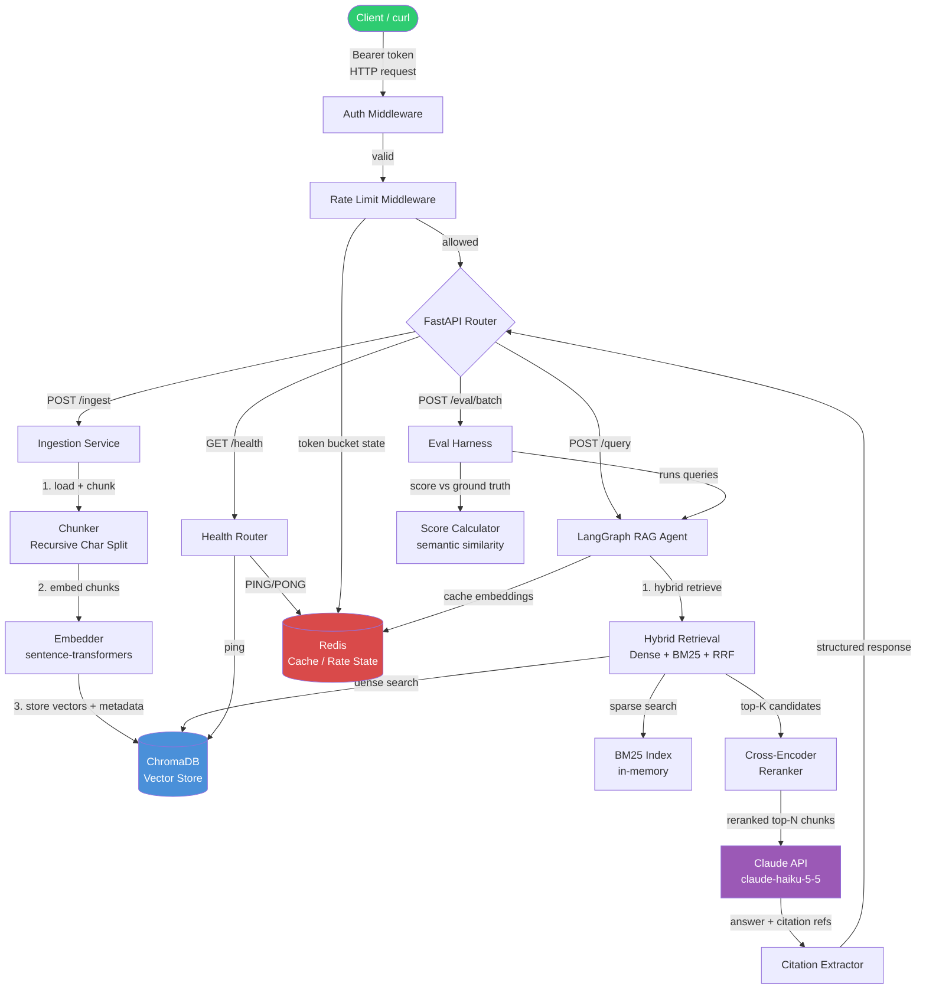

# Solutions — Week 08 · Day 7 (Sunday Assessment + Docs Day)

Day 7 is review, documentation, and interview prep. Use this file to finalize your README, verify your architecture diagram is complete, and practice answering RAG interview questions.

---

## Completed README

```markdown
# Document Intelligence Platform

A production-grade Retrieval-Augmented Generation (RAG) service built with FastAPI, ChromaDB,
and Claude. Accepts documents via REST, indexes them with hybrid retrieval, and answers questions
with grounded, cited responses.

## Architecture

See [Architecture](#architecture-overview) section below.

## Features

- Document ingestion: PDF, plain text, and Markdown via REST endpoint
- Chunking: recursive character splitting with configurable chunk size and overlap
- Embeddings: sentence-transformers (local, no external API cost)
- Vector store: ChromaDB with persistent storage
- Hybrid retrieval: dense vector search + BM25 sparse search fused with Reciprocal Rank Fusion
- Reranking: cross-encoder reranker to refine top-K candidates
- Agentic RAG: LangGraph agent that iterates retrieval until answer confidence is sufficient
- Citations: every answer includes source chunk IDs and document references
- Streaming: Server-Sent Events for incremental answer delivery
- Evaluation harness: POST /eval/batch computes per-question similarity scores against a golden dataset
- Auth: API key middleware with constant-time comparison
- Rate limiting: token-bucket middleware, configurable via RATE_LIMIT_PER_MINUTE
- PII scrubbing: email, phone, SSN masked before logging
- Observability: structured JSON logs, Prometheus metrics at /metrics, OpenTelemetry traces
- Docker: multi-stage Dockerfile, docker-compose with ChromaDB and Redis dependencies

## Quickstart

### Prerequisites

- Docker and Docker Compose
- An Anthropic API key

### Setup

```bash
git clone <repo-url>
cd document-intelligence-platform
cp .env.example .env
# Edit .env and set required values (see Configuration)
docker-compose up --build -d
```

### Verify

```bash
curl http://localhost:8000/health
```

Expected: `{"status": "healthy", ...}`

## Configuration

All configuration is via environment variables. Copy `.env.example` to `.env` and fill in values.
Never commit `.env`.

| Variable | Required | Default | Description |
|---|---|---|---|
| `ANTHROPIC_API_KEY` | Yes | — | Anthropic API key |
| `ANTHROPIC_MODEL` | No | `claude-haiku-5-5` | Model ID |
| `API_KEY_SECRET` | Yes | — | Bearer token clients must send |
| `VECTOR_STORE_URL` | No | `http://chromadb:8000` | ChromaDB base URL |
| `REDIS_URL` | No | `redis://redis:6379` | Redis connection string |
| `EMBED_MODEL` | No | `all-MiniLM-L6-v2` | sentence-transformers model name |
| `CHUNK_SIZE` | No | `512` | Characters per chunk |
| `CHUNK_OVERLAP` | No | `64` | Overlap between adjacent chunks |
| `TOP_K_RETRIEVAL` | No | `20` | Candidates retrieved before reranking |
| `TOP_K_RERANK` | No | `5` | Final chunks passed to LLM |
| `RATE_LIMIT_PER_MINUTE` | No | `60` | Max requests per IP per minute |
| `EVAL_SCORE_THRESHOLD` | No | `0.7` | Minimum acceptable eval score |
| `LOG_LEVEL` | No | `INFO` | Python logging level |

## API Reference

### POST /ingest

Ingest a single document.

```json
{
  "text": "string",
  "source": "filename.txt",
  "metadata": {"key": "value"}
}
```

Response: `{"document_id": "...", "chunk_count": 12, "status": "ingested"}`

### POST /ingest/batch

Ingest multiple documents. Body: `{"documents": [<IngestRequest>, ...]}`.

### POST /query

Query the knowledge base.

```json
{
  "question": "string",
  "top_k": 5,
  "stream": false
}
```

Response:
```json
{
  "answer": "string",
  "citations": [
    {"chunk_id": "abc123", "source": "intro.txt", "score": 0.92, "excerpt": "..."}
  ],
  "model": "claude-haiku-5-5",
  "tokens_used": 512
}
```

### POST /query/stream

Same request body as `/query`. Returns a `text/event-stream` of SSE events:
- `data: {"token": "word"}` — incremental answer tokens
- `data: {"citations": [...]}` — final citations on stream close
- `data: [DONE]` — stream terminator

### POST /eval/batch

Run evaluation against a golden dataset.

```json
{
  "questions": [
    {
      "question": "string",
      "ground_truth_answer": "string"
    }
  ]
}
```

Response: per-question scores + aggregate statistics.

### GET /health

Returns connectivity status for all downstream services. HTTP 200 if healthy, 503 if degraded.

## Development

```bash
# Install dependencies
pip install -e ".[dev]"

# Run tests
pytest tests/ -v --cov=src --cov-report=term-missing

# Lint
ruff check src/ tests/

# Format
black src/ tests/
```

## Docker

```bash
# Build image only
docker build -t doc-intel-platform .

# Start all services
docker-compose up -d

# View logs
docker-compose logs -f app

# Stop and remove volumes
docker-compose down -v
```

## Security

- All secrets via environment variables; no hardcoded credentials
- API key validated with `hmac.compare_digest` (constant-time)
- PII scrubbed from logs before emission
- Docker container runs as non-root user (UID 1000)
- Dependencies pinned in `pyproject.toml`

## License

Apache 2.0
```

---

## Architecture Diagram (Mermaid)

Paste this into any Mermaid-compatible renderer (GitHub README, Notion, mermaid.live):



---

## Sample Interview Q&A

### Q1: "How does hybrid retrieval work, and why use it over pure vector search?"

**Strong answer:**

Hybrid retrieval runs two independent search passes and merges the results. The dense pass uses embedding similarity — the query and documents are projected into a shared vector space, and nearest neighbors by cosine distance are retrieved. The sparse pass uses a keyword method like BM25, which scores documents based on term frequency and inverse document frequency — it rewards exact term matches.

Each method has a complementary failure mode: dense search handles paraphrase and semantic similarity well but misses rare proper nouns and exact-match queries; BM25 handles exact terms and entity names but misses synonyms and rephrased queries. Hybrid retrieval fixes both.

The two result lists are merged with Reciprocal Rank Fusion. RRF scores each document as the sum of 1/(k + rank) across each list, where k is a constant (typically 60) that dampens the influence of very high ranks. Documents appearing near the top in both lists score highest. This is rank-based, so it does not require score normalization across the two incompatible similarity scales.

The practical outcome is higher recall across diverse query types without increasing the number of chunks passed to the LLM.

---

### Q2: "How do you ensure citation accuracy in a RAG system?"

**Strong answer:**

Citation accuracy has three layers: retrieval, generation, and extraction.

At retrieval: each stored chunk is assigned a stable `chunk_id` at ingest time. The vector store stores `chunk_id`, `source`, and original text in metadata. When chunks are retrieved, they carry their IDs into the LLM context.

At generation: the system prompt explicitly instructs the model to cite using the chunk ID format (e.g., `[chunk_id]`) whenever it draws on a specific chunk. The prompt includes a worked example showing the expected citation format. Without this instruction, models cite loosely or not at all.

At extraction: after generation, a post-processing step parses `[chunk_id]` references from the output using a regex or structured output schema. Each extracted ID is cross-referenced against the retrieved chunks to confirm it was actually in context — if a model hallucinates a chunk ID that was not retrieved, it is dropped from the citation list.

To evaluate citation quality, the eval harness checks that the citation score (fraction of answer claims traceable to a cited chunk) stays above a threshold. The golden dataset can include `expected_source_keywords` fields to verify the right documents were cited.

---

### Q3: "How would you scale this platform to 10 million documents?"

**Strong answer:**

At 10M documents, several components need to change.

Vector store: ChromaDB is suitable for prototyping but does not scale horizontally. Replace it with a distributed vector database such as Pinecone, Weaviate, or Qdrant Cloud, which shard the index across multiple nodes and support filtered ANN queries. Use product quantization or binary quantization to reduce memory per vector.

Ingestion: move from a synchronous endpoint to an async pipeline. A client POSTs a document, which goes to a queue (Kafka or SQS). A worker fleet processes chunking and embedding in parallel. Each worker batch-embeds chunks using the embeddings API with batching (up to 2048 texts per call). The vector store supports batch upsert. This decouples ingest latency from ingest throughput.

BM25 index: an in-memory BM25 index cannot hold 10M documents. Replace it with Elasticsearch or OpenSearch, which provide scalable inverted-index BM25 via a REST API and integrate cleanly into a hybrid retrieval layer.

Embedding model: self-hosted `sentence-transformers` does not scale without a GPU fleet. Move embeddings to a dedicated inference service (e.g., text-embedding-3-large via API, or a self-hosted model on GPU workers with vLLM). Cache embeddings for repeated or near-duplicate chunks using an embedding similarity cache in Redis.

Reranker: cross-encoders are expensive per-pair. Cache reranker scores by (query_hash, chunk_id) pair in Redis with a short TTL. For high-traffic queries, pre-compute and cache the full reranked result.

Eval: at scale, running the full eval harness on every deploy is slow. Stratify the golden dataset — run a 100-question fast eval on every PR and the full 1000-question eval nightly.

---

## Self-Assessment Scoring Guide

Use this rubric to score your platform before peer review.

| Skill | 1 — Not present | 2 — Partial | 3 — Complete |
|---|---|---|---|
| All 7 RAG components integrated | Missing 3+ | Missing 1-2 | All present and wired |
| API correctness | Endpoints error or return wrong schema | Endpoints work but schema inconsistent | All endpoints match spec, Pydantic models correct |
| Docker runs end-to-end | `docker-compose up` fails | Starts but app crashes on first request | Full flow: ingest, query, eval all work |
| Test coverage | <50% or no mocks | 50-70%, some real I/O | >80%, all LLM/HTTP mocked |
| Security posture | Hardcoded secret or no auth | Auth present, minor issues | Auth + PII scrubber + rate limit + no secrets |

**Score interpretation:**
- 13-15 points: Production-ready. Submit for peer review.
- 10-12 points: Strong foundation. Address any 1-scores before review.
- 7-9 points: Core RAG works. Gaps in operability (Docker, tests, security).
- Below 7: Return to Week 8 Day 1-4 lessons and rebuild the missing components.
