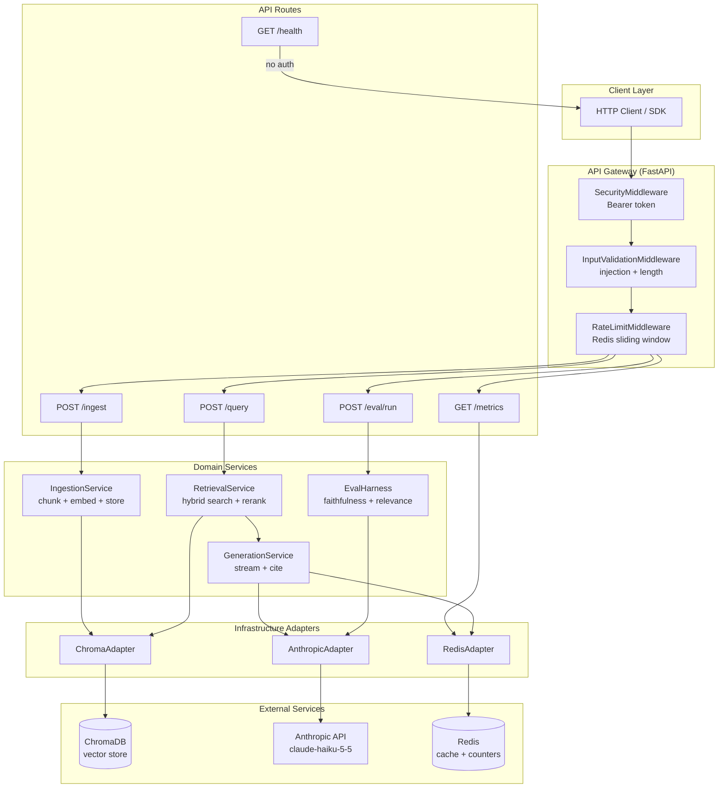

# Week 08 Project — CAPSTONE: Document Intelligence Platform

## Overview

Build a production-grade Document Intelligence Platform: a FastAPI service that ingests documents, stores them in a vector database with embeddings, retrieves relevant context using hybrid search and reranking, and generates grounded answers with source citations via the Claude API. The platform ships as a Docker Compose stack with structured logging, cost tracking, and an automated evaluation harness.

This is the capstone project for Phase 4. It integrates every component built across weeks 1-7 into a single deployable system.

**Who it is for**: ML engineers who need to deploy RAG systems to production and demonstrate full-stack ownership — ingestion to serving to evaluation.

**Time allocation**: Day 6 (Saturday) = 4-5 hr build; Day 7 (Sunday) = 1-2 hr documentation + assessment.

---

## Architecture



---

## Requirements

### Functional

| ID | Requirement |
|---|---|
| F1 | Ingest a document from a URL (PDF or HTML) or raw text via `POST /ingest` |
| F2 | Chunk documents with configurable size and overlap; attach metadata to each chunk |
| F3 | Embed chunks and store in ChromaDB with doc_id, chunk_index, source_url, ingested_at |
| F4 | Retrieve top-k chunks using hybrid search (dense + BM25) with RRF fusion |
| F5 | Rerank retrieved chunks with a cross-encoder before passing to the LLM |
| F6 | Generate answers using Claude with retrieved context; include inline citations |
| F7 | Support streaming responses via Server-Sent Events when `stream: true` |
| F8 | Run eval harness against a golden dataset and return per-question + aggregate scores |
| F9 | Expose cost and latency metrics at `GET /metrics` |
| F10 | Enforce Bearer token authentication on all routes except `/health` |

### Non-functional

| ID | Requirement | Target |
|---|---|---|
| NF1 | p95 latency for `POST /query` (non-streaming) | < 3s |
| NF2 | Uptime | >= 99% in Docker Compose |
| NF3 | No secrets in logs or source code | Zero tolerance |
| NF4 | PII scrubbed from all log lines | Regex on email, phone, SSN |
| NF5 | Unit test coverage on all service methods | >= 80% |
| NF6 | Container runs as non-root user | UID 1001 |
| NF7 | Structured JSON logging | structlog |

---

## Component specifications

### 1. Ingestion pipeline (`src/services/ingestion.py`)

Input: `IngestRequest` — either `source_url` (fetched with `httpx`) or `raw_text`.

Processing steps:
1. Fetch document if URL provided (support `application/pdf` via `pypdf`, `text/html` via `html2text`)
2. Chunk with `RecursiveCharacterTextSplitter(chunk_size=512, chunk_overlap=64)`
3. Generate embeddings — use Anthropic voyage embeddings or a configurable local model
4. Upsert all chunks to ChromaDB in a single batch call
5. Return `IngestResult` with doc_id, chunk count, collection, timestamp

Error handling: if any step fails, no chunks are written (transactional semantics at the adapter level).

### 2. Chunking + embeddings (`src/services/ingestion.py`)

Chunking strategy selection via `Settings.chunk_strategy`:
- `recursive` (default): `RecursiveCharacterTextSplitter` on paragraph → sentence → word boundaries
- `semantic`: split on embedding cosine similarity drops (requires embedding model)
- `fixed`: naive fixed-size split (fast, lower quality, useful for structured data)

Embedding provider via `Settings.embedding_provider`:
- `voyage` (default): Anthropic voyage-3 via the Anthropic SDK
- `local`: sentence-transformers `all-MiniLM-L6-v2` via `sentence-transformers` package

Embedding dimensions must be consistent within a collection. The adapter raises `DimensionMismatchError` if a collection already exists with a different dimension.

### 3. Vector store (`src/adapters/chroma.py`)

Collection management:
- `upsert_chunks(doc_id, chunks, embeddings, metadata)` — batch upsert
- `query(embedding, collection, top_k, where_filter)` — dense retrieval
- `bm25_query(query_text, collection, top_k)` — keyword retrieval (ChromaDB full-text or external)
- `delete_document(doc_id, collection)` — remove all chunks for a doc_id
- `list_collections()` — return collection names and document counts
- `health_check()` — ping the ChromaDB heartbeat endpoint

### 4. Hybrid retrieval + reranking (`src/services/retrieval.py`)

Retrieval flow:
1. Run dense retrieval (top 20) and BM25 retrieval (top 20) in parallel with `asyncio.gather`
2. Merge results with Reciprocal Rank Fusion: `score(d) = sum(1 / (k + rank(d)))` for k=60
3. Take top `top_k * 3` merged candidates
4. Rerank with cross-encoder (`cross-encoder/ms-marco-MiniLM-L-6-v2` via sentence-transformers)
5. Return top `top_k` reranked chunks as `list[RetrievedChunk]`

`RetrievedChunk` schema:
```python
class RetrievedChunk(BaseModel):
    doc_id: str
    chunk_index: int
    text: str
    source_url: str | None
    dense_score: float
    bm25_score: float | None
    rerank_score: float | None
    final_score: float
```

### 5. Agentic RAG with citations (`src/services/generation.py`)

System prompt template (stored in `src/prompts/generation.py`, not inline):
```
You are a precise research assistant. Answer the question using ONLY the provided context chunks.
For every factual claim, cite the source chunk using [chunk_index] notation.
If the context does not contain enough information to answer, say so explicitly.
Do not hallucinate. Do not use knowledge outside the provided context.
```

Generation flow:
1. Format retrieved chunks as numbered context blocks
2. Call `anthropic.AsyncAnthropic().messages.create()` or `.stream()` depending on `stream` flag
3. Parse `[n]` citation markers from the generated text
4. Map citation indices back to `RetrievedChunk` objects
5. Return `QueryResponse` with answer, citations list, token counts, latency

### 6. Evaluation harness (`src/eval/harness.py`)

Metrics computed per question:
- **Faithfulness**: Does the generated answer contain only claims supported by the retrieved context? Score with LLM-as-judge using claude-haiku-5-5 (1=fully faithful, 0=hallucinated).
- **Answer relevance**: Does the answer address the question? Embed both and measure cosine similarity.
- **Citation precision**: What fraction of cited chunks actually support the corresponding claim?
- **Retrieval recall**: Were the source documents for the expected answer retrieved in the top-k?

Golden dataset format (JSON array):
```json
[
  {
    "id": "q1",
    "question": "What chunking strategy is best for legal documents?",
    "expected_answer": "Semantic chunking that respects document structure",
    "source_doc_id": "doc_abc123",
    "tags": ["factual", "chunking"]
  }
]
```

Eval result schema:
```python
class EvalResult(BaseModel):
    question_id: str
    question: str
    generated_answer: str
    faithfulness: float
    answer_relevance: float
    citation_precision: float
    retrieval_recall: float
    passed: bool  # True if faithfulness >= 0.8 and answer_relevance >= 0.7

class EvalReport(BaseModel):
    dataset_path: str
    collection: str
    total_questions: int
    passed: int
    failed: int
    avg_faithfulness: float
    avg_answer_relevance: float
    avg_citation_precision: float
    avg_retrieval_recall: float
    results: list[EvalResult]
    run_at: datetime
    model: str
```

### 7. Observability + cost tracking (`src/adapters/redis_client.py`)

Redis key schema:
- `metrics:requests:total` — INCR counter
- `metrics:tokens:input:{model}` — INCRBY counter
- `metrics:tokens:output:{model}` — INCRBY counter
- `metrics:latency_ms` — Redis sorted set, score = latency, member = request_id
- `metrics:cost_usd` — float string, INCRBYFLOAT

`GET /metrics` response:
```python
class MetricsResponse(BaseModel):
    total_requests: int
    total_tokens_input: dict[str, int]   # per model
    total_tokens_output: dict[str, int]  # per model
    estimated_cost_usd: float
    p50_latency_ms: float
    p95_latency_ms: float
    p99_latency_ms: float
```

---

## FastAPI API specification

### POST /ingest

Request:
```json
{
  "source_url": "https://example.com/doc.pdf",
  "raw_text": null,
  "collection": "research",
  "metadata": {"author": "Jane Doe", "year": "2024"}
}
```

Response 200:
```json
{
  "doc_id": "doc_a1b2c3",
  "chunks_created": 42,
  "collection": "research",
  "ingested_at": "2024-11-11T10:00:00Z"
}
```

Errors: 400 (neither source_url nor raw_text), 413 (document too large), 422 (validation), 502 (fetch failed)

### POST /query

Request:
```json
{
  "question": "What are the main chunking strategies?",
  "collection": "research",
  "top_k": 5,
  "rerank": true,
  "stream": false
}
```

Response 200:
```json
{
  "answer": "The main chunking strategies are fixed-size [1], recursive [2], and semantic [3].",
  "citations": [
    {"doc_id": "doc_a1b2c3", "chunk_index": 7, "source_url": "https://...", "excerpt": "Fixed-size chunking splits...", "relevance_score": 0.92}
  ],
  "model": "claude-haiku-5-5",
  "tokens_used": 842,
  "latency_ms": 1240.5
}
```

Streaming response (when `stream: true`): `Content-Type: text/event-stream`

Errors: 401 (no auth), 403 (bad auth), 404 (collection not found), 422 (validation)

### GET /health

Response 200:
```json
{"status": "ok", "environment": "production", "checks": {"chromadb": "ok", "redis": "ok"}}
```

Response 503:
```json
{"status": "degraded", "checks": {"chromadb": "ok", "redis": "timeout"}}
```

---

## Docker architecture

Three-service Compose stack:

| Service | Image | Port (internal) | Persistence |
|---|---|---|---|
| `app` | Built from `docker/Dockerfile` | 8080 | None (stateless) |
| `chromadb` | `chromadb/chroma:0.5.0` | 8000 | `chroma_data` volume |
| `redis` | `redis:7-alpine` | 6379 | `redis_data` volume |

All services share the `platform_net` bridge network. Only the `app` service exposes a port to the host (8080:8080).

The Dockerfile uses a multi-stage build: builder stage installs deps into `/build/venv`, runtime stage copies only the venv and source. The container runs as UID 1001 (non-root).

---

## Eval gate specification

The eval gate is a mandatory check before any deployment. It runs automatically in CI (if configured) and can be triggered manually via `POST /eval/run`.

Gate thresholds (fail the build if any threshold is not met):

| Metric | Minimum |
|---|---|
| Faithfulness | 0.80 |
| Answer relevance | 0.70 |
| Citation precision | 0.75 |
| Retrieval recall | 0.85 |

The gate is configurable via `Settings.eval_thresholds` (a dict loaded from env var `EVAL_THRESHOLDS_JSON`). If the env var is not set, the defaults above apply.

---

## Golden dataset format

Store at `tests/golden/{collection}_dataset.json`. Minimum 5 questions per collection for a meaningful gate signal. Questions must span different document types and difficulty levels.

Required fields per record: `id`, `question`, `expected_answer`, `source_doc_id`
Optional fields: `tags`, `difficulty` (`easy`/`medium`/`hard`), `requires_multi_hop` (bool)

---

## Acceptance criteria

The build passes when ALL of the following are true:

- [ ] `docker-compose up -d --build` completes without errors
- [ ] `curl http://localhost:8080/health` returns `{"status": "ok"}`
- [ ] `POST /ingest` with raw text returns `chunks_created >= 1`
- [ ] `POST /query` returns a non-empty `answer` and at least one citation
- [ ] `POST /query` with `stream: true` emits SSE events and terminates
- [ ] `POST /query` without Authorization header returns 401
- [ ] `GET /metrics` returns `total_requests >= 1` after at least one query
- [ ] `pytest tests/unit/ -v` exits 0 with >= 80% coverage on `src/services/`
- [ ] `pytest tests/integration/ -v` exits 0 (requires running ChromaDB + Redis)
- [ ] `ruff check src/` exits 0
- [ ] `docker-compose logs app` contains no occurrences of the `ANTHROPIC_API_KEY` value
- [ ] `POST /eval/run` against the sample golden dataset returns `avg_faithfulness >= 0.80`

---

## Deliverables checklist

- [ ] `src/` — complete application source with all 7 components
- [ ] `tests/unit/` — unit tests for all service methods (all LLM calls mocked)
- [ ] `tests/integration/` — integration tests for FastAPI routes
- [ ] `tests/smoke/` — end-to-end smoke tests for the Docker stack
- [ ] `tests/golden/sample_dataset.json` — at least 5 golden questions
- [ ] `docker/Dockerfile` — multi-stage, non-root user
- [ ] `docker-compose.yml` — all three services with health checks
- [ ] `.env.example` — all env var names, no values
- [ ] `pyproject.toml` — all dependencies declared
- [ ] `README.md` — filled-in template from day-7 (including Mermaid diagram)

---

## Grading rubric

| Dimension | Weight | Criteria |
|---|---|---|
| Functional completeness | 35% | All 10 functional requirements implemented and demonstrable via curl |
| Code architecture | 25% | Clean separation between API / services / adapters layers; no god files; type hints everywhere |
| Testing | 20% | Unit tests mock all LLM calls; >= 80% coverage on services; integration tests pass; eval gate runs |
| Security and observability | 10% | No secrets in logs; PII scrubbed; Bearer auth enforced; metrics endpoint returns real data |
| Documentation | 10% | README with Mermaid diagram; API reference table; troubleshooting section; .env.example |

**Pass threshold: 75%**

Partial credit is given within each dimension. The project is graded holistically — a system with all components wired together but rough edges scores higher than a perfectly polished subsystem that does not compose.
