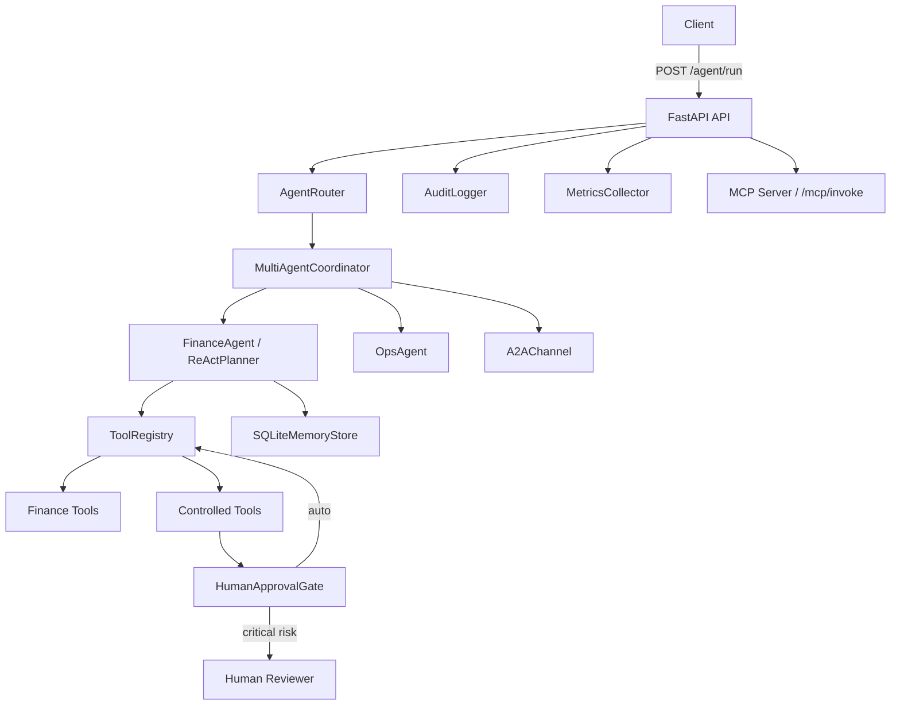

# Week 12 Project — Enterprise Agent Orchestration Framework

## Overview

Build a production-ready Enterprise Agent Orchestration Framework for a synthetic finance/operations domain. This is the Phase 5 capstone: every concept from weeks 1–11 integrates here.

## Deliverables

| # | Deliverable | Requirement |
|---|---|---|
| 1 | Source code | Full `src/finops_agent/` package, all modules implemented |
| 2 | Tests | `pytest` suite: unit + integration, all passing, LLM mocked |
| 3 | Docker | `Dockerfile` (multi-stage) + `docker-compose.yml` — `docker compose up` must succeed |
| 4 | Eval dataset | `eval/dataset.jsonl` with at least 6 cases covering finance, ops, approval, error paths |
| 5 | Audit log demo | `logs/audit.jsonl` with at least 5 real events from a test run |
| 6 | README | Architecture diagram (ASCII or Mermaid), setup instructions, API reference |
| 7 | Interview prep | 5 bullet points on architecture decisions and trade-offs |

## Technical requirements

- Python 3.12+, Pydantic v2, FastAPI
- Model IDs: `claude-opus-5-5` (planning/supervisor), `claude-sonnet-5-5` (primary agent), `claude-haiku-5-5` (routing/fast tasks)
- All LLM credentials via `os.getenv("ANTHROPIC_API_KEY")` — no hardcoded values
- All LLM calls mocked in tests via `unittest.mock.patch`
- `HumanApprovalGate` must block all tools with `risk_level="critical"` without human review
- `AuditLogger` writes JSONL — thread-safe, append-only
- `EvalHarness` must report `pass_rate`, `avg_latency_ms`, `avg_score`
- FastAPI endpoints: `POST /agent/run`, `GET /health`, `GET /metrics`, `GET /hitl/pending`, `POST /hitl/resolve/{id}`

## Architecture diagram (Mermaid)

## Grading criteria

| Criterion | Weight | Pass threshold |
|---|---|---|
| All modules implemented and importable | 20% | All 10 modules |
| Full test suite passes (LLM mocked) | 25% | 0 failures |
| Docker build succeeds | 15% | `docker build` exits 0 |
| HITL gate blocks critical actions | 15% | Gate test passing |
| Eval harness runs 6+ cases | 15% | `pass_rate` reported |
| README + architecture diagram | 10% | Both present |

Pass gate: at least 75% overall.

## Supplementary resources

- [Anthropic API docs](https://docs.anthropic.com)
- [FastAPI docs](https://fastapi.tiangolo.com)
- [Pydantic v2 docs](https://docs.pydantic.dev/latest/)
- [LangGraph concepts (reference)](https://langchain-ai.github.io/langgraph/)
- [MCP spec](https://modelcontextprotocol.io)
- [Docker multi-stage builds](https://docs.docker.com/build/building/multi-stage/)
