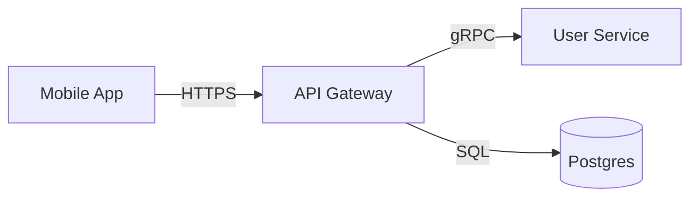

# Solutions — Day 5: Diagramming & Communicating Trade-offs

---

## Exercise 1 — URL Shortener ASCII diagram

```
┌────────────────────────────────────────────────────┐
│                       Client                        │
└────────────────────────┬───────────────────────────┘
                         │ HTTPS
                         ▼
                 [ Load Balancer ]
                         │ HTTP
              ┌──────────▼──────────┐
              │                     │
     [ API Service 1 ]   [ API Service 2 ]
              │                     │
              └─────────┬───────────┘
                        │
              ┌─────────┴────────────────┐
              │ Redis GET/SET            │ SQL SELECT/INSERT
              ▼                          ▼
         { Redis Cache }         ( Postgres Primary )
                                         │
                                   SQL replication
                                         │
                                         ▼
                                ( Postgres Replica )

Legend:
  [ ] = application service
  { } = cache
  ( ) = database
```

---

## Exercise 2 — Trade-off statement (queue vs. direct HTTP)

> "I chose to put a message queue between the API and the notification service instead of a direct HTTP call.
> The queue gives us decoupling and resilience: if the notification service goes down, messages accumulate in the queue and are delivered when it recovers, rather than failing the original API request.
> The cost is added latency (messages are processed asynchronously, not inline) and operational complexity (we now manage a queue cluster).
> That trade-off is acceptable because our NFRs allow notifications to arrive within 60 seconds — not in real-time — so the async delay is within tolerance."

---

## Exercise 3 — Mermaid conversion



---

## Exercise 4 — Leaderboard trade-off matrix

| Criterion | Option A: Redis sorted set | Option B: DB recalc every 60 s |
|---|---|---|
| **Read latency** | O(log N) ≈ microseconds | 0 ms (pre-computed) but stale by up to 60 s |
| **Write latency** | O(log N) per score update, ~100 μs | Full table scan / aggregation on recalc; expensive at scale |
| **Consistency** | Strongly consistent; every write reflected immediately | Eventually consistent; up to 60 s stale |
| **Operational complexity** | Medium: Redis cluster, persistence config, eviction policy | Low: single cron job; standard DB operations |
| **Failure mode** | Redis down → leaderboard unavailable unless fallback | Recalc job fails → stale data continues serving (graceful degradation) |
| **Scale ceiling** | Redis ZADD is O(log N); fine for millions of members | Full table scan is O(N) — expensive at 100 M+ players |

**Recommendation:** Use Redis sorted set (Option A) for live competitive games requiring real-time accuracy. Use the DB recalc (Option B) for historical leaderboards where slight staleness is acceptable and operational simplicity is valued. Hybrid: Redis for "live" top-100, DB snapshot for "all-time" leaderboard.
