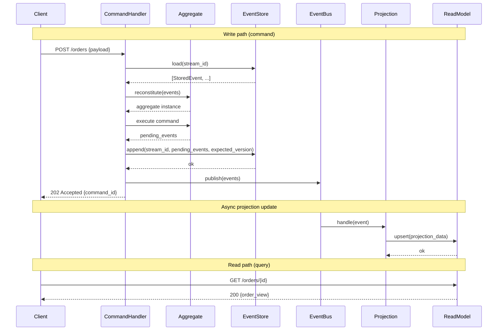

# Solutions — Week 04 · Day 7

## Exercise 1: Analytics Ingestion Capacity Design

**Problem:** Design for 1 M events/sec, p99 < 500 ms, 7-day retention.

**Assumptions:**
- Per-partition throughput: 10 MB/s (Kafka default safe limit)
- Average event size: 500 bytes
- Replication factor: 3
- Retention: 7 days = 604 800 seconds

**Step 1 — Throughput in MB/s**

```
total_throughput_mbs = 1_000_000 events/sec × 500 bytes/event
                     = 500 000 000 bytes/sec
                     = ~476.8 MB/s
```

**Step 2 — Partition count**

```
import math

per_partition_throughput_mbs = 10  # MB/s
total_throughput_mbs = 1_000_000 * 500 / 1_048_576  # ≈ 476.8 MB/s

partition_count = math.ceil(total_throughput_mbs / per_partition_throughput_mbs)
# = math.ceil(476.8 / 10) = 48

# Round up to nearest power of 2 for even key distribution:
partition_count = 64
```

**Step 3 — Storage estimate (single replica)**

```
retention_seconds = 7 * 24 * 3600          # 604 800 s
bytes_per_second  = 1_000_000 * 500        # 500 MB/s
raw_storage_bytes = bytes_per_second * retention_seconds
                  = 500_000_000 * 604_800
                  = 302_400_000_000_000 bytes
                  ≈ 275 TB
```

**Step 4 — With replication**

```
total_storage = raw_storage * replication_factor
              = 275 TB × 3
              = ~825 TB
```

**Step 5 — Consumer group sizing**

```
# Rule: consumers per group <= partition count
# Aim for ~70% utilisation per consumer

consumer_throughput_mbs = 30  # MB/s per consumer (read is cheaper than write)
consumers_needed = math.ceil(total_throughput_mbs / consumer_throughput_mbs)
                 = math.ceil(476.8 / 30)
                 = 16 consumers per group

# With 64 partitions and 16 consumers: 4 partitions per consumer
```

**Step 6 — p99 latency budget**

| Stage | Budget |
|---|---|
| Producer → broker (acks=1) | ~5 ms |
| Broker replication (acks=all) | ~20 ms |
| Consumer poll interval | ~50 ms |
| Consumer processing | ~100 ms |
| **Total (p50)** | ~175 ms |
| Safety headroom to p99 | × 2.5 |
| **p99 budget** | ~440 ms |

p99 < 500 ms is achievable with `linger.ms=5`, `batch.size=262144` (256 KB), and consumers polling at 50 ms intervals.

**Summary table:**

| Parameter | Value |
|---|---|
| Partition count | 64 |
| Consumer instances (per group) | 16 |
| Raw storage (7-day) | ~275 TB |
| Total storage (3× replication) | ~825 TB |
| Estimated p99 latency | ~440 ms |

---

## Exercise 2: Event-driven System Sequence Diagram

CQRS + Event Sourcing full flow — command write path and query read path.



---

## Exercise 3: Failure Modes and Mitigations

| Failure | Symptom | Mitigation |
|---|---|---|
| **Duplicate processing** | Side effects executed twice (e.g. double charge, double inventory decrement) | Idempotency key on each command/message; consumer checks `seen_ids` set or a dedup store before processing; use transactional outbox pattern |
| **Out-of-order delivery** | Aggregate reconstituted in wrong state; projections show inconsistent data | Partition by entity key so all events for one entity arrive in order; version-check on append (`expected_version`); consumers reject events with version gap and requeue |
| **Consumer lag buildup** | Read models are stale; SLA breached; consumer group offset falls behind retention window (data loss risk) | Monitor `consumer_lag` metric; autoscale consumer instances; backpressure — pause producer if lag exceeds threshold; tune `fetch.min.bytes` and `max.poll.records` |
| **Event store write failure** | Commands appear to succeed but events not persisted; aggregate state diverges | Return error to caller and do not publish to EventBus; use outbox pattern (write event + command result atomically to same DB); retry with exponential back-off |
| **Projection drift** | Read model out of sync with event store; queries return stale or incorrect data | Rebuild projections from event store on startup via replay; store projection checkpoint (last processed version); detect via periodic reconciliation job comparing aggregate state with projection |

---

## Exercise 4: Interview Answer — Exactly-Once Semantics

**Question:** How do you implement exactly-once semantics in a Kafka-based event-driven system?

**Model answer:**

Exactly-once is the hardest delivery guarantee because network partitions mean "did the broker receive it?" is unknowable without an ACK. There are two axes: producer side and consumer side.

**Producer side — transactional producer (Kafka >= 0.11):**
```
producer.initTransactions()
producer.beginTransaction()
producer.send(record)
producer.commitTransaction()  # atomic across partitions
```
With `enable.idempotence=true` and a `transactional.id`, the broker deduplicates retried sends using a sequence number. This gives exactly-once at the broker level.

**Consumer side — idempotent consumer:**
Even with a transactional producer, a consumer can crash after processing but before committing its offset, causing redelivery. The consumer must be idempotent:

```python
# Strategy 1: deduplication store
if message.key in seen_ids:
    return  # already processed
seen_ids.add(message.key)
process(message)
commit_offset()
```

```python
# Strategy 2: conditional write (optimistic concurrency)
# Only update the DB if the version matches the expected version.
# If not, the record was already processed — skip.
```

**Read-process-write in one transaction (Kafka Streams / transactional consumer):**
Write the processed result AND the consumed offset in a single atomic transaction. This is Kafka Streams' default exactly-once mode (`processing.guarantee=exactly_once_v2`).

**Trade-off:** Transactional producers reduce throughput (~20–30% on small messages) and add latency. Use exactly-once only where double-processing causes real harm (financial transactions, inventory). For analytics, at-least-once + idempotent aggregation is simpler and faster.

---

## Exercise 5: Capacity Math Worked Example

**Scenario:** IoT platform ingesting sensor readings.

```python
import math

# Given
events_per_second   = 1_000_000
avg_event_bytes     = 500
retention_days      = 7
replication_factor  = 3
per_partition_mbs   = 10

# Derived
throughput_bytes_per_sec = events_per_second * avg_event_bytes
throughput_mbs           = throughput_bytes_per_sec / (1024 ** 2)  # ~476.8 MB/s

# Partitions
partition_count = math.ceil(throughput_mbs / per_partition_mbs)
# ceil(47.68) = 48 → round to 64 for power-of-2 alignment

# Storage
retention_seconds    = retention_days * 24 * 3600             # 604 800
raw_bytes            = throughput_bytes_per_sec * retention_seconds
raw_tb               = raw_bytes / (1024 ** 4)                  # ~275 TB
replicated_tb        = raw_tb * replication_factor              # ~825 TB

# Consumer sizing
consumer_mbs_each    = 30
consumers_per_group  = math.ceil(throughput_mbs / consumer_mbs_each)  # 16

print(f"Partitions:          {partition_count}")
print(f"Raw storage (TB):    {raw_tb:.1f}")
print(f"Replicated TB:       {replicated_tb:.1f}")
print(f"Consumers per group: {consumers_per_group}")
# Output:
# Partitions:          64
# Raw storage (TB):    275.0
# Replicated TB:       825.0
# Consumers per group: 16
```

**Disk provisioning note:** Add 20% overhead for indexes, segment files, and OS page cache. Provision ~990 TB (or ~1 PB) across the broker cluster for a comfortable safety margin.

---

## Discussion Notes

**Choreography vs orchestration revisited at scale:**
- Choreography distributes coordination across services — no bottleneck, but debugging a multi-step saga requires distributed tracing (Jaeger, Zipkin) with correlation IDs on every event.
- Orchestration (Saga orchestrator, LangGraph subgraph, Temporal workflow) gives full visibility and explicit compensation but adds a coordination bottleneck and point of failure.
- At > 5 participating services, strong preference for orchestration to maintain debuggability.

**Window strategy selection guide:**

| Strategy | Use when |
|---|---|
| Tumbling | Hourly billing, per-minute metrics, non-overlapping batches |
| Sliding | Rolling averages, anomaly detection over overlapping periods |
| Session | User session analytics, clickstream grouping, activity-based gaps |

**Backpressure mechanisms:**

1. **Bounded queues** — `asyncio.Queue(maxsize=N)` blocks producers when full.
2. **Async semaphores** — `asyncio.Semaphore(N)` limits concurrent in-flight requests.
3. **Pull-based polling** — Consumer requests next batch only when ready; producer never pushes unsolicited.
4. **TCP flow control** — At network level; Kafka consumers naturally leverage this via `fetch.max.bytes`.

**Event sourcing vs CRUD decision matrix:**

| Criterion | Event sourcing wins | CRUD wins |
|---|---|---|
| Audit requirement | Full history required | Recent state only |
| Temporal queries | Need point-in-time state | Not required |
| Write throughput | Append-only is fast | Updates in-place |
| Storage cost | High (full history) | Low (current state) |
| Team familiarity | High (ES experts) | Low (standard SQL) |
