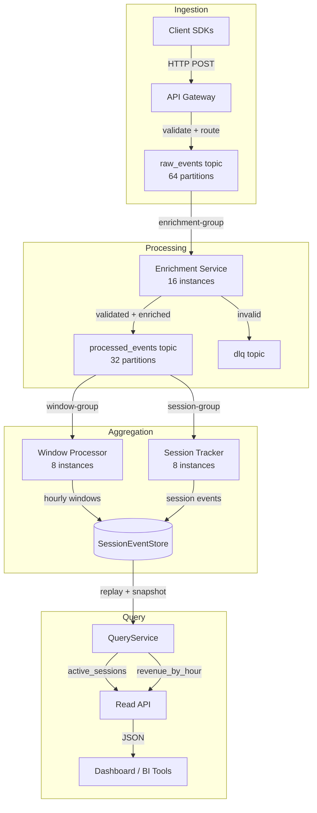

# Project Solution — Week 04: Analytics Ingestion System

## Written Design Document

### System Requirements

| Requirement | Target |
|---|---|
| Ingestion throughput | 1 M events/sec sustained |
| Write latency (p99) | < 500 ms end-to-end |
| Retention | 7 days |
| Delivery guarantee | At-least-once with idempotent processing |
| Availability | AP (availability + partition tolerance) |
| Read latency (p99) | < 100 ms for pre-aggregated queries |

---

### Kafka Topology

**Topics:**

| Topic | Partitions | Retention | Purpose |
|---|---|---|---|
| `raw_events` | 64 | 7 days | All inbound events |
| `processed_events` | 32 | 3 days | Post-enrichment events |
| `dlq` | 8 | 30 days | Failed/unroutable events |

**Partition count rationale:**

```
throughput   = 1_000_000 events/s × 500 bytes = ~476.8 MB/s
per_partition = 10 MB/s (Kafka safe limit)
min_partitions = ceil(476.8 / 10) = 48 → round up to 64 (power of 2)
```

**Topic configuration:**

```properties
# raw_events
retention.ms=604800000        # 7 days
min.insync.replicas=2
replication.factor=3
compression.type=lz4
```

---

### Consumer Group Layout

| Group | Topic | Instances | Partitions/Instance | Role |
|---|---|---|---|---|
| `enrichment-group` | `raw_events` | 16 | 4 | Enrich + validate |
| `window-group` | `processed_events` | 8 | 4 | Tumbling window aggregation |
| `session-group` | `processed_events` | 8 | 4 | Session tracking |

---

### Storage Estimate

```
raw = 1_000_000 events/s × 500 bytes × 604_800 s ≈ 275 TB
replicated = 275 TB × 3 = 825 TB
with 20% OS/index overhead = 990 TB → provision 1 PB
```

---

### Failure Modes and Mitigations

| Failure | Symptom | Mitigation |
|---|---|---|
| Duplicate events | Revenue double-counted | Idempotency key on each event; `seen_ids` dedup at consumer |
| Out-of-order delivery | Session state corrupted | Partition by `session_id`; version-gated writes |
| Consumer lag buildup | Stale dashboards, data loss risk | `consumer_lag` alerts; autoscale instances; pause ingestion at lag threshold |
| Event store write failure | Session state lost | Transactional outbox; retry with exponential back-off; DLQ on max retries |
| Projection drift | Revenue query returns wrong total | Replay from event store on startup; periodic reconciliation |

---

## Architecture Diagram (Mermaid)



---

## Reference Implementation

### `models.py`

```python
"""
models.py — Pydantic models for the analytics ingestion system.
"""
from __future__ import annotations

import uuid
from datetime import datetime
from typing import Any

from pydantic import BaseModel, Field


class StoredEvent(BaseModel):
    event_id: str = Field(default_factory=lambda: str(uuid.uuid4()))
    stream_id: str
    version: int
    event_type: str
    data: dict[str, Any]
    timestamp: datetime = Field(default_factory=datetime.utcnow)


class Snapshot(BaseModel):
    stream_id: str
    version: int
    state: dict[str, Any]
    timestamp: datetime = Field(default_factory=datetime.utcnow)


class StreamRecord(BaseModel):
    record_id: str = Field(default_factory=lambda: str(uuid.uuid4()))
    topic: str
    timestamp: datetime
    value: float
    attributes: dict[str, Any] = Field(default_factory=dict)


class WindowResult(BaseModel):
    window_start: datetime
    window_end: datetime
    topic: str
    count: int
    total: float
    min_value: float
    max_value: float
```

---

### `analytics_session.py` — Event-sourced aggregate

```python
"""
analytics_session.py — AnalyticsSession event-sourced aggregate.

Events:
    SessionStarted      — session lifecycle begins
    PageViewed          — user views a page
    PurchaseMade        — revenue event
    SessionEnded        — session lifecycle ends

State fields:
    session_id: str
    user_id: str
    started_at: datetime | None
    ended_at: datetime | None
    page_views: int
    total_revenue: float
    active: bool
    purchases: list[dict]
"""
from __future__ import annotations

import logging
from datetime import datetime
from typing import Any

from models import Snapshot, StoredEvent

logger = logging.getLogger(__name__)


class SessionAlreadyEndedError(Exception):
    pass


class SessionNotActiveError(Exception):
    pass


class AnalyticsSession:
    """Event-sourced aggregate for a user analytics session."""

    def __init__(self, session_id: str) -> None:
        self.id = session_id
        self._state: dict[str, Any] = self._initial_state()
        self._version: int = 0
        self._pending: list[StoredEvent] = []

    @staticmethod
    def _initial_state() -> dict[str, Any]:
        return {
            "session_id": "",
            "user_id": "",
            "started_at": None,
            "ended_at": None,
            "page_views": 0,
            "total_revenue": 0.0,
            "active": False,
            "purchases": [],
        }

    # ------------------------------------------------------------------
    # Apply (pure)
    # ------------------------------------------------------------------

    def _apply(self, state: dict[str, Any], event: StoredEvent) -> dict[str, Any]:
        s = dict(state)
        match event.event_type:
            case "SessionStarted":
                s["session_id"] = event.data["session_id"]
                s["user_id"] = event.data["user_id"]
                s["started_at"] = event.data["started_at"]
                s["active"] = True
            case "PageViewed":
                s["page_views"] += 1
            case "PurchaseMade":
                amount = event.data["amount"]
                s["total_revenue"] += amount
                s["purchases"] = list(s["purchases"]) + [
                    {"amount": amount, "product_id": event.data.get("product_id", "")}
                ]
            case "SessionEnded":
                s["ended_at"] = event.data["ended_at"]
                s["active"] = False
            case _:
                logger.warning("Unknown event: %s", event.event_type)
        return s

    # ------------------------------------------------------------------
    # Commands
    # ------------------------------------------------------------------

    def start(self, user_id: str, started_at: datetime | None = None) -> None:
        if self._state["active"]:
            raise ValueError("Session already started")
        ts = started_at or datetime.utcnow()
        self._raise("SessionStarted", {
            "session_id": self.id,
            "user_id": user_id,
            "started_at": ts.isoformat(),
        })

    def view_page(self, url: str) -> None:
        self._assert_active()
        self._raise("PageViewed", {"url": url})

    def make_purchase(self, amount: float, product_id: str = "") -> None:
        self._assert_active()
        if amount <= 0:
            raise ValueError("Purchase amount must be positive")
        self._raise("PurchaseMade", {"amount": amount, "product_id": product_id})

    def end(self, ended_at: datetime | None = None) -> None:
        self._assert_active()
        ts = ended_at or datetime.utcnow()
        self._raise("SessionEnded", {"ended_at": ts.isoformat()})

    # ------------------------------------------------------------------
    # Read properties
    # ------------------------------------------------------------------

    @property
    def user_id(self) -> str:
        return self._state["user_id"]

    @property
    def active(self) -> bool:
        return self._state["active"]

    @property
    def page_views(self) -> int:
        return self._state["page_views"]

    @property
    def total_revenue(self) -> float:
        return self._state["total_revenue"]

    @property
    def purchases(self) -> list[dict[str, Any]]:
        return list(self._state["purchases"])

    @property
    def version(self) -> int:
        return self._version

    @property
    def pending_events(self) -> list[StoredEvent]:
        return list(self._pending)

    # ------------------------------------------------------------------
    # Reconstitution + snapshot
    # ------------------------------------------------------------------

    @classmethod
    def reconstitute(
        cls,
        session_id: str,
        events: list[StoredEvent],
        snapshot: Snapshot | None = None,
    ) -> "AnalyticsSession":
        instance = cls.__new__(cls)
        instance.id = session_id
        instance._pending = []

        if snapshot:
            instance._state = dict(snapshot.state)
            instance._version = snapshot.version
            events = [e for e in events if e.version > snapshot.version]
        else:
            instance._state = instance._initial_state()
            instance._version = 0

        for event in sorted(events, key=lambda e: e.version):
            instance._state = instance._apply(instance._state, event)
            instance._version = event.version

        return instance

    def get_snapshot(self) -> Snapshot:
        return Snapshot(
            stream_id=self.id,
            version=self._version,
            state=dict(self._state),
        )

    def mark_committed(self) -> None:
        self._version += len(self._pending)
        self._pending.clear()

    # ------------------------------------------------------------------
    # Internal
    # ------------------------------------------------------------------

    def _raise(self, event_type: str, data: dict[str, Any]) -> None:
        event = StoredEvent(
            stream_id=self.id,
            version=self._version + len(self._pending) + 1,
            event_type=event_type,
            data=data,
        )
        self._state = self._apply(self._state, event)
        self._pending.append(event)

    def _assert_active(self) -> None:
        if not self._state["active"]:
            raise SessionNotActiveError(f"Session {self.id} is not active")
```

---

### `session_event_store.py` — In-memory event store

```python
"""
session_event_store.py — In-memory event store for AnalyticsSession.
"""
from __future__ import annotations

import logging
from typing import Any

from analytics_session import AnalyticsSession
from models import Snapshot, StoredEvent

logger = logging.getLogger(__name__)


class ConcurrencyError(Exception):
    pass


class SessionEventStore:
    """
    Thread-unsafe in-memory event store.
    Supports optimistic concurrency control, snapshots, and reconstitution.
    """

    def __init__(self) -> None:
        self._streams: dict[str, list[StoredEvent]] = {}
        self._snapshots: dict[str, Snapshot] = {}

    def append(
        self,
        stream_id: str,
        events: list[StoredEvent],
        expected_version: int = -1,
    ) -> None:
        current = self._streams.get(stream_id, [])
        actual_version = current[-1].version if current else -1

        if expected_version != -2 and actual_version != expected_version:
            raise ConcurrencyError(
                f"Stream '{stream_id}': expected {expected_version}, got {actual_version}"
            )

        self._streams.setdefault(stream_id, []).extend(events)

    def load(self, stream_id: str, after_version: int = 0) -> list[StoredEvent]:
        return [
            e for e in self._streams.get(stream_id, [])
            if e.version > after_version
        ]

    def save_snapshot(self, snapshot: Snapshot) -> None:
        self._snapshots[snapshot.stream_id] = snapshot

    def load_snapshot(self, stream_id: str) -> Snapshot | None:
        return self._snapshots.get(stream_id)

    def stream_version(self, stream_id: str) -> int:
        events = self._streams.get(stream_id)
        return events[-1].version if events else -1

    def reconstitute(self, session_id: str) -> AnalyticsSession:
        snapshot = self.load_snapshot(session_id)
        after = snapshot.version if snapshot else 0
        events = self.load(session_id, after_version=after)
        return AnalyticsSession.reconstitute(session_id, events, snapshot=snapshot)
```

---

### `revenue_window_processor.py` — 1-hour tumbling windows

```python
"""
revenue_window_processor.py — Tumbling 1-hour window processor for revenue events.
"""
from __future__ import annotations

import logging
from datetime import datetime, timedelta
from typing import Callable

from models import StreamRecord, WindowResult

logger = logging.getLogger(__name__)

HOUR_SECONDS = 3600


def _window_start(ts: datetime) -> datetime:
    epoch = datetime(1970, 1, 1)
    secs = int((ts - epoch).total_seconds() // HOUR_SECONDS) * HOUR_SECONDS
    return epoch + timedelta(seconds=secs)


class _Acc:
    def __init__(self, start: datetime, topic: str) -> None:
        self.start = start
        self.end = start + timedelta(seconds=HOUR_SECONDS)
        self.topic = topic
        self.count = 0
        self.total = 0.0
        self.min_v = float("inf")
        self.max_v = float("-inf")

    def add(self, v: float) -> None:
        self.count += 1
        self.total += v
        self.min_v = min(self.min_v, v)
        self.max_v = max(self.max_v, v)

    def result(self) -> WindowResult:
        return WindowResult(
            window_start=self.start,
            window_end=self.end,
            topic=self.topic,
            count=self.count,
            total=round(self.total, 2),
            min_value=self.min_v if self.count else 0.0,
            max_value=self.max_v if self.count else 0.0,
        )


class RevenueWindowProcessor:
    """
    Tumbling 1-hour window processor.
    Emits WindowResult for each closed window via on_window_close callback.
    """

    def __init__(
        self,
        on_window_close: Callable[[WindowResult], None] | None = None,
    ) -> None:
        self._cb = on_window_close or (lambda _: None)
        self._windows: dict[tuple[str, datetime], _Acc] = {}
        self._closed: list[WindowResult] = []
        self._watermark = datetime.min

    def process(self, record: StreamRecord) -> None:
        ws = _window_start(record.timestamp)
        cutoff = self._watermark - timedelta(seconds=HOUR_SECONDS)

        if record.timestamp < cutoff and self._watermark != datetime.min:
            logger.warning(
                "Dropping late record topic=%s ts=%s", record.topic, record.timestamp
            )
            return

        if record.timestamp > self._watermark:
            self._watermark = record.timestamp
            for key, acc in list(self._windows.items()):
                if acc.end <= self._watermark:
                    result = self._windows.pop(key).result()
                    self._closed.append(result)
                    self._cb(result)

        key = (record.topic, ws)
        if key not in self._windows:
            self._windows[key] = _Acc(ws, record.topic)
        self._windows[key].add(record.value)

    def flush_all(self) -> None:
        for acc in list(self._windows.values()):
            result = acc.result()
            self._closed.append(result)
            self._cb(result)
        self._windows.clear()

    @property
    def closed_windows(self) -> list[WindowResult]:
        return list(self._closed)

    def get_open_windows(self) -> list[WindowResult]:
        return [acc.result() for acc in self._windows.values()]
```

---

### `query_service.py` — Read model

```python
"""
query_service.py — QueryService providing read-model views over the event store.
"""
from __future__ import annotations

import logging
from datetime import datetime

from models import WindowResult
from revenue_window_processor import RevenueWindowProcessor
from session_event_store import SessionEventStore

logger = logging.getLogger(__name__)


class QueryService:
    """
    Read service that queries the SessionEventStore and window processor results.
    All state is derived from the event store — no separate DB required.
    """

    def __init__(
        self,
        store: SessionEventStore,
        window_processor: RevenueWindowProcessor,
    ) -> None:
        self._store = store
        self._wp = window_processor

    def active_sessions(self) -> list[str]:
        """Return session IDs of all currently active sessions."""
        active: list[str] = []
        for stream_id in self._store._streams:
            try:
                session = self._store.reconstitute(stream_id)
                if session.active:
                    active.append(stream_id)
            except Exception:
                logger.exception("Error reconstituting session %s", stream_id)
        return active

    def revenue_by_hour(self) -> list[WindowResult]:
        """Return closed hourly revenue windows, sorted by window start."""
        return sorted(self._wp.closed_windows, key=lambda w: w.window_start)

    def session_summary(self, session_id: str) -> dict:
        """Return a summary dict for a single session."""
        session = self._store.reconstitute(session_id)
        return {
            "session_id": session_id,
            "user_id": session.user_id,
            "active": session.active,
            "page_views": session.page_views,
            "total_revenue": session.total_revenue,
            "purchases": session.purchases,
            "version": session.version,
        }
```

---

## Test Suite

```python
"""
test_project.py — Full pytest test suite for the analytics ingestion system.
"""
from __future__ import annotations

from datetime import datetime, timedelta

import pytest

from analytics_session import AnalyticsSession, SessionAlreadyEndedError, SessionNotActiveError
from models import Snapshot, StoredEvent, StreamRecord
from query_service import QueryService
from revenue_window_processor import RevenueWindowProcessor
from session_event_store import ConcurrencyError, SessionEventStore


# ---------------------------------------------------------------------------
# Helpers
# ---------------------------------------------------------------------------

def _make_session(session_id: str = "sess-001", user_id: str = "user-42") -> AnalyticsSession:
    s = AnalyticsSession(session_id)
    s.start(user_id=user_id, started_at=datetime(2024, 1, 1, 10, 0, 0))
    return s


def _make_record(ts: datetime, value: float, topic: str = "revenue") -> StreamRecord:
    return StreamRecord(topic=topic, timestamp=ts, value=value)


# ---------------------------------------------------------------------------
# AnalyticsSession aggregate tests
# ---------------------------------------------------------------------------

def test_session_start_sets_active() -> None:
    s = _make_session()
    assert s.active is True
    assert s.user_id == "user-42"


def test_session_page_view_increments_count() -> None:
    s = _make_session()
    s.view_page("/home")
    s.view_page("/products")
    assert s.page_views == 2


def test_session_purchase_adds_revenue() -> None:
    s = _make_session()
    s.make_purchase(49.99, product_id="sku-001")
    s.make_purchase(10.00, product_id="sku-002")
    assert s.total_revenue == pytest.approx(59.99)
    assert len(s.purchases) == 2


def test_session_end_deactivates() -> None:
    s = _make_session()
    s.end(ended_at=datetime(2024, 1, 1, 10, 30, 0))
    assert s.active is False


def test_view_page_on_inactive_session_raises() -> None:
    s = _make_session()
    s.end()
    with pytest.raises(SessionNotActiveError):
        s.view_page("/checkout")


def test_purchase_zero_amount_raises() -> None:
    s = _make_session()
    with pytest.raises(ValueError, match="positive"):
        s.make_purchase(0.0)


def test_session_events_emitted_in_order() -> None:
    s = _make_session()
    s.view_page("/a")
    s.make_purchase(25.0)
    s.end()

    types = [e.event_type for e in s.pending_events]
    assert types == ["SessionStarted", "PageViewed", "PurchaseMade", "SessionEnded"]


def test_reconstitute_restores_full_state() -> None:
    original = _make_session()
    original.view_page("/landing")
    original.make_purchase(100.0, "prod-x")
    original.end()

    events = original.pending_events
    restored = AnalyticsSession.reconstitute("sess-001", events)

    assert restored.active is False
    assert restored.page_views == 1
    assert restored.total_revenue == 100.0
    assert len(restored.purchases) == 1


def test_reconstitute_from_snapshot() -> None:
    snap = Snapshot(
        stream_id="sess-002",
        version=3,
        state={
            "session_id": "sess-002",
            "user_id": "u-99",
            "started_at": "2024-01-01T10:00:00",
            "ended_at": None,
            "page_views": 5,
            "total_revenue": 200.0,
            "active": True,
            "purchases": [],
        },
    )
    later_event = StoredEvent(
        stream_id="sess-002",
        version=4,
        event_type="PurchaseMade",
        data={"amount": 50.0, "product_id": "p-1"},
    )
    restored = AnalyticsSession.reconstitute("sess-002", [later_event], snapshot=snap)
    assert restored.total_revenue == 250.0
    assert restored.page_views == 5


# ---------------------------------------------------------------------------
# SessionEventStore tests
# ---------------------------------------------------------------------------

def test_store_append_and_load() -> None:
    store = SessionEventStore()
    s = _make_session()
    store.append("sess-001", s.pending_events, expected_version=-1)
    loaded = store.load("sess-001")
    assert len(loaded) == 1


def test_store_concurrency_error_on_version_mismatch() -> None:
    store = SessionEventStore()
    s = _make_session()
    store.append("sess-001", s.pending_events, expected_version=-1)
    s.mark_committed()

    s.view_page("/a")
    with pytest.raises(ConcurrencyError):
        store.append("sess-001", s.pending_events, expected_version=0)


def test_store_reconstitute_via_store() -> None:
    store = SessionEventStore()
    s = _make_session()
    s.view_page("/x")
    store.append("sess-001", s.pending_events, expected_version=-1)

    restored = store.reconstitute("sess-001")
    assert restored.page_views == 1
    assert restored.active is True


def test_store_snapshot_used_on_reconstitute() -> None:
    store = SessionEventStore()
    s = _make_session()
    s.view_page("/a")
    store.append("sess-001", s.pending_events, expected_version=-1)
    s.mark_committed()

    snap = s.get_snapshot()
    store.save_snapshot(snap)

    s2 = store.reconstitute("sess-001")
    assert s2.page_views == 1


# ---------------------------------------------------------------------------
# RevenueWindowProcessor tests
# ---------------------------------------------------------------------------

def test_window_aggregates_hourly() -> None:
    closed = []
    proc = RevenueWindowProcessor(on_window_close=closed.append)
    t = datetime(2024, 3, 1, 12, 0, 0)

    for v in [10.0, 20.0, 30.0]:
        proc.process(_make_record(t, v))
        t += timedelta(minutes=10)

    proc.process(_make_record(datetime(2024, 3, 1, 14, 0, 0), 0.0))
    assert len(closed) == 1
    assert closed[0].total == 60.0
    assert closed[0].count == 3


def test_window_min_max_correct() -> None:
    proc = RevenueWindowProcessor()
    t = datetime(2024, 1, 1, 9, 0, 0)
    for v in [5.0, 100.0, 1.0, 50.0]:
        proc.process(_make_record(t, v))
        t += timedelta(minutes=5)
    proc.flush_all()

    w = proc.closed_windows[0]
    assert w.min_value == 1.0
    assert w.max_value == 100.0


def test_flush_all_closes_remaining() -> None:
    proc = RevenueWindowProcessor()
    t = datetime(2024, 1, 1, 8, 0, 0)
    proc.process(_make_record(t, 99.0))
    assert len(proc.closed_windows) == 0

    proc.flush_all()
    assert len(proc.closed_windows) == 1


# ---------------------------------------------------------------------------
# QueryService tests
# ---------------------------------------------------------------------------

def test_active_sessions_returns_active_only() -> None:
    store = SessionEventStore()
    wp = RevenueWindowProcessor()
    qs = QueryService(store, wp)

    s1 = _make_session("s-1", "u-1")
    store.append("s-1", s1.pending_events, expected_version=-1)

    s2 = _make_session("s-2", "u-2")
    s2.end()
    store.append("s-2", s2.pending_events, expected_version=-1)

    active = qs.active_sessions()
    assert "s-1" in active
    assert "s-2" not in active


def test_revenue_by_hour_sorted() -> None:
    store = SessionEventStore()
    closed = []
    wp = RevenueWindowProcessor(on_window_close=closed.append)
    qs = QueryService(store, wp)

    t1 = datetime(2024, 1, 1, 8, 30, 0)
    t2 = datetime(2024, 1, 1, 9, 30, 0)

    for t, v in [(t1, 50.0), (t2, 75.0)]:
        wp.process(_make_record(t, v))

    wp.flush_all()

    hours = qs.revenue_by_hour()
    assert len(hours) == 2
    assert hours[0].window_start < hours[1].window_start


def test_session_summary_correct() -> None:
    store = SessionEventStore()
    wp = RevenueWindowProcessor()
    qs = QueryService(store, wp)

    s = _make_session("s-10", "u-10")
    s.view_page("/checkout")
    s.make_purchase(99.0)
    store.append("s-10", s.pending_events, expected_version=-1)

    summary = qs.session_summary("s-10")
    assert summary["user_id"] == "u-10"
    assert summary["page_views"] == 1
    assert summary["total_revenue"] == 99.0
    assert summary["active"] is True
```

---

## Design Decisions and Tradeoffs

### 1. In-memory event store vs. real Kafka/Postgres

The reference implementation uses an in-memory store to make it runnable without external infrastructure. In production, the event store would be Postgres with an `events` table (stream_id, version, event_type, data) and a unique index on `(stream_id, version)` for optimistic concurrency. The `version` check maps directly to a `WHERE version = expected_version` conditional UPDATE or an `INSERT ... WHERE NOT EXISTS` pattern.

### 2. Snapshot strategy

Snapshots are taken on-demand (triggered by `get_snapshot()`). In production, a background job would snapshot streams with version > N (e.g. 100 events). The grace period before a snapshot is useful: if a snapshot is written mid-replay, it must be consistent with events already acknowledged by the event bus.

### 3. Idempotent purchase recording

The `PurchaseMade` handler records `product_id`. To make it idempotent, production code would include an `idempotency_key` in the event data and check `seen_purchase_ids` before applying. This is omitted from the reference to keep the aggregate focused on structure.

### 4. At-least-once vs exactly-once

The reference guarantees at-least-once: events are appended to the store, then published to the bus. If the service crashes after `append` but before `publish`, the event replays on restart. Read models must be idempotent (re-applying the same event produces the same state). The `_apply` methods are pure and idempotent by construction.

### 5. Window processor watermark

The watermark advances with each new record's timestamp. This means out-of-order records are handled gracefully as long as they arrive within one window size. Records older than `watermark - window_size` are dropped with a warning log. For production, set the grace period to the 99th percentile network jitter (typically 5–30 seconds for IoT data).
