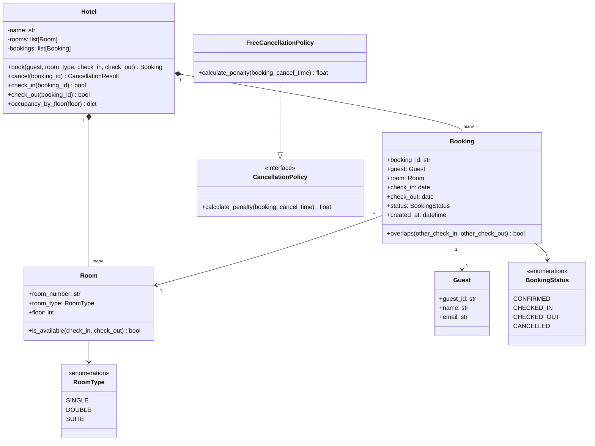

# Solutions — Phase 7 · Week 07 · Day 1

## Exercise 1 — Elevator System (6-step LLD)

### Step 1 — Clarify

Assumed answers to key questions:
- **Floors**: 20 floors, ground (0) to floor 19.
- **Elevators**: 4 elevators, each independent.
- **Capacity**: each elevator holds up to 10 people (weight-based in production, count-based here).
- **Controls**: riders press a floor button inside; waiting passengers press up/down outside.
- **Features**: real-time state tracking; no reservations; doors open/close automatically.
- **Edge cases**: elevator at capacity rejects new passengers; multiple simultaneous floor requests are queued.
- **Persistence**: in-memory for interview scope.

### Step 2 — Entities

```
Building             — owns all floors and the elevator bank
Floor                — one level; has an up/down call button
ElevatorCar          — one physical elevator car (has doors, state, current floor)
ElevatorDoor         — open/closed state, part of a car
Request              — a passenger call: either HALL_CALL (floor + direction) or CAR_CALL (destination floor)
ElevatorController   — brain; receives requests, dispatches cars via a scheduling strategy
SchedulingStrategy   — algorithm that picks the best car for a request
Passenger            — actor, not stored; triggers Request creation
```

### Step 3 — Relationships

```
Building          1 ----< Floor
Building          1 ----< ElevatorCar
ElevatorCar       1 ---- 1 ElevatorDoor
ElevatorController 1 ----< ElevatorCar
ElevatorController 1 ---- 1 SchedulingStrategy
ElevatorController >----< Request       (many requests processed by controller)
Request           1 ---- 1 ElevatorCar  (after dispatch)
```

### Step 4 — Interfaces (ASCII class diagram)

```
+---------------------------+
|  <<interface>>            |
|  SchedulingStrategy       |
+---------------------------+
| + select(cars: list[ElevatorCar],   |
|           req: Request)             |
|   -> ElevatorCar | None             |
+---------------------------+
          ^
          |
+--------------------------+   +--------------------------+
| NearestElevatorScheduler |   | SCANScheduler            |
+--------------------------+   +--------------------------+
| + select(...)            |   | + select(...)            |
+--------------------------+   +--------------------------+

+---------------------------+
|  ElevatorController       |
+---------------------------+
| - cars: list[ElevatorCar] |
| - strategy: SchedulingStrategy |
| - pending: deque[Request] |
| + request_hall_call(floor, dir) -> None  |
| + request_car_call(car_id, floor) -> None|
| + step() -> None          |
+---------------------------+

+---------------------------+        +---------------------------+
|  ElevatorCar              |        |  ElevatorDoor             |
+---------------------------+        +---------------------------+
| - car_id: str             |        | - is_open: bool           |
| - current_floor: int      | 1----1 | + open() -> None          |
| - state: CarState         |        | + close() -> None         |
| - direction: Direction    |        +---------------------------+
| - destinations: list[int] |
| + add_destination(f: int) -> None |
| + move_one_floor() -> None        |
| + open_door() -> None             |
| + close_door() -> None            |
| + is_idle() -> bool               |
+---------------------------+
```

### Step 5 — Patterns

| Problem | Pattern |
|---------|---------|
| Picking which elevator to send | Strategy (`SchedulingStrategy`) |
| Elevator state (idle/moving/doors_open) | State machine (enum + transitions) |
| One controller for the whole bank | Singleton (`ElevatorController`) |
| Notifying floor displays when elevator arrives | Observer |
| Building the right scheduler from config | Factory Method |

### Step 6 — Code

```python
"""
elevator_system.py — LLD Interview: Elevator Controller
Python 3.12+ | pydantic v2 | logging
"""
from __future__ import annotations

import logging
import uuid
from abc import ABC, abstractmethod
from collections import deque
from enum import Enum, auto
from typing import Optional

from pydantic import BaseModel, Field

logging.basicConfig(level=logging.INFO, format="%(levelname)s %(name)s: %(message)s")
log = logging.getLogger(__name__)


# ---------------------------------------------------------------------------
# Enums
# ---------------------------------------------------------------------------

class Direction(Enum):
    UP = auto()
    DOWN = auto()
    IDLE = auto()


class CarState(Enum):
    IDLE = auto()
    MOVING = auto()
    DOORS_OPEN = auto()


class RequestType(Enum):
    HALL_CALL = auto()   # passenger on a floor presses up/down
    CAR_CALL = auto()    # passenger inside car presses destination


# ---------------------------------------------------------------------------
# Domain models
# ---------------------------------------------------------------------------

class Request(BaseModel):
    request_id: str = Field(default_factory=lambda: str(uuid.uuid4())[:8])
    request_type: RequestType
    floor: int
    direction: Optional[Direction] = None   # only for HALL_CALL
    assigned_car_id: Optional[str] = None


class ElevatorDoor(BaseModel):
    is_open: bool = False

    def open(self) -> None:
        self.is_open = True
        log.info("Door opened")

    def close(self) -> None:
        self.is_open = False
        log.info("Door closed")


class ElevatorCar(BaseModel):
    car_id: str = Field(default_factory=lambda: str(uuid.uuid4())[:6])
    current_floor: int = 0
    state: CarState = CarState.IDLE
    direction: Direction = Direction.IDLE
    door: ElevatorDoor = Field(default_factory=ElevatorDoor)
    destinations: list[int] = Field(default_factory=list)

    model_config = {"arbitrary_types_allowed": True}

    def is_idle(self) -> bool:
        return self.state == CarState.IDLE and not self.destinations

    def distance_to(self, floor: int) -> int:
        return abs(self.current_floor - floor)

    def add_destination(self, floor: int) -> None:
        if floor not in self.destinations:
            self.destinations.append(floor)
            self.destinations.sort()
            log.info("Car %s queued floor %d (queue: %s)", self.car_id, floor, self.destinations)

    def move_one_floor(self) -> None:
        """Advance the car one floor toward the next destination."""
        if not self.destinations:
            self.state = CarState.IDLE
            self.direction = Direction.IDLE
            return

        target = self.destinations[0]
        if self.current_floor < target:
            self.current_floor += 1
            self.direction = Direction.UP
        elif self.current_floor > target:
            self.current_floor -= 1
            self.direction = Direction.DOWN

        self.state = CarState.MOVING
        log.info("Car %s moving %s -> floor %d", self.car_id, self.direction.name, self.current_floor)

        if self.current_floor == target:
            self.destinations.pop(0)
            self.open_door()

    def open_door(self) -> None:
        self.state = CarState.DOORS_OPEN
        self.door.open()
        log.info("Car %s arrived at floor %d, doors open", self.car_id, self.current_floor)

    def close_door(self) -> None:
        self.door.close()
        self.state = CarState.IDLE if not self.destinations else CarState.MOVING
        log.info("Car %s doors closed at floor %d", self.car_id, self.current_floor)


# ---------------------------------------------------------------------------
# Strategy: Scheduling
# ---------------------------------------------------------------------------

class SchedulingStrategy(ABC):
    @abstractmethod
    def select(
        self, cars: list[ElevatorCar], request: Request
    ) -> Optional[ElevatorCar]:
        ...


class NearestElevatorScheduler(SchedulingStrategy):
    """
    Picks the closest idle elevator to the requested floor.
    Falls back to the closest moving elevator heading in the same direction.
    Final fallback: any car (shortest absolute distance).
    """

    def select(
        self, cars: list[ElevatorCar], request: Request
    ) -> Optional[ElevatorCar]:
        if not cars:
            return None

        # Priority 1: idle cars ordered by distance
        idle_cars = [c for c in cars if c.is_idle()]
        if idle_cars:
            best = min(idle_cars, key=lambda c: c.distance_to(request.floor))
            log.info(
                "NearestScheduler: idle car %s selected for floor %d (dist=%d)",
                best.car_id, request.floor, best.distance_to(request.floor),
            )
            return best

        # Priority 2: a car moving toward the floor in the same direction
        if request.direction is not None:
            same_dir = [
                c for c in cars
                if c.direction == request.direction
                and (
                    (request.direction == Direction.UP and c.current_floor <= request.floor)
                    or (request.direction == Direction.DOWN and c.current_floor >= request.floor)
                )
            ]
            if same_dir:
                best = min(same_dir, key=lambda c: c.distance_to(request.floor))
                log.info(
                    "NearestScheduler: en-route car %s selected for floor %d",
                    best.car_id, request.floor,
                )
                return best

        # Priority 3: any car, closest distance
        best = min(cars, key=lambda c: c.distance_to(request.floor))
        log.info(
            "NearestScheduler: fallback car %s for floor %d",
            best.car_id, request.floor,
        )
        return best


class SCANScheduler(SchedulingStrategy):
    """
    SCAN (elevator) algorithm: car sweeps floor range, changes direction at extremes.
    Assigns to the car whose current sweep will naturally pass the requested floor.
    """

    def select(
        self, cars: list[ElevatorCar], request: Request
    ) -> Optional[ElevatorCar]:
        # Simplified: prefer car currently heading toward request floor
        for car in cars:
            if car.direction == Direction.UP and car.current_floor <= request.floor:
                return car
            if car.direction == Direction.DOWN and car.current_floor >= request.floor:
                return car
        # No car on the way: fall back to nearest idle
        idle = [c for c in cars if c.is_idle()]
        if idle:
            return min(idle, key=lambda c: c.distance_to(request.floor))
        return min(cars, key=lambda c: c.distance_to(request.floor))


# ---------------------------------------------------------------------------
# ElevatorController — Singleton
# ---------------------------------------------------------------------------

class ElevatorController:
    _instance: Optional[ElevatorController] = None

    def __init__(
        self,
        num_floors: int,
        cars: list[ElevatorCar],
        strategy: SchedulingStrategy,
    ) -> None:
        self.num_floors = num_floors
        self.cars = cars
        self.strategy = strategy
        self._pending: deque[Request] = deque()
        log.info(
            "ElevatorController created: %d floors, %d cars",
            num_floors, len(cars),
        )

    @classmethod
    def get_instance(
        cls,
        num_floors: int,
        cars: list[ElevatorCar],
        strategy: SchedulingStrategy,
    ) -> ElevatorController:
        if cls._instance is None:
            cls._instance = cls(num_floors, cars, strategy)
        return cls._instance

    @classmethod
    def reset(cls) -> None:
        cls._instance = None

    def request_hall_call(self, floor: int, direction: Direction) -> None:
        if not (0 <= floor < self.num_floors):
            log.error("Invalid floor: %d", floor)
            return
        req = Request(
            request_type=RequestType.HALL_CALL,
            floor=floor,
            direction=direction,
        )
        self._dispatch(req)

    def request_car_call(self, car_id: str, floor: int) -> None:
        car = next((c for c in self.cars if c.car_id == car_id), None)
        if car is None:
            log.error("Unknown car: %s", car_id)
            return
        car.add_destination(floor)

    def _dispatch(self, request: Request) -> None:
        car = self.strategy.select(self.cars, request)
        if car is None:
            log.warning("No car available for request %s", request.request_id)
            self._pending.append(request)
            return
        car.add_destination(request.floor)
        request.assigned_car_id = car.car_id
        log.info(
            "Request %s (floor %d) -> car %s",
            request.request_id, request.floor, car.car_id,
        )

    def step(self) -> None:
        """Advance the simulation by one tick (one floor movement per car)."""
        for car in self.cars:
            if car.state == CarState.DOORS_OPEN:
                car.close_door()
            else:
                car.move_one_floor()
        # Retry pending requests if any car is now idle
        retried: list[Request] = []
        while self._pending:
            req = self._pending.popleft()
            car = self.strategy.select(self.cars, req)
            if car:
                car.add_destination(req.floor)
                req.assigned_car_id = car.car_id
            else:
                retried.append(req)
        self._pending.extend(retried)

    def status(self) -> list[dict]:
        return [
            {
                "car_id": c.car_id,
                "floor": c.current_floor,
                "state": c.state.name,
                "direction": c.direction.name,
                "queue": c.destinations,
            }
            for c in self.cars
        ]


# ---------------------------------------------------------------------------
# Demo
# ---------------------------------------------------------------------------

def main() -> None:
    ElevatorController.reset()
    cars = [ElevatorCar(car_id=f"E{i}", current_floor=0) for i in range(1, 5)]
    controller = ElevatorController.get_instance(
        num_floors=20,
        cars=cars,
        strategy=NearestElevatorScheduler(),
    )

    controller.request_hall_call(5, Direction.UP)
    controller.request_hall_call(12, Direction.DOWN)
    controller.request_hall_call(3, Direction.UP)

    for tick in range(8):
        log.info("--- tick %d ---", tick)
        controller.step()
        for s in controller.status():
            log.info("  %s", s)


if __name__ == "__main__":
    main()
```

---

## Exercise 2 — Library Management System (6-step LLD)

### Step 1 — Clarify

- Multiple physical copies of each book (same ISBN, different copy IDs).
- Members borrow up to 3 books at a time; librarians have no borrow limit.
- Loan period: 14 days. Fine: $0.10/day overdue.
- Reservation queue: if all copies are borrowed, member joins a queue; notified when a copy returns.
- Features in scope: borrow, return, search by title/author/ISBN, reserve, fine calculation.
- Out of scope: purchasing new books, physical shelf location, inter-library loans.

### Step 2 — Entities

```
Library          — the system; owns catalog and members
Book             — the logical book (ISBN, title, author, metadata)
BookCopy         — a physical copy of a Book (copy_id, status)
Member           — a registered borrower
Librarian        — staff account; can manage catalog
BorrowRecord     — active loan: member, copy, dates
Fine             — monetary penalty on overdue return
ReservationQueue — ordered waitlist per ISBN
```

### Step 3 — Relationships

```
Library      1 ----< Book
Book         1 ----< BookCopy
Member       1 ----< BorrowRecord
BookCopy     1 ---- 1 BorrowRecord   (when on loan)
BorrowRecord 1 ---- 0..1 Fine
Book         1 ---- 1 ReservationQueue
ReservationQueue 1 ----< Member
```

### Step 4 — Interfaces

```
+-----------------------------+
|  <<interface>>              |
|  Borrowable                 |
+-----------------------------+
| + borrow(member_id, isbn)   |
|   -> BorrowRecord | None    |
| + return_book(record_id)    |
|   -> Fine | None            |
+-----------------------------+

+-----------------------------+
|  <<interface>>              |
|  Searchable                 |
+-----------------------------+
| + search_by_isbn(isbn)      |
|   -> Book | None            |
| + search_by_title(title)    |
|   -> list[Book]             |
| + search_by_author(author)  |
|   -> list[Book]             |
+-----------------------------+

+-----------------------------+
|  <<interface>>              |
|  Reservable                 |
+-----------------------------+
| + reserve(member_id, isbn)  |
|   -> bool                   |
| + cancel_reservation(...)   |
|   -> bool                   |
+-----------------------------+
```

### Step 5 — Patterns

| Problem | Pattern |
|---------|---------|
| Different fine calculation policies | Strategy |
| Notify next member in queue on return | Observer |
| Single catalog shared across branches | Singleton |
| Book copy lifecycle (available/borrowed/reserved) | State |

### Step 6 — Code

```python
"""
library_management.py — LLD Interview: Library Management System
Python 3.12+ | pydantic v2 | logging
"""
from __future__ import annotations

import logging
import uuid
from abc import ABC, abstractmethod
from collections import defaultdict, deque
from datetime import date, timedelta
from enum import Enum, auto
from typing import Optional

from pydantic import BaseModel, Field

logging.basicConfig(level=logging.INFO, format="%(levelname)s %(name)s: %(message)s")
log = logging.getLogger(__name__)

LOAN_DAYS = 14
FINE_RATE_PER_DAY = 0.10
MAX_BORROW_MEMBER = 3


# ---------------------------------------------------------------------------
# Enums
# ---------------------------------------------------------------------------

class CopyStatus(Enum):
    AVAILABLE = auto()
    BORROWED = auto()
    RESERVED = auto()
    LOST = auto()


class MemberStatus(Enum):
    ACTIVE = auto()
    SUSPENDED = auto()


# ---------------------------------------------------------------------------
# Value objects / domain models
# ---------------------------------------------------------------------------

class Book(BaseModel):
    isbn: str
    title: str
    author: str
    year: int

    model_config = {"frozen": True}


class BookCopy(BaseModel):
    copy_id: str = Field(default_factory=lambda: str(uuid.uuid4())[:8])
    isbn: str
    status: CopyStatus = CopyStatus.AVAILABLE

    def is_available(self) -> bool:
        return self.status == CopyStatus.AVAILABLE

    def check_out(self) -> None:
        self.status = CopyStatus.BORROWED

    def check_in(self) -> None:
        self.status = CopyStatus.AVAILABLE


class Member(BaseModel):
    member_id: str = Field(default_factory=lambda: str(uuid.uuid4())[:8])
    name: str
    email: str
    status: MemberStatus = MemberStatus.ACTIVE
    active_borrows: int = 0

    def can_borrow(self) -> bool:
        return (
            self.status == MemberStatus.ACTIVE
            and self.active_borrows < MAX_BORROW_MEMBER
        )


class BorrowRecord(BaseModel):
    record_id: str = Field(default_factory=lambda: str(uuid.uuid4())[:12])
    member_id: str
    copy_id: str
    isbn: str
    borrow_date: date = Field(default_factory=date.today)
    due_date: date = Field(
        default_factory=lambda: date.today() + timedelta(days=LOAN_DAYS)
    )
    return_date: Optional[date] = None

    def is_overdue(self, as_of: date | None = None) -> bool:
        check = as_of or date.today()
        return self.return_date is None and check > self.due_date

    def days_overdue(self, as_of: date | None = None) -> int:
        check = as_of or date.today()
        if not self.is_overdue(check):
            return 0
        return (check - self.due_date).days


class Fine(BaseModel):
    fine_id: str = Field(default_factory=lambda: str(uuid.uuid4())[:8])
    record_id: str
    member_id: str
    amount: float
    issued_date: date = Field(default_factory=date.today)
    paid: bool = False


# ---------------------------------------------------------------------------
# Strategy: Fine calculation
# ---------------------------------------------------------------------------

class FineStrategy(ABC):
    @abstractmethod
    def calculate(self, record: BorrowRecord, return_date: date) -> float:
        ...


class StandardFineStrategy(FineStrategy):
    """$0.10 per day overdue, minimum $0."""

    def calculate(self, record: BorrowRecord, return_date: date) -> float:
        overdue_days = max((return_date - record.due_date).days, 0)
        return round(overdue_days * FINE_RATE_PER_DAY, 2)


class GracePeriodFineStrategy(FineStrategy):
    """1 day grace period, then $0.10/day."""

    def calculate(self, record: BorrowRecord, return_date: date) -> float:
        overdue_days = max((return_date - record.due_date).days - 1, 0)
        return round(overdue_days * FINE_RATE_PER_DAY, 2)


# ---------------------------------------------------------------------------
# Reservation queue
# ---------------------------------------------------------------------------

class ReservationQueue:
    def __init__(self, isbn: str) -> None:
        self.isbn = isbn
        self._queue: deque[str] = deque()  # member_ids in order

    def enqueue(self, member_id: str) -> None:
        if member_id not in self._queue:
            self._queue.append(member_id)
            log.info("Member %s queued for ISBN %s (position %d)", member_id, self.isbn, len(self._queue))

    def dequeue(self) -> Optional[str]:
        if self._queue:
            return self._queue.popleft()
        return None

    def cancel(self, member_id: str) -> bool:
        try:
            self._queue.remove(member_id)
            return True
        except ValueError:
            return False

    def __len__(self) -> int:
        return len(self._queue)

    def peek(self) -> Optional[str]:
        return self._queue[0] if self._queue else None


# ---------------------------------------------------------------------------
# Library — main facade
# ---------------------------------------------------------------------------

class Library:
    _instance: Optional[Library] = None

    def __init__(self, name: str, fine_strategy: FineStrategy | None = None) -> None:
        self.name = name
        self._fine_strategy: FineStrategy = fine_strategy or StandardFineStrategy()
        self._books: dict[str, Book] = {}                    # isbn -> Book
        self._copies: dict[str, BookCopy] = {}               # copy_id -> BookCopy
        self._isbn_to_copies: dict[str, list[str]] = defaultdict(list)  # isbn -> [copy_ids]
        self._members: dict[str, Member] = {}                # member_id -> Member
        self._records: dict[str, BorrowRecord] = {}          # record_id -> BorrowRecord
        self._queues: dict[str, ReservationQueue] = {}       # isbn -> queue

    @classmethod
    def get_instance(cls, name: str = "City Library") -> Library:
        if cls._instance is None:
            cls._instance = cls(name)
        return cls._instance

    @classmethod
    def reset(cls) -> None:
        cls._instance = None

    # ------------------------------------------------------------------
    # Catalog management
    # ------------------------------------------------------------------

    def add_book(self, book: Book) -> None:
        self._books[book.isbn] = book
        self._queues.setdefault(book.isbn, ReservationQueue(book.isbn))
        log.info("Book added: %s (%s)", book.title, book.isbn)

    def add_copy(self, copy: BookCopy) -> None:
        if copy.isbn not in self._books:
            raise ValueError(f"No book with ISBN {copy.isbn!r} in catalog")
        self._copies[copy.copy_id] = copy
        self._isbn_to_copies[copy.isbn].append(copy.copy_id)
        log.info("Copy %s added for ISBN %s", copy.copy_id, copy.isbn)

    def register_member(self, member: Member) -> None:
        self._members[member.member_id] = member
        log.info("Member registered: %s (%s)", member.name, member.member_id)

    # ------------------------------------------------------------------
    # Search (Searchable interface)
    # ------------------------------------------------------------------

    def search_by_isbn(self, isbn: str) -> Optional[Book]:
        return self._books.get(isbn)

    def search_by_title(self, title: str) -> list[Book]:
        title_lower = title.lower()
        return [b for b in self._books.values() if title_lower in b.title.lower()]

    def search_by_author(self, author: str) -> list[Book]:
        author_lower = author.lower()
        return [b for b in self._books.values() if author_lower in b.author.lower()]

    # ------------------------------------------------------------------
    # Core borrow/return (Borrowable interface)
    # ------------------------------------------------------------------

    def borrow(self, member_id: str, isbn: str) -> Optional[BorrowRecord]:
        """
        Attempt to borrow a book.
        Returns BorrowRecord on success, None if member cannot borrow
        (limit reached, suspended) or no copy available.
        """
        member = self._members.get(member_id)
        if member is None:
            log.error("Unknown member: %s", member_id)
            return None
        if not member.can_borrow():
            log.warning(
                "Member %s cannot borrow: status=%s, active=%d",
                member_id, member.status.name, member.active_borrows,
            )
            return None

        copy = self._find_available_copy(isbn)
        if copy is None:
            log.warning("No available copy for ISBN %s", isbn)
            return None

        copy.check_out()
        member.active_borrows += 1
        record = BorrowRecord(member_id=member_id, copy_id=copy.copy_id, isbn=isbn)
        self._records[record.record_id] = record
        log.info(
            "Borrow: member %s borrowed copy %s (ISBN %s), due %s",
            member_id, copy.copy_id, isbn, record.due_date,
        )
        return record

    def return_book(self, record_id: str) -> Optional[Fine]:
        """
        Process a book return.
        Returns Fine if overdue, None if returned on time.
        """
        record = self._records.get(record_id)
        if record is None:
            log.error("Unknown record: %s", record_id)
            return None

        today = date.today()
        record.return_date = today

        copy = self._copies.get(record.copy_id)
        if copy:
            copy.check_in()

        member = self._members.get(record.member_id)
        if member:
            member.active_borrows = max(member.active_borrows - 1, 0)

        fine: Optional[Fine] = None
        fine_amount = self._fine_strategy.calculate(record, today)
        if fine_amount > 0:
            fine = Fine(
                record_id=record_id,
                member_id=record.member_id,
                amount=fine_amount,
            )
            log.warning(
                "Fine issued: $%.2f for record %s (member %s)",
                fine_amount, record_id, record.member_id,
            )
        else:
            log.info("Book returned on time, no fine: record %s", record_id)

        # Notify next reservation holder
        queue = self._queues.get(record.isbn)
        if queue and len(queue) > 0:
            next_member_id = queue.dequeue()
            log.info(
                "ISBN %s now available; notifying member %s",
                record.isbn, next_member_id,
            )

        return fine

    # ------------------------------------------------------------------
    # Reservations (Reservable interface)
    # ------------------------------------------------------------------

    def reserve(self, member_id: str, isbn: str) -> bool:
        if isbn not in self._books:
            log.error("ISBN not in catalog: %s", isbn)
            return False
        queue = self._queues[isbn]
        queue.enqueue(member_id)
        return True

    def cancel_reservation(self, member_id: str, isbn: str) -> bool:
        queue = self._queues.get(isbn)
        if queue is None:
            return False
        return queue.cancel(member_id)

    # ------------------------------------------------------------------
    # Helpers
    # ------------------------------------------------------------------

    def _find_available_copy(self, isbn: str) -> Optional[BookCopy]:
        for copy_id in self._isbn_to_copies.get(isbn, []):
            copy = self._copies[copy_id]
            if copy.is_available():
                return copy
        return None

    def availability(self, isbn: str) -> dict[str, int]:
        copies = [
            self._copies[cid]
            for cid in self._isbn_to_copies.get(isbn, [])
        ]
        return {
            "total": len(copies),
            "available": sum(1 for c in copies if c.is_available()),
            "queued": len(self._queues.get(isbn, ReservationQueue(isbn))),
        }


# ---------------------------------------------------------------------------
# Demo
# ---------------------------------------------------------------------------

def main() -> None:
    Library.reset()
    lib = Library.get_instance("Central Library")

    book = Book(isbn="978-0-13-468599-1", title="Clean Code", author="Robert C. Martin", year=2008)
    lib.add_book(book)
    lib.add_copy(BookCopy(isbn=book.isbn))
    lib.add_copy(BookCopy(isbn=book.isbn))

    alice = Member(name="Alice", email="alice@example.com")
    bob = Member(name="Bob", email="bob@example.com")
    lib.register_member(alice)
    lib.register_member(bob)

    record = lib.borrow(alice.member_id, book.isbn)
    if record:
        log.info("Alice borrowed: record=%s due=%s", record.record_id, record.due_date)

    # Simulate overdue return (mock return date by directly setting)
    if record:
        record.return_date = None  # reset so return_book runs
        # Manually simulate overdue by patching due_date
        record.due_date = date.today() - timedelta(days=5)
        fine = lib.return_book(record.record_id)
        if fine:
            log.info("Fine: $%.2f", fine.amount)

    log.info("Availability: %s", lib.availability(book.isbn))


if __name__ == "__main__":
    main()
```

---

## Exercise 3 — Hotel Booking System: 20-minute Time-Pressure Drill (Steps 1-4 only)

*Timer-based exercise — interface specification only, no implementation code.*

### Step 1 — Clarify (2 min)

Questions asked and assumed answers:
- Room types: SINGLE, DOUBLE, SUITE.
- Max occupancy per type: 1, 2, 4 respectively.
- Booking: date ranges (check-in date inclusive, check-out date exclusive).
- Double-booking prevention: same room cannot be booked for overlapping date ranges.
- Cancellation: free within 24 hours of booking creation; 1-night penalty after that.
- Actors: Guest (books, cancels), FrontDesk (checks in/out), System (tracks occupancy).
- Constraints: no partial-day check-in; payments handled separately (out of scope).
- Scale: MVP single hotel; multi-property support noted but deferred.

### Step 2 — Entities (3 min)

```
Hotel            — the facility; owns rooms and bookings
Room             — a physical room (number, type, floor)
RoomType         — enum: SINGLE / DOUBLE / SUITE
Guest            — person making a booking
Booking          — a reservation: guest, room, date range, status
BookingStatus    — enum: CONFIRMED / CHECKED_IN / CHECKED_OUT / CANCELLED
CancellationPolicy — rules for penalty calculation
Floor            — groups rooms; used for occupancy reporting
```

### Step 3 — Relationships

```
Hotel        1 ----< Room
Hotel        1 ----< Booking
Room         1 ----< Booking       (over time; at most 1 active per date range)
Guest        1 ----< Booking
Booking      1 ---- 1 Room
Booking      1 ---- 1 Guest
Booking      0..1 ---- 1 CancellationPolicy
Hotel        1 ----< Floor
Floor        1 ----< Room
```

### Step 4 — Interfaces

```
+------------------------------------+
|  <<interface>>                     |
|  BookingService                    |
+------------------------------------+
| + book(                            |
|     guest: Guest,                  |
|     room_type: RoomType,           |
|     check_in: date,                |
|     check_out: date                |
|   ) -> Booking | None              |
|                                    |
| + cancel(                          |
|     booking_id: str                |
|   ) -> CancellationResult          |
|                                    |
| + find_available_rooms(            |
|     room_type: RoomType,           |
|     check_in: date,                |
|     check_out: date                |
|   ) -> list[Room]                  |
+------------------------------------+

+------------------------------------+
|  <<interface>>                     |
|  FrontDeskService                  |
+------------------------------------+
| + check_in(booking_id: str)        |
|   -> bool                          |
|                                    |
| + check_out(booking_id: str)       |
|   -> bool                          |
|                                    |
| + occupancy_by_floor(              |
|     floor: int                     |
|   ) -> dict[str, int]              |
+------------------------------------+

+------------------------------------+
|  <<interface>>                     |
|  CancellationPolicy                |
+------------------------------------+
| + calculate_penalty(               |
|     booking: Booking,              |
|     cancel_time: datetime          |
|   ) -> float                       |
+------------------------------------+
```

**Mermaid class diagram:**



**Review — missing edge cases identified:**
- What if guest has an outstanding unpaid fine? (Add member status check to `book`.)
- What if room goes under maintenance between booking and check-in? (Add `Room.status` enum.)
- Group bookings (multiple rooms, one guest) — needs a `GroupBooking` wrapper entity.
- Late checkout policy — needs `FrontDeskService.request_late_checkout`.
