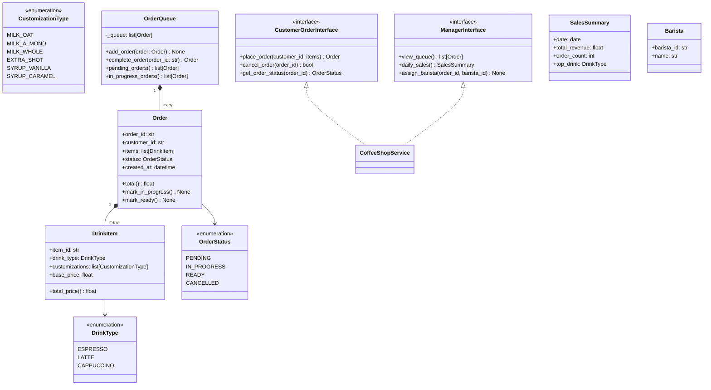

# Solutions — Phase 7 · Week 07 · Day 2

## Exercise 1 — Coffee Shop Ordering System

### Noun/Verb Extraction

**Raw nouns:** customer, drink, espresso, latte, cappuccino, customization, milk type, extra shot, syrup flavor, order, barista, queue, manager, sales.

**Filtered:**

| Entity (class) | Justification |
|----------------|---------------|
| `Order` | has state (pending/in-progress/ready) AND behavior (add item, mark complete) |
| `DrinkItem` | has state (type, customizations, price) |
| `Customization` | value object — immutable modifier attached to a DrinkItem |
| `OrderQueue` | has state (ordered list) AND behavior (enqueue, dequeue, query) |
| `Barista` | actor with identity; needed to track who completed which order |
| `Customer` | actor; needed to deliver notification |
| `DailySales` | aggregate; tracks total revenue and item counts |

**Dropped (attributes, not classes):** milk type, extra shot, syrup flavor → all are `Customization` subtypes or values on `DrinkItem`.

**Raw verbs → responsibilities:**

| Verb | Assigned to |
|------|-------------|
| place order | `OrderQueue.add_order` |
| mark order complete | `OrderQueue.complete_order` |
| view pending orders | `OrderQueue.pending_orders` |
| notify customer | `NotificationService.notify` (observer call) |
| view daily sales | `SalesTracker.daily_summary` |

### Mermaid Class Diagram



### Two Segregated Interfaces

```python
"""
coffee_shop.py — LLD: Coffee Shop Ordering System
Python 3.12+ | pydantic v2 | logging
"""
from __future__ import annotations

import logging
import uuid
from abc import ABC, abstractmethod
from collections import defaultdict
from datetime import date, datetime
from enum import Enum, auto
from typing import Optional

from pydantic import BaseModel, Field

logging.basicConfig(level=logging.INFO, format="%(levelname)s %(name)s: %(message)s")
log = logging.getLogger(__name__)


# ---------------------------------------------------------------------------
# Enums
# ---------------------------------------------------------------------------

class DrinkType(Enum):
    ESPRESSO = auto()
    LATTE = auto()
    CAPPUCCINO = auto()


class CustomizationType(Enum):
    MILK_OAT = auto()
    MILK_ALMOND = auto()
    MILK_WHOLE = auto()
    EXTRA_SHOT = auto()
    SYRUP_VANILLA = auto()
    SYRUP_CARAMEL = auto()


class OrderStatus(Enum):
    PENDING = auto()
    IN_PROGRESS = auto()
    READY = auto()
    CANCELLED = auto()


# ---------------------------------------------------------------------------
# Value objects
# ---------------------------------------------------------------------------

CUSTOMIZATION_PRICES: dict[CustomizationType, float] = {
    CustomizationType.MILK_OAT: 0.50,
    CustomizationType.MILK_ALMOND: 0.50,
    CustomizationType.MILK_WHOLE: 0.00,
    CustomizationType.EXTRA_SHOT: 0.75,
    CustomizationType.SYRUP_VANILLA: 0.50,
    CustomizationType.SYRUP_CARAMEL: 0.50,
}

BASE_PRICES: dict[DrinkType, float] = {
    DrinkType.ESPRESSO: 2.50,
    DrinkType.LATTE: 4.00,
    DrinkType.CAPPUCCINO: 3.75,
}


class DrinkItem(BaseModel):
    item_id: str = Field(default_factory=lambda: str(uuid.uuid4())[:8])
    drink_type: DrinkType
    customizations: list[CustomizationType] = Field(default_factory=list)

    model_config = {"frozen": True}

    def base_price(self) -> float:
        return BASE_PRICES[self.drink_type]

    def total_price(self) -> float:
        extras = sum(CUSTOMIZATION_PRICES[c] for c in self.customizations)
        return round(self.base_price() + extras, 2)


class SalesSummary(BaseModel):
    report_date: date
    total_revenue: float
    order_count: int
    item_counts: dict[str, int]


# ---------------------------------------------------------------------------
# Order
# ---------------------------------------------------------------------------

class Order(BaseModel):
    order_id: str = Field(default_factory=lambda: str(uuid.uuid4())[:10])
    customer_id: str
    items: list[DrinkItem]
    status: OrderStatus = OrderStatus.PENDING
    created_at: datetime = Field(default_factory=datetime.now)
    assigned_barista_id: Optional[str] = None

    def total(self) -> float:
        return round(sum(i.total_price() for i in self.items), 2)

    def mark_in_progress(self, barista_id: str) -> None:
        if self.status != OrderStatus.PENDING:
            raise ValueError(f"Cannot start order in state {self.status.name}")
        self.status = OrderStatus.IN_PROGRESS
        self.assigned_barista_id = barista_id
        log.info("Order %s in progress (barista %s)", self.order_id, barista_id)

    def mark_ready(self) -> None:
        if self.status != OrderStatus.IN_PROGRESS:
            raise ValueError(f"Cannot complete order in state {self.status.name}")
        self.status = OrderStatus.READY
        log.info("Order %s ready for pickup", self.order_id)

    def cancel(self) -> bool:
        if self.status in (OrderStatus.READY, OrderStatus.IN_PROGRESS):
            return False
        self.status = OrderStatus.CANCELLED
        return True


# ---------------------------------------------------------------------------
# OrderQueue
# ---------------------------------------------------------------------------

class OrderQueue:
    """
    Thread-unsafe queue for a single-location coffee shop.
    In production: replace backing store with a database-backed queue.
    """

    def __init__(self) -> None:
        self._orders: dict[str, Order] = {}   # order_id -> Order

    def add_order(self, order: Order) -> None:
        self._orders[order.order_id] = order
        log.info(
            "Order %s queued (customer %s, total $%.2f)",
            order.order_id, order.customer_id, order.total(),
        )

    def complete_order(self, order_id: str) -> Optional[Order]:
        order = self._orders.get(order_id)
        if order is None:
            log.error("Unknown order: %s", order_id)
            return None
        order.mark_ready()
        return order

    def pending_orders(self) -> list[Order]:
        return [o for o in self._orders.values() if o.status == OrderStatus.PENDING]

    def in_progress_orders(self) -> list[Order]:
        return [o for o in self._orders.values() if o.status == OrderStatus.IN_PROGRESS]

    def get_order(self, order_id: str) -> Optional[Order]:
        return self._orders.get(order_id)

    def all_orders(self) -> list[Order]:
        return list(self._orders.values())


# ---------------------------------------------------------------------------
# Segregated interfaces
# ---------------------------------------------------------------------------

class CustomerOrderInterface(ABC):
    """Interface exposed to customer terminals / self-service kiosks."""

    @abstractmethod
    def place_order(self, customer_id: str, items: list[DrinkItem]) -> Order: ...

    @abstractmethod
    def cancel_order(self, order_id: str) -> bool: ...

    @abstractmethod
    def get_order_status(self, order_id: str) -> Optional[OrderStatus]: ...


class ManagerInterface(ABC):
    """Interface exposed to the manager dashboard."""

    @abstractmethod
    def view_queue(self) -> list[Order]: ...

    @abstractmethod
    def daily_sales(self) -> SalesSummary: ...

    @abstractmethod
    def assign_barista(self, order_id: str, barista_id: str) -> bool: ...


# ---------------------------------------------------------------------------
# CoffeeShopService — implements both interfaces
# ---------------------------------------------------------------------------

class CoffeeShopService(CustomerOrderInterface, ManagerInterface):
    def __init__(self) -> None:
        self._queue = OrderQueue()

    # ------------------------------------------------------------------
    # CustomerOrderInterface
    # ------------------------------------------------------------------

    def place_order(self, customer_id: str, items: list[DrinkItem]) -> Order:
        if not items:
            raise ValueError("Order must contain at least one item")
        order = Order(customer_id=customer_id, items=items)
        self._queue.add_order(order)
        return order

    def cancel_order(self, order_id: str) -> bool:
        order = self._queue.get_order(order_id)
        if order is None:
            return False
        success = order.cancel()
        if not success:
            log.warning("Cannot cancel order %s in state %s", order_id, order.status.name)
        return success

    def get_order_status(self, order_id: str) -> Optional[OrderStatus]:
        order = self._queue.get_order(order_id)
        return order.status if order else None

    # ------------------------------------------------------------------
    # ManagerInterface
    # ------------------------------------------------------------------

    def view_queue(self) -> list[Order]:
        return self._queue.pending_orders() + self._queue.in_progress_orders()

    def daily_sales(self) -> SalesSummary:
        today = date.today()
        completed = [
            o for o in self._queue.all_orders()
            if o.status == OrderStatus.READY
            and o.created_at.date() == today
        ]
        item_counts: dict[str, int] = defaultdict(int)
        for order in completed:
            for item in order.items:
                item_counts[item.drink_type.name] += 1
        return SalesSummary(
            report_date=today,
            total_revenue=round(sum(o.total() for o in completed), 2),
            order_count=len(completed),
            item_counts=dict(item_counts),
        )

    def assign_barista(self, order_id: str, barista_id: str) -> bool:
        order = self._queue.get_order(order_id)
        if order is None:
            return False
        try:
            order.mark_in_progress(barista_id)
            return True
        except ValueError as exc:
            log.error("assign_barista failed: %s", exc)
            return False
```

---

## Exercise 2 — Hotel Booking System

### Noun/Verb Extraction

**Raw nouns:** hotel, room, single/double/suite, guest, booking, date range, cancellation, penalty, front desk staff, occupancy, floor.

**Filtered:**

| Entity | Type |
|--------|------|
| `Hotel` | Class — central domain object |
| `Room` | Class — state (type, occupied/available) |
| `RoomType` | Enum — not a class, but typed attribute |
| `Guest` | Class — identity + contact info |
| `Booking` | Class — join entity (Room x Guest x DateRange); has its own lifecycle |
| `DateRange` | Value object — check_in / check_out pair with overlap logic |
| `CancellationPolicy` | Interface — pluggable fine calculation strategy |

**Dropped:** "date range" → folded into `Booking` attributes; "penalty" → output of `CancellationPolicy.calculate`.

**Entity relationships:**

```
Hotel       1 ----< Room
Hotel       1 ----< Booking
Guest       1 ----< Booking
Room        1 ----< Booking       (multiple over time, at most 1 active overlapping)
Booking     1 ---- 1 Room
Booking     1 ---- 1 Guest
```

### ABC Interfaces for Booking and Payment

```python
"""
hotel_booking.py — LLD: Hotel Booking System
Python 3.12+ | pydantic v2 | logging
"""
from __future__ import annotations

import logging
import uuid
from abc import ABC, abstractmethod
from datetime import date, datetime, timedelta
from enum import Enum, auto
from typing import Optional

from pydantic import BaseModel, Field, model_validator

logging.basicConfig(level=logging.INFO, format="%(levelname)s %(name)s: %(message)s")
log = logging.getLogger(__name__)


# ---------------------------------------------------------------------------
# Enums
# ---------------------------------------------------------------------------

class RoomType(Enum):
    SINGLE = auto()
    DOUBLE = auto()
    SUITE = auto()


class BookingStatus(Enum):
    CONFIRMED = auto()
    CHECKED_IN = auto()
    CHECKED_OUT = auto()
    CANCELLED = auto()


# ---------------------------------------------------------------------------
# Value objects
# ---------------------------------------------------------------------------

NIGHTLY_RATES: dict[RoomType, float] = {
    RoomType.SINGLE: 80.0,
    RoomType.DOUBLE: 120.0,
    RoomType.SUITE: 250.0,
}


class Guest(BaseModel):
    guest_id: str = Field(default_factory=lambda: str(uuid.uuid4())[:8])
    name: str
    email: str


class Room(BaseModel):
    room_number: str
    room_type: RoomType
    floor: int

    def nightly_rate(self) -> float:
        return NIGHTLY_RATES[self.room_type]


class CancellationResult(BaseModel):
    success: bool
    penalty_amount: float = 0.0
    message: str = ""


# ---------------------------------------------------------------------------
# ABC: CancellationPolicy (Strategy pattern)
# ---------------------------------------------------------------------------

class CancellationPolicy(ABC):
    """
    Strategy for computing a cancellation penalty.
    Injected into Hotel so policy can change without altering core logic.
    """

    @abstractmethod
    def calculate_penalty(self, booking: Booking, cancel_time: datetime) -> float:
        """Return penalty amount in dollars. 0.0 means free cancellation."""
        ...


class FreeCancellationWithin24h(CancellationPolicy):
    """
    Free cancellation if cancelled within 24 hours of booking creation.
    After that: 1-night penalty.
    """

    def calculate_penalty(self, booking: Booking, cancel_time: datetime) -> float:
        hours_since_booking = (cancel_time - booking.created_at).total_seconds() / 3600
        if hours_since_booking <= 24:
            return 0.0
        return NIGHTLY_RATES[booking.room_type]


class NoRefundPolicy(CancellationPolicy):
    """Full first-night charge on any cancellation."""

    def calculate_penalty(self, booking: Booking, cancel_time: datetime) -> float:
        return NIGHTLY_RATES[booking.room_type]


# ---------------------------------------------------------------------------
# ABC: PaymentGateway (DIP — Hotel depends on abstraction)
# ---------------------------------------------------------------------------

class PaymentGateway(ABC):
    """
    Abstraction over payment processing.
    Concrete implementations: StripeGateway, PayPalGateway, MockGateway.
    Hotel depends only on this interface — never on a concrete class.
    """

    @abstractmethod
    def charge(self, guest_id: str, amount: float, description: str) -> str:
        """Charge the guest. Returns a transaction ID."""
        ...

    @abstractmethod
    def refund(self, transaction_id: str, amount: float) -> bool:
        """Refund a prior transaction. Returns success flag."""
        ...


class MockPaymentGateway(PaymentGateway):
    """In-memory mock for tests and demos."""

    def __init__(self) -> None:
        self._transactions: dict[str, float] = {}

    def charge(self, guest_id: str, amount: float, description: str) -> str:
        txn_id = str(uuid.uuid4())[:10]
        self._transactions[txn_id] = amount
        log.info("MOCK charge $%.2f for guest %s: %s -> txn %s", amount, guest_id, description, txn_id)
        return txn_id

    def refund(self, transaction_id: str, amount: float) -> bool:
        if transaction_id in self._transactions:
            log.info("MOCK refund $%.2f for txn %s", amount, transaction_id)
            return True
        return False


# ---------------------------------------------------------------------------
# Booking domain object
# ---------------------------------------------------------------------------

class Booking(BaseModel):
    booking_id: str = Field(default_factory=lambda: str(uuid.uuid4())[:10])
    guest_id: str
    room_number: str
    room_type: RoomType
    check_in: date
    check_out: date
    status: BookingStatus = BookingStatus.CONFIRMED
    created_at: datetime = Field(default_factory=datetime.now)
    transaction_id: Optional[str] = None

    @model_validator(mode="after")
    def validate_dates(self) -> Booking:
        if self.check_out <= self.check_in:
            raise ValueError("check_out must be after check_in")
        return self

    def nights(self) -> int:
        return (self.check_out - self.check_in).days

    def overlaps(self, check_in: date, check_out: date) -> bool:
        """True if this booking overlaps with the given date range."""
        return self.check_in < check_out and check_in < self.check_out

    def total_cost(self) -> float:
        return round(self.nights() * NIGHTLY_RATES[self.room_type], 2)


# ---------------------------------------------------------------------------
# Hotel — implements BookingService + FrontDeskService
# ---------------------------------------------------------------------------

class BookingServiceABC(ABC):
    @abstractmethod
    def book(
        self,
        guest: Guest,
        room_type: RoomType,
        check_in: date,
        check_out: date,
    ) -> Optional[Booking]: ...

    @abstractmethod
    def cancel(self, booking_id: str) -> CancellationResult: ...

    @abstractmethod
    def find_available_rooms(
        self, room_type: RoomType, check_in: date, check_out: date
    ) -> list[Room]: ...


class FrontDeskServiceABC(ABC):
    @abstractmethod
    def check_in(self, booking_id: str) -> bool: ...

    @abstractmethod
    def check_out(self, booking_id: str) -> bool: ...

    @abstractmethod
    def occupancy_by_floor(self, floor: int) -> dict[str, int]: ...


class Hotel(BookingServiceABC, FrontDeskServiceABC):
    def __init__(
        self,
        name: str,
        cancellation_policy: CancellationPolicy | None = None,
        payment_gateway: PaymentGateway | None = None,
    ) -> None:
        self.name = name
        self._policy = cancellation_policy or FreeCancellationWithin24h()
        self._payment = payment_gateway or MockPaymentGateway()
        self._rooms: dict[str, Room] = {}             # room_number -> Room
        self._guests: dict[str, Guest] = {}           # guest_id -> Guest
        self._bookings: dict[str, Booking] = {}       # booking_id -> Booking

    # ------------------------------------------------------------------
    # Setup helpers
    # ------------------------------------------------------------------

    def add_room(self, room: Room) -> None:
        self._rooms[room.room_number] = room
        log.info("Room %s (%s, floor %d) added", room.room_number, room.room_type.name, room.floor)

    def register_guest(self, guest: Guest) -> None:
        self._guests[guest.guest_id] = guest

    # ------------------------------------------------------------------
    # BookingServiceABC
    # ------------------------------------------------------------------

    def book(
        self,
        guest: Guest,
        room_type: RoomType,
        check_in: date,
        check_out: date,
    ) -> Optional[Booking]:
        """
        Book a room for a guest. Returns None if no room of the given type
        is available for the date range (overlap detection).
        """
        available = self.find_available_rooms(room_type, check_in, check_out)
        if not available:
            log.warning(
                "No %s rooms available %s to %s", room_type.name, check_in, check_out
            )
            return None

        room = available[0]
        self._guests[guest.guest_id] = guest

        txn_id = self._payment.charge(
            guest.guest_id,
            (check_out - check_in).days * NIGHTLY_RATES[room_type],
            f"Booking {room.room_number} {check_in} to {check_out}",
        )

        booking = Booking(
            guest_id=guest.guest_id,
            room_number=room.room_number,
            room_type=room_type,
            check_in=check_in,
            check_out=check_out,
            transaction_id=txn_id,
        )
        self._bookings[booking.booking_id] = booking
        log.info(
            "Booking %s: guest %s -> room %s (%s to %s)",
            booking.booking_id, guest.name, room.room_number, check_in, check_out,
        )
        return booking

    def cancel(self, booking_id: str) -> CancellationResult:
        booking = self._bookings.get(booking_id)
        if booking is None:
            return CancellationResult(success=False, message="Booking not found")
        if booking.status != BookingStatus.CONFIRMED:
            return CancellationResult(
                success=False,
                message=f"Cannot cancel booking in state {booking.status.name}",
            )

        penalty = self._policy.calculate_penalty(booking, datetime.now())
        booking.status = BookingStatus.CANCELLED

        if booking.transaction_id and penalty < booking.total_cost():
            refund_amount = booking.total_cost() - penalty
            self._payment.refund(booking.transaction_id, refund_amount)

        log.info("Booking %s cancelled. Penalty: $%.2f", booking_id, penalty)
        return CancellationResult(
            success=True, penalty_amount=penalty, message="Booking cancelled"
        )

    def find_available_rooms(
        self, room_type: RoomType, check_in: date, check_out: date
    ) -> list[Room]:
        """Return rooms of the requested type with no overlapping active booking."""
        booked_numbers = {
            b.room_number
            for b in self._bookings.values()
            if b.room_type == room_type
            and b.status == BookingStatus.CONFIRMED
            and b.overlaps(check_in, check_out)
        }
        return [
            r for r in self._rooms.values()
            if r.room_type == room_type and r.room_number not in booked_numbers
        ]

    # ------------------------------------------------------------------
    # FrontDeskServiceABC
    # ------------------------------------------------------------------

    def check_in(self, booking_id: str) -> bool:
        booking = self._bookings.get(booking_id)
        if booking is None or booking.status != BookingStatus.CONFIRMED:
            log.error("Cannot check in booking %s", booking_id)
            return False
        booking.status = BookingStatus.CHECKED_IN
        log.info("Guest checked in: booking %s, room %s", booking_id, booking.room_number)
        return True

    def check_out(self, booking_id: str) -> bool:
        booking = self._bookings.get(booking_id)
        if booking is None or booking.status != BookingStatus.CHECKED_IN:
            log.error("Cannot check out booking %s", booking_id)
            return False
        booking.status = BookingStatus.CHECKED_OUT
        log.info("Guest checked out: booking %s", booking_id)
        return True

    def occupancy_by_floor(self, floor: int) -> dict[str, int]:
        floor_rooms = [r for r in self._rooms.values() if r.floor == floor]
        occupied = {
            b.room_number
            for b in self._bookings.values()
            if b.status == BookingStatus.CHECKED_IN
        }
        occupied_count = sum(1 for r in floor_rooms if r.room_number in occupied)
        return {
            "floor": floor,
            "total_rooms": len(floor_rooms),
            "occupied": occupied_count,
            "available": len(floor_rooms) - occupied_count,
        }
```

---

## Exercise 3 — Interface Segregation: Refactoring the DocumentService God Interface

### Identifying the ISP Violation

The original `DocumentService` interface forces every implementor to provide 7 methods. This violates ISP because different callers only need disjoint subsets:

| Caller type | Methods they actually need |
|-------------|---------------------------|
| **Reader** (e.g., read-only viewer app) | `read`, `search` |
| **Editor** (e.g., document editor UI) | `read`, `write`, `delete`, `get_edit_history` |
| **Publisher** (e.g., print/export service) | `read`, `export_pdf` |
| **Collaborator** (e.g., sharing/permissions service) | `read`, `share` |

A `ReadOnlyDocumentStore` only needs `read` and `search` — it must stub `write`, `delete`, `export_pdf`, `share`, and `get_edit_history` as `raise NotImplementedError`, which is the classic ISP violation symptom.

### Refactored Interfaces

```python
"""
document_service_refactored.py — ISP exercise solution
Python 3.12+ | logging
"""
from __future__ import annotations

import logging
from abc import ABC, abstractmethod

log = logging.getLogger(__name__)


# ---------------------------------------------------------------------------
# Segregated interfaces — each named for the caller who needs it
# ---------------------------------------------------------------------------

class DocumentReader(ABC):
    """
    For any component that needs read-only access to document content.
    Callers: viewer apps, search indexers, export services.
    """

    @abstractmethod
    def read(self, doc_id: str) -> str: ...


class DocumentSearcher(ABC):
    """
    For any component that queries documents by content.
    Callers: search UIs, admin dashboards.
    Separate from Reader because a full-text search index may implement
    search without storing full document bodies (it stores an inverted index).
    """

    @abstractmethod
    def search(self, query: str) -> list[str]: ...


class DocumentWriter(ABC):
    """
    For components that mutate document content.
    Callers: editors, content management systems.
    """

    @abstractmethod
    def write(self, doc_id: str, content: str) -> None: ...

    @abstractmethod
    def delete(self, doc_id: str) -> None: ...


class DocumentExporter(ABC):
    """
    For components that need document rendering/export.
    Callers: print services, PDF generators.
    Separate because a pure in-memory document store may not implement PDF
    rendering — that often lives in a separate rendering service.
    """

    @abstractmethod
    def export_pdf(self, doc_id: str) -> bytes: ...


class DocumentCollaborator(ABC):
    """
    For components that manage sharing and permissions.
    Callers: sharing dialogs, notification services.
    Separate because permission management is a distinct bounded context;
    a pure storage backend has no concept of users.
    """

    @abstractmethod
    def share(self, doc_id: str, user_id: str) -> None: ...


class DocumentAuditor(ABC):
    """
    For compliance and audit tooling.
    Callers: audit dashboards, compliance exporters.
    Separate because audit history is append-only and write-heavy
    — a different access pattern from the main document store.
    """

    @abstractmethod
    def get_edit_history(self, doc_id: str) -> list[dict]: ...


# ---------------------------------------------------------------------------
# Concrete implementations — each only implements what it supports
# ---------------------------------------------------------------------------

class InMemoryDocumentStore(DocumentReader, DocumentWriter, DocumentSearcher):
    """
    A simple in-memory store.
    Supports reading, writing, and searching.
    Does NOT export PDF (different service), does NOT share (different context),
    does NOT audit (separate audit log).
    """

    def __init__(self) -> None:
        self._docs: dict[str, str] = {}

    def read(self, doc_id: str) -> str:
        content = self._docs.get(doc_id, "")
        log.info("Read doc %s (%d chars)", doc_id, len(content))
        return content

    def write(self, doc_id: str, content: str) -> None:
        self._docs[doc_id] = content
        log.info("Wrote doc %s (%d chars)", doc_id, len(content))

    def delete(self, doc_id: str) -> None:
        self._docs.pop(doc_id, None)
        log.info("Deleted doc %s", doc_id)

    def search(self, query: str) -> list[str]:
        q = query.lower()
        return [
            doc_id
            for doc_id, content in self._docs.items()
            if q in content.lower()
        ]


class AuditTrail(DocumentAuditor):
    """
    Append-only audit log — implements only the audit interface.
    Could be backed by an event store, Kafka, or a write-only database.
    """

    def __init__(self) -> None:
        self._history: dict[str, list[dict]] = {}

    def record_edit(self, doc_id: str, editor: str, change_summary: str) -> None:
        self._history.setdefault(doc_id, []).append({
            "editor": editor,
            "summary": change_summary,
        })

    def get_edit_history(self, doc_id: str) -> list[dict]:
        return list(self._history.get(doc_id, []))


class PDFRenderingService(DocumentExporter):
    """
    Delegates PDF generation to an external renderer.
    Only implements DocumentExporter — reads documents via DocumentReader
    injected at construction (DIP).
    """

    def __init__(self, reader: DocumentReader) -> None:
        self._reader = reader

    def export_pdf(self, doc_id: str) -> bytes:
        content = self._reader.read(doc_id)
        # In production: call a PDF library (reportlab, weasyprint, etc.)
        log.info("Exporting doc %s to PDF (%d chars)", doc_id, len(content))
        return content.encode("utf-8")  # simplified placeholder


class SharingService(DocumentCollaborator):
    """
    Manages document access control.
    Only implements DocumentCollaborator.
    """

    def __init__(self) -> None:
        self._shares: dict[str, set[str]] = {}

    def share(self, doc_id: str, user_id: str) -> None:
        self._shares.setdefault(doc_id, set()).add(user_id)
        log.info("Doc %s shared with user %s", doc_id, user_id)

    def has_access(self, doc_id: str, user_id: str) -> bool:
        return user_id in self._shares.get(doc_id, set())


# ---------------------------------------------------------------------------
# Why this split is correct — justification by caller
# ---------------------------------------------------------------------------

# DocumentReader    <- viewer app, PDF exporter, search service
# DocumentWriter    <- editor UI, admin bulk-delete
# DocumentSearcher  <- search UI, indexer
# DocumentExporter  <- print service, email attachment service
# DocumentCollaborator <- sharing dialog, permissions audit
# DocumentAuditor   <- compliance dashboard, GDPR export

# A "read-only viewer" only depends on DocumentReader + DocumentSearcher.
# Adding a new method to DocumentWriter does NOT require recompiling the viewer.
# This is the core ISP guarantee: callers are insulated from changes to
# methods they never use.
```

### Key Justifications

**Why split `search` from `read`?**
A full-text search index (e.g., Elasticsearch) stores an inverted index, not full document bodies. It implements `DocumentSearcher` but not `DocumentReader`. Merging them would force it to stub `read`.

**Why split `export_pdf` from `write`?**
PDF export is a rendering concern — often a separate microservice. It needs to *read* but never *writes*. Merging export with write means the PDF service must depend on (and potentially trigger) write operations it will never use.

**Why split `get_edit_history` from `write`?**
Audit logs are typically append-only event stores with different SLAs (high write throughput, eventual read consistency). The audit interface is consumed by compliance tools, not by the editor UI.

**The original violation in one sentence:**
Every implementor of `DocumentService` is forced to depend on methods for 4 distinct concerns (read/write, search, export, share, audit), meaning a change in any one concern recompiles all implementors — exactly what ISP was designed to prevent.
