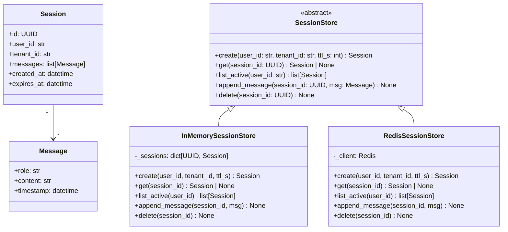

# Solutions — Week 12 Assessment

## Section 1 — Coding: Priority Queue (model answer)

```python
# phase-7-system-design/week-12/solutions/priority_queue.py
import heapq
import threading
import logging
from typing import TypeVar, Generic

logger = logging.getLogger(__name__)

T = TypeVar("T")


class QueueEmptyError(Exception):
    """Raised on pop() from an empty PriorityQueue."""


class PriorityQueue(Generic[T]):
    """
    Thread-safe priority queue.
    Highest priority (largest int) dequeued first.
    Ties broken by insertion order (FIFO).
    push/pop: O(log n).
    """

    def __init__(self) -> None:
        # heap entries: (-priority, seq, item)
        self._heap: list[tuple[int, int, T]] = []
        self._seq = 0
        self._lock = threading.Lock()

    def push(self, item: T, priority: int) -> None:
        with self._lock:
            heapq.heappush(self._heap, (-priority, self._seq, item))
            self._seq += 1
            logger.debug("pushed priority=%d seq=%d", priority, self._seq - 1)

    def pop(self) -> T:
        with self._lock:
            if not self._heap:
                raise QueueEmptyError("pop from empty priority queue")
            _, _, item = heapq.heappop(self._heap)
            return item

    def peek(self) -> T | None:
        with self._lock:
            if not self._heap:
                return None
            return self._heap[0][2]

    def __len__(self) -> int:
        with self._lock:
            return len(self._heap)
```

**Tests**

```python
# tests/test_priority_queue.py
import threading
import pytest
from solutions.priority_queue import PriorityQueue, QueueEmptyError


def test_empty_pop_raises():
    q: PriorityQueue[str] = PriorityQueue()
    with pytest.raises(QueueEmptyError):
        q.pop()


def test_priority_ordering():
    q: PriorityQueue[str] = PriorityQueue()
    q.push("low", priority=1)
    q.push("high", priority=10)
    q.push("mid", priority=5)
    assert q.pop() == "high"
    assert q.pop() == "mid"
    assert q.pop() == "low"


def test_fifo_tie_breaking():
    q: PriorityQueue[str] = PriorityQueue()
    q.push("first", priority=5)
    q.push("second", priority=5)
    q.push("third", priority=5)
    assert q.pop() == "first"
    assert q.pop() == "second"
    assert q.pop() == "third"


def test_thread_safety():
    q: PriorityQueue[int] = PriorityQueue()
    results: list[int] = []
    lock = threading.Lock()

    def producer(start: int):
        for i in range(start, start + 50):
            q.push(i, priority=i)

    def consumer():
        for _ in range(50):
            item = q.pop()
            with lock:
                results.append(item)

    t1 = threading.Thread(target=producer, args=(0,))
    t2 = threading.Thread(target=producer, args=(50,))
    t1.start(); t2.start()
    t1.join(); t2.join()

    t3 = threading.Thread(target=consumer)
    t4 = threading.Thread(target=consumer)
    t3.start(); t4.start()
    t3.join(); t4.join()

    assert sorted(results) == list(range(100))
    assert results == sorted(results, reverse=True)  # highest priority first
```

---

## Section 2 — LLD: Session Manager (model answer)



```python
import uuid
from datetime import datetime, timezone, timedelta
from pydantic import BaseModel, Field


class Message(BaseModel):
    role: str
    content: str
    timestamp: datetime = Field(default_factory=lambda: datetime.now(timezone.utc))


class Session(BaseModel):
    id: uuid.UUID = Field(default_factory=uuid.uuid4)
    user_id: str
    tenant_id: str
    messages: list[Message] = Field(default_factory=list)
    created_at: datetime = Field(default_factory=lambda: datetime.now(timezone.utc))
    expires_at: datetime
```

---

## Section 3 — HLD: AI Code Review Assistant (model answer)

**Requirements**

| Functional | Non-functional |
|---|---|
| Webhook on PR creation | 500 PRs/day peak |
| Analyse changed files | Review completion p95 < 5 min |
| Post inline PR comments | GitHub API rate: 5,000 req/hr/app |
| Multi-language support | Graceful degradation if LLM unavailable |

**Architecture**

```
GitHub Webhook ──POST──► Webhook Service (FastAPI)
                              │ enqueue job
                              ▼
                          Job Queue (Redis/Celery)
                              │ worker picks up
                              ▼
                          Review Worker
                            ├── Fetch PR diff (GitHub API)
                            ├── Language detect + chunk diff
                            ├── LLM call (claude-sonnet-5-5 or self-hosted)
                            ├── Parse LLM output → [InlineComment]
                            └── Post comments (GitHub API)
                              │
                          Postgres (review_jobs, comments, status)
```

**Webhook handler API**

```
POST /webhooks/github
  Headers: X-Hub-Signature-256 (HMAC validation)
  Body: GitHub PullRequestEvent
  Response: 202 Accepted
```

**ReviewJob data model**

```python
class ReviewJobStatus(str, Enum):
    PENDING = "pending"; RUNNING = "running"; DONE = "done"; FAILED = "failed"

class ReviewJob(BaseModel):
    id: uuid.UUID = Field(default_factory=uuid.uuid4)
    repo: str; pr_number: int; commit_sha: str
    status: ReviewJobStatus = ReviewJobStatus.PENDING
    created_at: datetime = Field(default_factory=lambda: datetime.now(timezone.utc))
    completed_at: datetime | None = None
    error: str | None = None
```

**Capacity estimate**

- 500 PRs/day = 0.006 PRs/s avg; peak 50 PRs/hour = 0.014 PRs/s
- Avg diff: 200 lines × 50 tokens = 10K tokens; LLM at 50 tokens/s = 200 s per review → need parallelism
- 10 workers at 5 concurrent reviews each = 50 concurrent reviews → 50 × 1/200s = 0.25 reviews/s throughput — sufficient for peak
- GitHub API: 50 comments per review × 500 PRs/day = 25,000 API calls/day < 5,000/hr limit ✓

**Failure modes**

1. GitHub API rate limit: exponential backoff with jitter + per-repo rate tracking
2. LLM timeout: 120s job timeout → mark failed, post "review unavailable" comment, alert on-call

---

## Section 4 — Architecture Critique (model answers)

**Flaw 1 — No circuit breaker on embedding service (Correctness + Operational)**
Cascading failure when embedding service is slow. Fix: circuit breaker with fallback to keyword (BM25) search.

**Flaw 2 — Re-embedding at query time (Scale)**
Document embeddings are precomputed. Only query needs embedding at runtime. Fix: ingest pipeline pre-embeds; query path embeds only the user query (~50ms).

**Flaw 3 — top-50 + no reranking + all chunks to LLM (Scale + Cost)**
25K tokens × $3/M = $0.075/query × 500 QPS × 86,400 = $3,240/day. Fix: reranker → top-5; cost drops to $324/day.

**Flaw 4 — No semantic cache (Scale)**
Repeat queries (common in enterprise) hit full pipeline. Fix: semantic cache, 20% expected hit rate.

**Flaw 5 — Tenant isolation via SQL filter (Correctness)**
A missing WHERE clause exposes all tenants. Fix: Postgres RLS + Qdrant namespace per tenant.

**Fix first at 3am**: Flaw 1 — circuit breaker. A stuck embedding service takes down the entire query path. A circuit breaker with BM25 fallback restores service in degraded mode immediately.

**Tenant isolation — correct pattern**: Postgres RLS enforced by the DB engine (not bypassable by application code) + Qdrant namespace isolation (enforced by vector DB). SQL filter alone is a single-point-of-failure for a security property.

---

## Section 5 — Behavioral (model STAR answers — abbreviated)

### Prompt A — Reliability with data
S: RAG service had p99 spikes to 8s, unclear cause.  
T: Query service owner; 5s SLA.  
A: Added per-component Prometheus histograms; identified reranking on long docs as root cause in 24h; moved to thread pool with 500ms timeout fallback.  
R: p99 → 2.1s; timeout triggered < 0.3% of queries. Lesson: profile before optimise.

### Prompt B — Technical debt vs. feature delivery
S: 6-week feature sprint with 3 engineers; codebase had no type hints (90% of functions), making refactoring risky.  
T: I was tech lead; PM wanted features; I wanted to type the codebase.  
A: Proposed a 20% time allocation: each engineer spends 20% of sprint adding types to the files they touch. No separate sprint needed. Wrote a mypy CI gate that failed on new untyped files only (not existing ones).  
R: By end of sprint, 40% of codebase typed; 3 latent bugs caught by mypy before they reached production. Feature delivery was 1 day behind schedule (acceptable). Team adopted the 20% rule permanently.

---

## Section 6 — Capstone Design Doc Checklist (pass/fail notes)

A score of 20+/27 (≥74%) on the capstone checklist, combined with a weighted score ≥75 across all sections, is a passing grade.

**Common shortfalls seen in weaker capstone docs**:

- Capacity math is missing or uses round numbers without working ("the system will handle 800 QPS" vs. "800 QPS × 700 tokens avg × $3/M = X/day")
- Trade-offs say "we chose X" without naming the alternative and the reason
- Security section mentions auth but not prompt injection or tenant isolation
- Cost model has per-component costs but no monthly total
- Roadmap has phases named but no deliverables or success criteria
