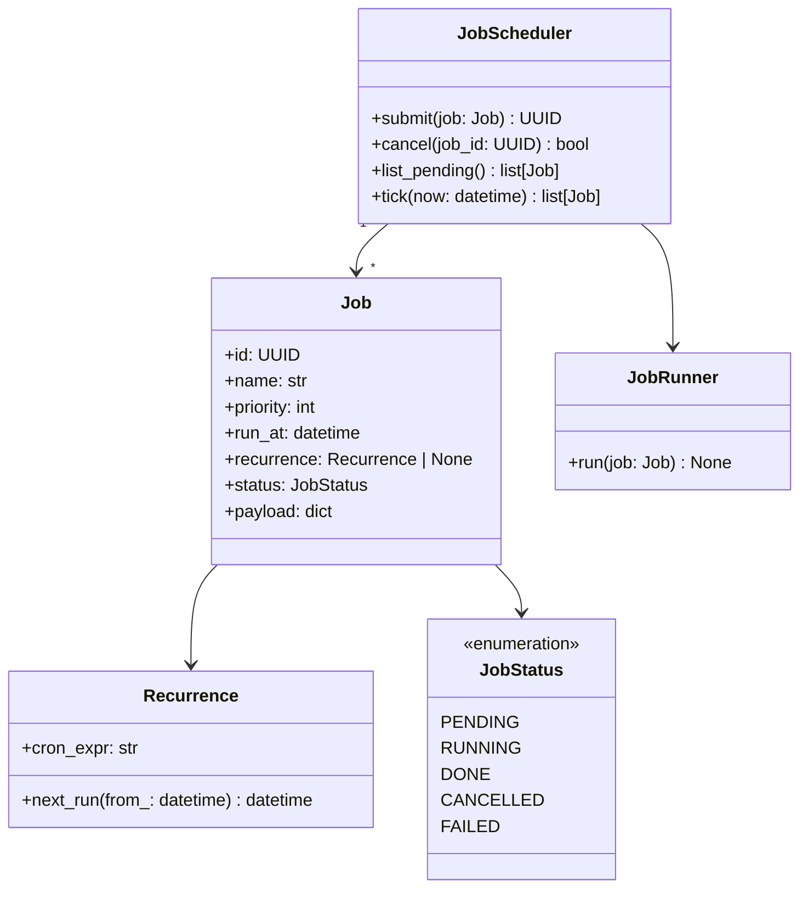

# Solutions — Week 12 · Day 1: Coding + LLD Mock Loop

## Exercise 1 — LRU Cache

```python
# phase-7-system-design/week-12/solutions/lru_cache.py
import logging
from collections import OrderedDict
from typing import TypeVar, Generic

logger = logging.getLogger(__name__)

K = TypeVar("K")
V = TypeVar("V")


class LRUCache(Generic[K, V]):
    """O(1) get and put via OrderedDict (doubly-linked hashmap)."""

    def __init__(self, capacity: int) -> None:
        if capacity <= 0:
            raise ValueError(f"capacity must be > 0, got {capacity}")
        self._cap = capacity
        self._data: OrderedDict[K, V] = OrderedDict()

    def get(self, key: K) -> V | None:
        if key not in self._data:
            return None
        self._data.move_to_end(key)   # mark as most recently used
        return self._data[key]

    def put(self, key: K, value: V) -> None:
        if key in self._data:
            self._data.move_to_end(key)
        self._data[key] = value
        if len(self._data) > self._cap:
            evicted_key, _ = self._data.popitem(last=False)
            logger.debug("evicted key=%s", evicted_key)
```

**Test file**

```python
# tests/test_lru_cache.py
import pytest
from solutions.lru_cache import LRUCache


def test_missing_key_returns_none():
    c: LRUCache[str, int] = LRUCache(2)
    assert c.get("x") is None


def test_capacity_eviction():
    c: LRUCache[str, int] = LRUCache(2)
    c.put("a", 1)
    c.put("b", 2)
    c.put("c", 3)   # evicts "a"
    assert c.get("a") is None
    assert c.get("b") == 2
    assert c.get("c") == 3


def test_key_update_refreshes_lru():
    c: LRUCache[str, int] = LRUCache(2)
    c.put("a", 1)
    c.put("b", 2)
    c.get("a")      # access "a" — makes "b" LRU
    c.put("c", 3)   # should evict "b", not "a"
    assert c.get("a") == 1
    assert c.get("b") is None
    assert c.get("c") == 3
```

**Complexity**: `get` O(1), `put` O(1). `OrderedDict` uses a dict + doubly-linked list internally.

---

## Exercise 2 — Job Scheduler LLD

**Mermaid class diagram**



**Pydantic model**

```python
import uuid
from datetime import datetime
from enum import Enum
from pydantic import BaseModel, Field


class JobStatus(str, Enum):
    PENDING = "pending"
    RUNNING = "running"
    DONE = "done"
    CANCELLED = "cancelled"
    FAILED = "failed"


class Recurrence(BaseModel):
    cron_expr: str

    def next_run(self, from_: datetime) -> datetime:
        # use croniter library in production
        raise NotImplementedError


class Job(BaseModel):
    id: uuid.UUID = Field(default_factory=uuid.uuid4)
    name: str
    priority: int = 0
    run_at: datetime
    recurrence: Recurrence | None = None
    status: JobStatus = JobStatus.PENDING
    payload: dict = Field(default_factory=dict)
```

**Three design decisions**

1. `priority` is an int (higher = more urgent). `tick()` returns jobs sorted by `(-priority, run_at)` — avoids a separate priority queue while keeping the model simple.
2. `Recurrence` is optional and encapsulated — one-time jobs are the default; no if/else scattered through the scheduler.
3. `cancel()` sets `status=CANCELLED` rather than deleting — preserves audit trail; a separate archiver cleans up old records.

---

## Exercise 3 — Self-scoring guide

Typical point losses in the token bucket drill:
- **Communication (-20%)**: silence > 30 sec with no narration
- **Edge cases (-15%)**: not handling concurrent access, not capping tokens at capacity
- **Complexity not stated (-10%)**: forgot to mention O(1) per call

If score < 75: repeat the drill with a different problem (sliding window rate limiter, leaky bucket).

---

## Exercise 4 — Space complexity fix

**Problem**: `_buckets` dict grows unboundedly — K unique keys → O(K) space with no eviction.

**Fix**: replace `dict[str, Bucket]` with an `LRUCache[str, Bucket]` of capacity `MAX_KEYS`. When a new key arrives and capacity is full, the least recently used key's bucket is evicted. Stale keys (inactive users) are naturally evicted; active users stay hot.

```python
from solutions.lru_cache import LRUCache

class TokenBucketLimiter:
    def __init__(self, capacity: float, refill_rate: float, max_keys: int = 100_000) -> None:
        self._capacity = capacity
        self._rate = refill_rate
        self._buckets: LRUCache[str, Bucket] = LRUCache(max_keys)
        self._global_lock = threading.Lock()
```

Space complexity becomes O(min(K, max_keys)) — bounded.
