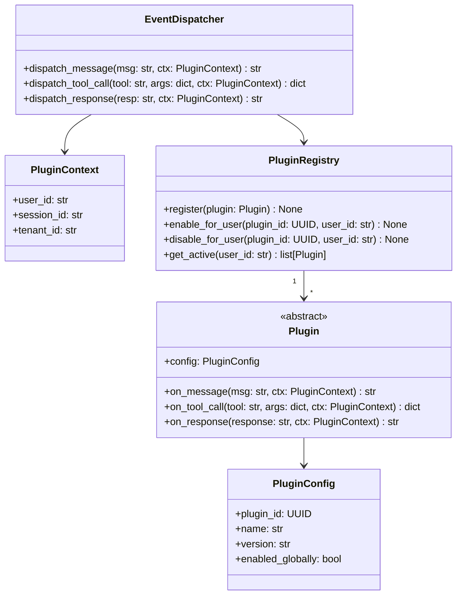

# Solutions — Week 12 · Day 7: Final Assessment, Reflection & Next Steps

## Round 1 — Coding: Bounded Channel (model answer)

```python
# phase-7-system-design/week-12/solutions/bounded_channel.py
import threading
import logging
from typing import TypeVar, Generic

logger = logging.getLogger(__name__)

T = TypeVar("T")


class ChannelClosedError(Exception):
    """Raised on send to a closed channel."""


class BoundedChannel(Generic[T]):
    """
    Thread-safe, bounded FIFO channel.
    - send() blocks if channel is full.
    - receive() blocks if channel is empty.
    - close() unblocks all waiting receivers (they return None).
    - Sending to a closed channel raises ChannelClosedError.
    """

    def __init__(self, capacity: int) -> None:
        if capacity <= 0:
            raise ValueError(f"capacity must be > 0, got {capacity}")
        self._cap = capacity
        self._queue: list[T] = []
        self._lock = threading.Lock()
        self._not_full = threading.Condition(self._lock)
        self._not_empty = threading.Condition(self._lock)
        self._closed = False

    def send(self, item: T) -> None:
        """Block until space is available, then enqueue item."""
        with self._not_full:
            if self._closed:
                raise ChannelClosedError("cannot send to a closed channel")
            while len(self._queue) >= self._cap and not self._closed:
                self._not_full.wait()
            if self._closed:
                raise ChannelClosedError("channel was closed while waiting to send")
            self._queue.append(item)
            logger.debug("sent item, queue size=%d", len(self._queue))
            self._not_empty.notify()

    def receive(self) -> T | None:
        """Block until an item is available. Returns None if channel is closed and empty."""
        with self._not_empty:
            while not self._queue and not self._closed:
                self._not_empty.wait()
            if self._queue:
                item = self._queue.pop(0)
                self._not_full.notify()
                return item
            return None  # closed and empty

    def close(self) -> None:
        """Close the channel; unblock all waiting receivers."""
        with self._not_full:
            self._closed = True
            self._not_full.notify_all()
        with self._not_empty:
            self._not_empty.notify_all()
```

**Tests**

```python
# tests/test_bounded_channel.py
import threading
import time
import pytest
from solutions.bounded_channel import BoundedChannel, ChannelClosedError


def test_basic_send_receive():
    ch: BoundedChannel[int] = BoundedChannel(2)
    ch.send(1)
    ch.send(2)
    assert ch.receive() == 1
    assert ch.receive() == 2


def test_close_unblocks_receiver():
    ch: BoundedChannel[int] = BoundedChannel(1)
    results: list[int | None] = []

    def receiver():
        results.append(ch.receive())

    t = threading.Thread(target=receiver)
    t.start()
    time.sleep(0.05)
    ch.close()
    t.join(timeout=1)
    assert results == [None]


def test_send_after_close_raises():
    ch: BoundedChannel[int] = BoundedChannel(1)
    ch.close()
    with pytest.raises(ChannelClosedError):
        ch.send(1)


def test_concurrent_senders_and_receivers():
    ch: BoundedChannel[int] = BoundedChannel(3)
    received: list[int] = []
    lock = threading.Lock()

    def sender(val: int):
        ch.send(val)

    def receiver():
        item = ch.receive()
        if item is not None:
            with lock:
                received.append(item)

    threads = [threading.Thread(target=sender, args=(i,)) for i in range(10)]
    threads += [threading.Thread(target=receiver) for _ in range(10)]
    for t in threads:
        t.start()
    for t in threads:
        t.join(timeout=3)

    assert sorted(received) == list(range(10))
```

---

## Round 2 — LLD: Plugin system (model answer)



**Pydantic model**

```python
import uuid
from pydantic import BaseModel


class PluginConfig(BaseModel):
    plugin_id: uuid.UUID = uuid.uuid4()
    name: str
    version: str
    enabled_globally: bool = True
```

**Extensibility**: Adding a new event (e.g., `on_error`) requires adding one method to `Plugin` base class. `EventDispatcher` adds one dispatch method. Zero changes to `PluginRegistry` or existing plugin implementations.

---

## Round 3 — HLD: Notification service (model answer, condensed)

**Requirements**

- Functional: send email/SMS/push per notification request; delivery guarantee; idempotent (no duplicate delivery)
- NFR: 50K notifications/s peak; delivery guarantee (at-least-once + deduplication); email p99 < 30 s; SMS p99 < 10 s; push p99 < 3 s

**Architecture**

```
API Gateway → Notification Service → Kafka (topic per channel)
                                   → Email Workers → SES/SendGrid
                                   → SMS Workers   → Twilio
                                   → Push Workers  → FCM/APNs
All workers → idempotency store (Redis, notification_id → delivered)
           → DLQ for failed deliveries (Kafka DLQ topic)
           → Postgres (notification events, status)
```

**Idempotency**: each notification has a `notification_id` (UUID, client-generated). Workers check Redis before delivery: if already delivered, skip. TTL: 7 days.

**Capacity estimate**: 50K notifications/s × avg 200 bytes = 10 MB/s Kafka throughput. 10 partitions per topic = 5K msgs/s per partition. 50K/s / 5K = 10 parallel workers per channel minimum.

---

## Round 4 — Behavioral (model STAR answers)

### Prompt A — Improving reliability with data

**S**: Our RAG service had intermittent p99 spikes to 8 s with no clear pattern in the logs.  
**T**: I owned the query service and was responsible for meeting the p99 < 5 s SLA.  
**A**: I added per-component histogram metrics (retrieval, reranking, LLM call separately) using Prometheus. Within 24h the data showed reranking was causing 95% of the spikes — specifically on documents with > 5,000 tokens. I traced this to the cross-encoder running synchronously on the main thread for long documents. I moved reranking to a background thread pool with a 500ms timeout fallback to skip reranking on timeout.  
**R**: p99 dropped from 8 s to 2.1 s. Reranking timeout triggered < 0.3% of queries (acceptable quality trade-off). I learned: profile before optimise — my initial guess (LLM latency) was wrong.

---

## Round 5 — Architecture critique (model answers)

**Flaw 1 — No circuit breaker on embedding service (Correctness + Operational)**  
If embedding service is slow or down, all queries block → cascading failure. Fix: circuit breaker (tenacity or custom) with fallback to keyword search.

**Flaw 2 — top-50 chunks with no reranking, full pass to LLM (Scale + Cost)**  
50 × 512 tokens = 25,600 tokens/query. At $3/M input: $0.077/query × 500 QPS × 86,400 s = $3,300/day. Fix: reranker → top-5; 90% cost reduction.

**Flaw 3 — Re-embedding at query time (Scale)**  
Query embedding is necessary; but the description implies documents are also re-embedded per query. Fix: document embeddings are pre-computed at ingest time and stored in Qdrant. Only the query is embedded at query time.

**Flaw 4 — No semantic cache (Scale)**  
Identical or near-identical queries (FAQ patterns) hit the full pipeline every time. Fix: semantic cache with cosine ≥ 0.97 threshold → expected 20% hit rate.

**Flaw 5 — Tenant isolation via SQL filter (Correctness)**  
`WHERE tenant_id = ?` is a bug's width away from a cross-tenant data leak. If a developer forgets the filter, all tenants' data is exposed. Fix: Qdrant namespace per tenant (enforced at DB level) + Postgres RLS (enforced at engine level).

**Fix first at 3am**: Flaw 1 (circuit breaker). A slow embedding service takes down the entire query path for all users. A circuit breaker with fallback to keyword search keeps the service degraded-but-operational until the embedding service recovers.

**Tenant isolation fix**: SQL filter is insufficient. Correct patterns: (1) Postgres RLS — `CREATE POLICY tenant_isolation ON sessions USING (tenant_id = current_setting('app.tenant_id')::uuid)` — enforced at engine, cannot be bypassed by application code. (2) Vector DB namespace — Qdrant namespaces isolate embedding spaces at the index level, not the query level.
