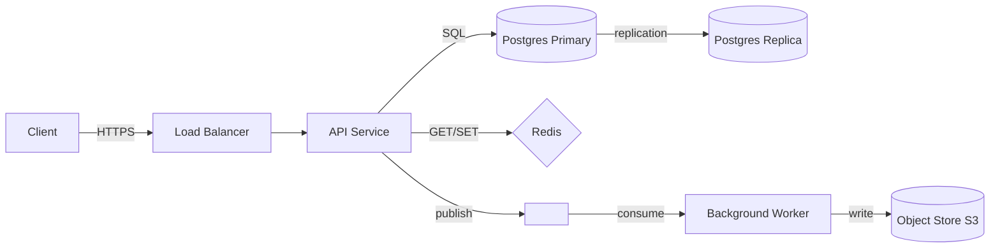

# Phase 7 · Week 01 · Day 5 — Diagramming & Communicating Trade-offs

> Objective: Draw clear architecture diagrams and articulate trade-offs with precision.  ·  Time: ~1 hr  ·  Prereqs: [[day-4]]

---

## Concept

A system-design interview without a diagram is a story without a map. The diagram is your shared artifact — it lets the interviewer follow your reasoning, ask targeted questions, and probe specific components. It also prevents you from hand-waving.

Communicating trade-offs is the hardest skill to fake. An interviewer can tell whether you chose Kafka over RabbitMQ because you understand the fan-out semantics, or because you memorised a blog post.

---

## Part 1: Architecture Diagrams

### What to draw (and when)

| Diagram type | When to use | Contains |
|---|---|---|
| **High-level component** | Step 5 of framework | Services, DBs, caches, queues, CDN, clients |
| **Data flow** | Deep dives | How data moves — arrows with labels |
| **Sequence** | Protocol/API deep dives | Time-ordered request/response flows |
| **Entity-relationship (ERD)** | Data model step | Tables, columns, relationships |

In an interview you almost always draw a high-level component diagram. Go deeper for the component you are deep-diving.

### ASCII diagram conventions

Use consistent shapes in ASCII:
```
[ Service ]       — application service / microservice
( Database )      — any data store (note shape in legend)
{ Cache }         — in-memory store
< Queue >         — message queue / topic
═══════           — synchronous call / HTTP
- - - →           — asynchronous / event

Arrows carry labels:
  HTTP/REST
  gRPC
  SQL
  pub/sub
  WebSocket
```

### Mermaid diagram conventions

Mermaid renders in GitHub, Notion, and Obsidian. Use `graph LR` for left-to-right flows.



### What makes a good diagram

1. **Layers are clear**: client tier, application tier, data tier, async tier.
2. **Labels on arrows**: don't just draw arrows — label the protocol or data type.
3. **Data stores are distinguished**: RDBMS, object store, cache, queue are different things.
4. **No orphan components**: every box connects to something.
5. **Scope matches the conversation**: high-level first, detail only where you're deep-diving.

### Common mistakes

- Drawing a diagram and then never referring back to it
- Showing five databases without explaining why each exists
- Using generic "Service" boxes with no description
- Omitting the client (it's part of the system)

---

## Part 2: Communicating Trade-offs

### The trade-off formula

Every architectural decision involves giving something up. State trade-offs with this structure:

```
"I chose X over Y.
 X gives us [benefit].
 The cost is [downside].
 That trade-off is acceptable because [justification from requirements]."
```

### The trade-off matrix

Build this habit: for every significant decision, write a mini-matrix:

| Option | Pros | Cons | Why chosen / rejected |
|---|---|---|---|
| SQL (Postgres) | ACID, joins, mature tooling | Horizontal write scale harder | Chosen: data is relational, writes are modest |
| NoSQL (DynamoDB) | Horizontal scale, low latency at scale | No joins, eventual consistency | Rejected: data model is relational |

### Canonical trade-offs to know

#### Consistency vs Availability (CAP)
- In a network partition, you must choose: **consistent** (reject requests until partition heals) or **available** (serve stale data).
- SQL DBs with synchronous replication: CP.
- DynamoDB / Cassandra defaults: AP.
- Most systems need neither extreme — use tunable consistency.

#### Latency vs Throughput
- Batching increases throughput but increases latency per record.
- Streaming reduces latency but increases per-event overhead.

#### Normalisation vs Denormalisation
- Normalised: no duplication, hard to query across tables at scale.
- Denormalised: duplicated data, faster reads, harder writes.

#### Push vs Pull
- Push (server sends to client): lower latency, harder backpressure, server must track clients.
- Pull (client polls server): simpler server, higher latency, clients control rate.

#### Synchronous vs Asynchronous
- Sync: simpler error handling, tight coupling, fails if downstream is slow.
- Async: decoupled, resilient, but harder debugging, eventual consistency.

---

## Worked Example

**Problem:** "Design a rate limiter."

### High-level component diagram

```
Client Request
    │
    ▼
[ API Gateway ]
    │
    ├── Rate Limiter Middleware
    │       │
    │       ▼
    │   { Redis }   ← sliding window counters (key: user_id:window)
    │       │
    │   Allow / Deny
    │
    ▼
[ Upstream Service ]
```

### Data flow (deep dive on rate limiter)

```
Sequence: Sliding Window Counter

1. Client sends request with user_id token
2. Middleware constructs key: "ratelimit:{user_id}:{window_start}"
3. INCR key in Redis (atomic)
4. If TTL not set → EXPIRE key (window duration)
5. Read counter value
6. If counter > limit → return 429 Too Many Requests
7. Else → forward to upstream
```

### Trade-off matrix for this design

| Decision | Option A | Option B | Chosen | Reason |
|---|---|---|---|---|
| Rate limit storage | Redis | Local memory | Redis | Multi-instance consistency; local memory allows bypass if LB doesn't sticky-route |
| Algorithm | Fixed window | Sliding window | Sliding window | Fixed window allows 2× burst at window boundary |
| Consistency | Strict (Redis INCR) | Approximate (eventual) | Strict | Financial API — must not allow burst above limit |

### Communicating in an interview

> "I'm putting the counter in Redis rather than in-process memory. The trade-off is an extra network hop (~200 μs), but that's acceptable because our latency SLO is p99 < 500 ms. The benefit is that all instances of the API service see the same counter, so a user can't bypass the limit by hitting different servers."

---

## Exercises

1. Draw an ASCII architecture diagram for a URL shortener. Include: client, load balancer, API service, cache, primary DB, replica DB. Label all arrows with the protocol used.
2. Write a trade-off statement (using the formula above) for: "I chose to use a message queue between the API and the notification service instead of a direct HTTP call."
3. Convert the following ASCII diagram to a Mermaid `graph LR` block:

```
Mobile App ──HTTPS──► [ API Gateway ] ──gRPC──► [ User Service ]
                            │
                          SQL
                            │
                       ( Postgres )
```

4. You're designing a leaderboard for a game. Two approaches: (a) maintain a sorted set in Redis, updated on every score change; (b) recalculate the leaderboard from the DB every 60 seconds. Write a trade-off matrix comparing them across latency, consistency, and operational complexity.

(Solutions: ../solutions/week-01/day-5.md)

---

## Self-check

- [ ] I can draw a clear, layered ASCII architecture diagram for a medium-complexity system.
- [ ] I can write a Mermaid diagram that renders correctly.
- [ ] I can state a trade-off using the "chose X over Y because..." formula.
- [ ] I can identify CAP trade-off implications for at least three storage systems.

---

## Supplementary

- [Mermaid Live Editor](https://mermaid.live/)
- [System Design Primer — Drawing Diagrams](https://github.com/donnemartin/system-design-primer)
- [AWS Architecture Icons (for professional diagrams)](https://aws.amazon.com/architecture/icons/)
