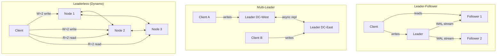

# Phase 7 · Week 03 · Day 3 — Replication Strategies

> Objective: Understand leader-follower, multi-leader, and leaderless replication — their consistency guarantees, failure modes, and tradeoffs — well enough to design and defend data layer choices in a system design interview.  ·  Time: ~1 hr  ·  Prereqs: [[day-2-week-03]]

---

## Concept

**Replication** means keeping copies of the same data on multiple nodes. Goals: fault tolerance (survive node loss), read scalability (distribute reads), reduced latency (serve reads from nearby replica).

Every replication strategy trades **consistency** against **availability** and **write latency**.

### Synchronous vs Asynchronous Replication

**Synchronous**: Leader waits for replica to acknowledge write before confirming to client. Guarantees no data loss on leader failure. Cost: write latency includes round-trip to replica; if replica is slow or unreachable, writes stall.

**Asynchronous**: Leader confirms to client immediately, replicates in background. Lower write latency, higher throughput. Cost: if leader fails before replica catches up, some committed writes are lost.

Most production systems use **semi-synchronous**: one synchronous replica (guaranteed durable), rest async.

---

### Leader-Follower (Single-Leader) Replication

One node is the **leader** (primary). All writes go to the leader. The leader replicates its write-ahead log (WAL) or replication log to **followers** (read replicas). Reads can go to any node (with consistency caveats).

**Failover**: When leader fails, one follower is promoted. Challenges:
- The new leader may lag behind — promoted replica may be missing recent writes.
- Clients must be redirected to new leader.
- Split-brain: old leader comes back online, both believe they are leader → **fencing tokens** or epoch numbers prevent this.

**Replication lag** and **read-your-writes**:
A client that just wrote to the leader may read from a lagging follower and see stale data. Solutions:
1. Route reads of recently-written data to the leader.
2. Track replication lag per follower; only route to follower if lag < threshold.
3. Timestamp-based: client sends last-write timestamp; replica only serves if its position ≥ that timestamp.

---

### Multi-Leader Replication

Multiple nodes accept writes. Changes are replicated to all other leaders. Common in:
- **Multi-datacenter** setups (one leader per DC, async across DCs).
- Offline-capable clients (each device is a leader, syncs on reconnect).

**Write conflicts** are inevitable: two leaders accept writes to the same row concurrently.

Conflict resolution strategies:
| Strategy | Behaviour | Risk |
|---|---|---|
| **Last-Write-Wins (LWW)** | Highest timestamp survives | Clock skew causes data loss |
| **Merge** | Application-level merge function | Complex; domain-specific |
| **CRDTs** | Conflict-free Replicated Data Types: data structures designed so any merge order is consistent | Works for counters, sets, sequences; not arbitrary updates |
| **Manual resolution** | Store conflict, surface to user | Poor UX for automated systems |

**CRDTs briefly**: A CRDT is a data type with a merge operation that is commutative, associative, and idempotent. Examples: G-Counter (grow-only), PN-Counter, OR-Set. Cassandra's counter columns and Riak's data types use CRDT semantics.

---

### Leaderless (Dynamo-Style) Replication

No single leader. Clients (or a coordinator) write to **multiple replicas directly**. Reads also query multiple replicas. Consistency is controlled by **quorum parameters**:

- **N** — total replicas
- **W** — write quorum (how many must acknowledge a write)
- **R** — read quorum (how many must respond to a read)

**Rule: W + R > N guarantees at least one overlapping node between read and write sets.**

Example: N=3, W=2, R=2. Any two nodes form a write set. Any two nodes form a read set. At least one node is in both → reads always see the latest write.

If W + R ≤ N (e.g., W=1, R=1): fast but eventually consistent — reads may miss latest write.

**Sloppy quorum**: During a network partition, accept writes on reachable nodes even if they are not the "home" replicas for a key. When the partition heals, a **hinted handoff** replays those writes to the correct nodes. Improves availability; may serve stale reads.

**Read repair**: When a read returns different values from different replicas, the coordinator writes the latest value back to stale replicas.

---

## How It Works Internally

### Replication Log Formats

1. **Statement-based**: replicate the SQL statement itself. Problem: non-deterministic functions (`NOW()`, `RAND()`) diverge on replicas. Deprecated in most systems.
2. **WAL shipping** (PostgreSQL): ship the binary write-ahead log. Tightly coupled to storage format — replica must be same DB version. Used by PostgreSQL streaming replication.
3. **Row-based (logical) replication**: replicate the actual row changes (before/after images). Version-independent. Used by MySQL binlog row format, PostgreSQL logical replication.
4. **Trigger-based**: application-level triggers write changes to a replication table, an external process ships them. Most flexible, most overhead.

### Replication Topologies (Mermaid)



---

## Worked Example

```python
"""
replica_router.py — Route reads to lag-aware replicas, writes to leader.

Simulates a replica set with configurable replication lag per follower.
A router ensures reads go only to followers whose lag is within a threshold.

Requires: Python 3.12+
"""

import logging
import os
import random
import time
from dataclasses import dataclass, field
from typing import Optional

logging.basicConfig(
    level=logging.INFO,
    format="%(asctime)s %(levelname)s %(name)s %(message)s",
)
logger = logging.getLogger(__name__)

# Configurable via environment — no hardcoded values
MAX_ACCEPTABLE_LAG_MS = int(os.getenv("MAX_REPLICA_LAG_MS", "500"))
LEADER_HOST = os.getenv("DB_LEADER_HOST", "db-leader.internal")


# ---------------------------------------------------------------------------
# Data model
# ---------------------------------------------------------------------------

@dataclass
class Replica:
    host: str
    is_leader: bool
    lag_ms: float = 0.0  # simulated replication lag in milliseconds
    last_checked: float = field(default_factory=time.monotonic)

    def refresh_lag(self) -> None:
        """Simulate fetching current lag from the replica's pg_stat_replication."""
        # In production: query `SELECT extract(epoch from replay_lag)*1000 FROM
        # pg_stat_replication WHERE application_name = 'replica_host'`
        self.lag_ms = random.uniform(0, 2000)  # 0–2000ms simulated
        self.last_checked = time.monotonic()
        logger.debug("Refreshed lag for %s: %.0f ms", self.host, self.lag_ms)


@dataclass
class WriteResult:
    success: bool
    host: str
    write_timestamp_ms: float


@dataclass
class ReadResult:
    data: Optional[str]
    host: str
    routed_to_leader: bool
    reason: str


# ---------------------------------------------------------------------------
# Router
# ---------------------------------------------------------------------------

class ReplicaRouter:
    """
    Routes writes to leader, reads to replicas respecting lag threshold.
    Falls back to leader for reads when no replica is healthy.
    """

    def __init__(
        self,
        replicas: list[Replica],
        max_lag_ms: float = MAX_ACCEPTABLE_LAG_MS,
    ) -> None:
        self._replicas = replicas
        self._max_lag_ms = max_lag_ms
        self._leader = next(r for r in replicas if r.is_leader)
        self._followers = [r for r in replicas if not r.is_leader]
        logger.info(
            "ReplicaRouter initialized: leader=%s, followers=%d, max_lag_ms=%.0f",
            self._leader.host,
            len(self._followers),
            self._max_lag_ms,
        )

    def write(self, key: str, value: str) -> WriteResult:
        """All writes go to the leader."""
        logger.info("WRITE key=%s -> leader=%s", key, self._leader.host)
        # Simulate write latency
        time.sleep(0.001)
        return WriteResult(
            success=True,
            host=self._leader.host,
            write_timestamp_ms=time.monotonic() * 1000,
        )

    def read(
        self,
        key: str,
        read_your_writes: bool = False,
        last_write_ms: Optional[float] = None,
    ) -> ReadResult:
        """
        Route read to a healthy replica.

        Args:
            key: The key to read.
            read_your_writes: If True, enforce that the selected replica is
                              caught up enough to reflect a recent write.
            last_write_ms: Monotonic timestamp (ms) of the client's last write.
                           Used with read_your_writes=True.
        """
        self._refresh_all_lags()

        if read_your_writes and last_write_ms is not None:
            return self._read_your_writes_route(key, last_write_ms)

        healthy = self._healthy_followers()
        if not healthy:
            logger.warning("No healthy followers; routing read to leader (fallback)")
            return ReadResult(
                data=self._fetch(self._leader, key),
                host=self._leader.host,
                routed_to_leader=True,
                reason="no healthy follower within lag threshold",
            )

        chosen = random.choice(healthy)
        logger.info(
            "READ key=%s -> follower=%s (lag=%.0f ms)",
            key,
            chosen.host,
            chosen.lag_ms,
        )
        return ReadResult(
            data=self._fetch(chosen, key),
            host=chosen.host,
            routed_to_leader=False,
            reason=f"follower lag {chosen.lag_ms:.0f}ms within threshold {self._max_lag_ms}ms",
        )

    def _read_your_writes_route(self, key: str, last_write_ms: float) -> ReadResult:
        """
        Find a follower that has caught up past last_write_ms.
        Falls back to leader if none qualify.
        """
        current_ms = time.monotonic() * 1000
        # A follower "sees" the write if: (current_time - last_write_ms) > follower lag
        candidates = [
            f for f in self._followers
            if (current_ms - last_write_ms) > f.lag_ms
            and f.lag_ms <= self._max_lag_ms
        ]
        if candidates:
            chosen = min(candidates, key=lambda r: r.lag_ms)
            logger.info(
                "READ-YOUR-WRITES key=%s -> follower=%s (lag=%.0f ms)",
                key,
                chosen.host,
                chosen.lag_ms,
            )
            return ReadResult(
                data=self._fetch(chosen, key),
                host=chosen.host,
                routed_to_leader=False,
                reason="follower caught up past write timestamp",
            )

        logger.warning(
            "READ-YOUR-WRITES fallback to leader: no follower caught up past write at %.0f ms",
            last_write_ms,
        )
        return ReadResult(
            data=self._fetch(self._leader, key),
            host=self._leader.host,
            routed_to_leader=True,
            reason="no follower caught up past client write timestamp",
        )

    def _healthy_followers(self) -> list[Replica]:
        return [f for f in self._followers if f.lag_ms <= self._max_lag_ms]

    def _refresh_all_lags(self) -> None:
        for follower in self._followers:
            # Only refresh if stale (>1s since last check)
            if time.monotonic() - follower.last_checked > 1.0:
                follower.refresh_lag()

    def _fetch(self, replica: Replica, key: str) -> str:
        """Stub: simulate row fetch."""
        return f"value_for_{key}_from_{replica.host}"

    def status(self) -> None:
        """Log current lag status of all replicas."""
        logger.info("--- Replica Status ---")
        for r in self._replicas:
            role = "LEADER" if r.is_leader else f"follower (lag={r.lag_ms:.0f}ms)"
            healthy = "" if r.is_leader else (
                " [OK]" if r.lag_ms <= self._max_lag_ms else " [LAGGING]"
            )
            logger.info("  %s  %s%s", r.host, role, healthy)


# ---------------------------------------------------------------------------
# Demo
# ---------------------------------------------------------------------------

def main() -> None:
    replicas = [
        Replica(host=LEADER_HOST, is_leader=True),
        Replica(host="db-replica-1.internal", is_leader=False, lag_ms=50),
        Replica(host="db-replica-2.internal", is_leader=False, lag_ms=800),  # lagging
        Replica(host="db-replica-3.internal", is_leader=False, lag_ms=120),
    ]

    router = ReplicaRouter(replicas, max_lag_ms=MAX_ACCEPTABLE_LAG_MS)
    router.status()

    logger.info("")
    logger.info("=== Normal reads (lag-aware routing) ===")
    for i in range(4):
        result = router.read(key=f"user:{i}")
        logger.info("  -> %s (leader=%s) reason: %s", result.host, result.routed_to_leader, result.reason)

    logger.info("")
    logger.info("=== Write then read-your-writes ===")
    write_result = router.write(key="user:99", value="alice")
    logger.info("  Write to %s at %.0f ms", write_result.host, write_result.write_timestamp_ms)

    ryw_result = router.read(
        key="user:99",
        read_your_writes=True,
        last_write_ms=write_result.write_timestamp_ms,
    )
    logger.info(
        "  Read-your-writes -> %s (routed_to_leader=%s) reason: %s",
        ryw_result.host,
        ryw_result.routed_to_leader,
        ryw_result.reason,
    )


if __name__ == "__main__":
    main()
```

---

## Exercises

1. Add a `QuorumCoordinator` class that simulates Dynamo-style leaderless replication. It should accept `n_replicas`, `w`, `r` params and simulate `write(key, value)` and `read(key)` with random per-node latency. Assert that `W + R > N` holds at init time (raise `ValueError` otherwise). Log which nodes participated in each quorum.

2. Simulate replication lag catch-up: extend `Replica` with `apply_pending_writes(batch_size: int)` that reduces lag by a fixed amount per call. Write a pytest test that confirms a lagging replica becomes healthy after enough catch-up cycles.

3. In the `ReplicaRouter`, add a `promote_follower(host: str)` method to simulate leader failover. The method should: (a) demote the current leader to follower, (b) promote the named follower to leader, (c) reject the promotion if the chosen follower's lag > 100ms (stale replica — data loss risk). Write tests for the happy path and rejection case.

4. Multi-leader conflict scenario: write a Python function `resolve_conflict(a: dict, b: dict) -> dict` that implements LWW using a `"updated_at"` timestamp field. Write a second resolver that raises `ConflictError` if both records changed the same field with different values. Test both resolvers.

5. Research: PostgreSQL `synchronous_commit` has values `on`, `remote_apply`, `remote_write`, `local`, `off`. Describe in comments what each level means for durability and latency. Which would you use for a financial ledger vs. an analytics event stream?

(Solutions: ../solutions/week-03/day-3.md)

---

## Self-check

- [ ] I can explain synchronous vs asynchronous replication and their durability guarantees.
- [ ] I can describe the read-your-writes problem and implement a router that prevents stale reads.
- [ ] I can derive the W + R > N quorum rule and explain what happens when it is violated.
- [ ] I can explain at least two conflict resolution strategies for multi-leader replication and name a use case for each.
- [ ] I can implement `ReplicaRouter` with lag-aware routing from scratch without reference.

---

## Supplementary Links

- [Designing Data-Intensive Applications — Kleppmann (Ch 5, Replication)](https://dataintensive.net/)
- [PostgreSQL — Streaming Replication](https://www.postgresql.org/docs/current/warm-standby.html)
- [Amazon Dynamo Paper (original)](https://www.allthingsdistributed.com/files/amazon-dynamo-sosp2007.pdf)
- [CRDTs: A Gentle Introduction](https://crdt.tech/)
- [Martin Fowler — Patterns of Distributed Systems: Quorum](https://martinfowler.com/articles/patterns-of-distributed-systems/quorum.html)
- [Cassandra — Replication and Consistency](https://cassandra.apache.org/doc/latest/cassandra/architecture/dynamo.html)
