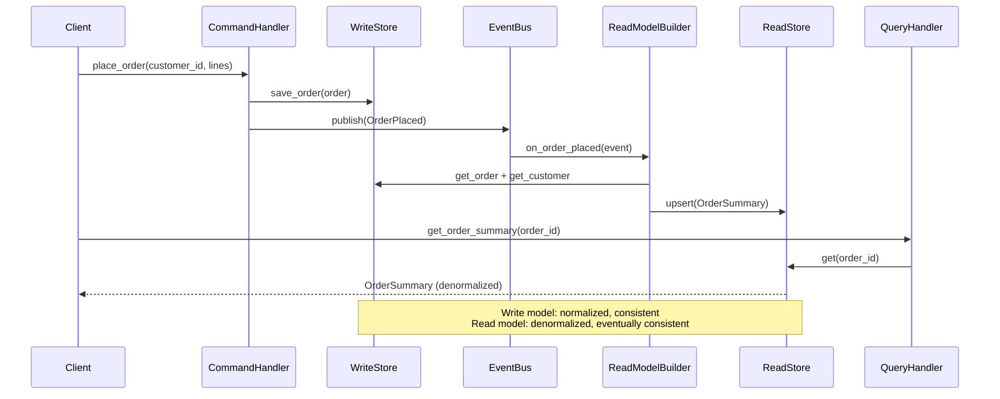

# Phase 7 · Week 03 · Day 5 — CQRS, Denormalization & OLTP vs OLAP

> Objective: Know when to split read and write models, when to denormalize, and how OLTP and OLAP systems differ architecturally.  ·  Time: ~1 hr  ·  Prereqs: [[day-4]]

---

## Concept

Every data system makes a choice: optimize for writes or for reads. The default relational model tries to do both through normalization + indexes. At scale, that compromise breaks down:

- **OLTP** (Online Transaction Processing): high-frequency, low-latency, narrow reads/writes. Normalized rows. Row-oriented storage.
- **OLAP** (Online Analytical Processing): infrequent, long-running, wide scans. Denormalized fact tables. Column-oriented storage.
- **CQRS** (Command Query Responsibility Segregation): architectural pattern — explicitly separate the *write model* (commands) from the *read model* (queries), each optimized independently.

These concepts are complementary. OLTP/OLAP describes storage engine characteristics; CQRS describes how your application code handles the split.

---

## How It Works Internally

### OLTP — Row-Oriented Storage

Data for one row is stored contiguously on disk:

```
Row 1: [order_id=1, customer=alice, amount=99.00, status=pending]
Row 2: [order_id=2, customer=bob,   amount=42.50, status=shipped]
```

Updating a single row → one seek, one small write. Ideal for transactional workloads with point reads and narrow updates. B-tree indexes support fast keyed lookups.

**Characteristics:**
- Latency target: single-digit milliseconds.
- Concurrency: many short transactions (MVCC / row-level locking).
- Dataset in RAM: working set fits in buffer pool.
- Query pattern: `WHERE pk = ?`, small result sets.

### OLAP — Column-Oriented Storage

Data for one column is stored contiguously:

```
order_id column: [1, 2, 3, 4, ...]
amount column:   [99.00, 42.50, 150.00, 7.99, ...]
status column:   [pending, shipped, pending, delivered, ...]
```

Aggregation queries (`SUM(amount) WHERE status = 'shipped'`) read *only* the `amount` and `status` columns, skipping all others. This drastically reduces I/O.

**Column compression:** Values in a column tend to repeat (few distinct statuses). Run-length encoding and dictionary encoding compress aggressively, often 5–10×.

**Vectorized execution:** The query engine processes a batch of column values in a tight CPU loop, fitting the batch into L1/L2 cache and leveraging SIMD instructions — orders of magnitude faster than row-at-a-time interpretation.

```
Without vectorization:
  for row in rows:
      if row.status == "shipped":
          total += row.amount    # One function call per row — interpreter overhead

With vectorized:
  mask  = (status_col == "shipped")     # SIMD comparison, entire batch
  total = (amount_col * mask).sum()     # SIMD sum, entire batch
```

**Characteristics:**
- Latency target: seconds to minutes (full-scan analytics).
- Concurrency: few long-running read queries.
- Storage: compressed columns, no row locality needed.
- Query pattern: full scans, GROUP BY, aggregates.

### Star Schema and ETL/ELT

OLAP systems typically use a **star schema**:

- **Fact table:** measurements (sales, events, logs). Tall and narrow in meaning — one row per event.
- **Dimension tables:** descriptive attributes (customers, products, time). Smaller, pre-joined during load.

Pre-joining means analytical queries avoid expensive joins at query time.

**ETL:** Extract → Transform → Load. Transformation happens before loading into the warehouse. The warehouse receives clean, typed data.

**ELT:** Extract → Load → Transform. Raw data lands in the warehouse first; transformation is done by the warehouse engine (SQL or dbt). Common in modern cloud warehouses (BigQuery, Snowflake, Redshift) where compute is elastic and cheap.

### CQRS Pattern

In a standard service, the same model handles both writes and reads:

```
Client → Service → DB (normalized write) → same DB (normalized read)
```

With CQRS, the write path and read path are separate:

```
Client ──► Command Handler ──► Write Store (normalized, append-only events)
                                     │
                              Domain Event Bus
                                     │
                              Read Model Builder ──► Read Store (denormalized views)
                                                           │
Client ◄────────────────── Query Handler ◄───────────────┘
```

**Write model:** Enforces invariants and business rules. Optimized for consistency. May store *events* (event sourcing) rather than current state.

**Read model:** Denormalized, pre-computed projections. Optimized for a specific query pattern — one read model per view if needed. Can be rebuilt from the event stream at any time.

**Eventual consistency:** The read model lags behind the write model by the event propagation time. Callers must accept stale reads or implement read-your-own-writes patterns.

### Denormalization

Denormalization embeds redundant data to avoid joins at query time:

| Normalized | Denormalized |
|---|---|
| `orders(order_id, customer_id)` + `customers(customer_id, name, email)` | `order_view(order_id, customer_name, customer_email, ...)` |

**Materialized views** are the database-native form: the engine computes the join once, stores the result, and refreshes it on a schedule or on write.

Trade-offs:
- **Read speed:** much faster (no join).
- **Write cost:** updates must fan out to all denormalized copies.
- **Storage:** data duplication.
- **Consistency:** read model may transiently disagree with write model.

---

## Worked Example — CQRS Order Service in Python

```python
"""
cqrs_orders.py

Minimal CQRS demo: an order service with a normalized write model
and a denormalized read model, connected via an in-process event bus.

Run:  python cqrs_orders.py
Test: pytest test_cqrs_orders.py
"""
from __future__ import annotations

import logging
import uuid
from dataclasses import dataclass, field
from datetime import datetime, timezone
from enum import Enum
from typing import Callable, Optional

logging.basicConfig(level=logging.INFO, format="%(asctime)s %(levelname)s %(name)s %(message)s")
log = logging.getLogger(__name__)


# ---------------------------------------------------------------------------
# Domain types
# ---------------------------------------------------------------------------

class OrderStatus(str, Enum):
    PENDING = "pending"
    CONFIRMED = "confirmed"
    SHIPPED = "shipped"
    CANCELLED = "cancelled"


@dataclass
class Customer:
    customer_id: str
    name: str
    email: str


@dataclass
class OrderLine:
    product_id: str
    product_name: str
    quantity: int
    unit_price: float

    @property
    def line_total(self) -> float:
        return self.quantity * self.unit_price


# ---------------------------------------------------------------------------
# Domain Events  (the immutable record of what happened)
# ---------------------------------------------------------------------------

@dataclass(frozen=True)
class OrderPlaced:
    event_id: str
    order_id: str
    customer_id: str
    lines: tuple[OrderLine, ...]
    occurred_at: datetime


@dataclass(frozen=True)
class OrderStatusChanged:
    event_id: str
    order_id: str
    new_status: OrderStatus
    occurred_at: datetime


DomainEvent = OrderPlaced | OrderStatusChanged


# ---------------------------------------------------------------------------
# Write Model — normalized, enforces invariants
# ---------------------------------------------------------------------------

@dataclass
class Order:
    """Normalized write-side aggregate."""
    order_id: str
    customer_id: str
    lines: list[OrderLine]
    status: OrderStatus = OrderStatus.PENDING
    created_at: datetime = field(default_factory=lambda: datetime.now(timezone.utc))

    def confirm(self) -> OrderStatusChanged:
        if self.status != OrderStatus.PENDING:
            raise ValueError(f"Cannot confirm order in status {self.status}")
        self.status = OrderStatus.CONFIRMED
        return OrderStatusChanged(
            event_id=str(uuid.uuid4()),
            order_id=self.order_id,
            new_status=OrderStatus.CONFIRMED,
            occurred_at=datetime.now(timezone.utc),
        )

    def ship(self) -> OrderStatusChanged:
        if self.status != OrderStatus.CONFIRMED:
            raise ValueError(f"Cannot ship order in status {self.status}")
        self.status = OrderStatus.SHIPPED
        return OrderStatusChanged(
            event_id=str(uuid.uuid4()),
            order_id=self.order_id,
            new_status=OrderStatus.SHIPPED,
            occurred_at=datetime.now(timezone.utc),
        )

    @property
    def total(self) -> float:
        return sum(line.line_total for line in self.lines)


class WriteStore:
    """In-memory normalized write store (stand-in for a relational DB)."""

    def __init__(self) -> None:
        self._orders: dict[str, Order] = {}
        self._customers: dict[str, Customer] = {}

    def save_customer(self, customer: Customer) -> None:
        self._customers[customer.customer_id] = customer
        log.debug("WriteStore: saved customer %s", customer.customer_id)

    def save_order(self, order: Order) -> None:
        self._orders[order.order_id] = order
        log.debug("WriteStore: saved order %s", order.order_id)

    def get_order(self, order_id: str) -> Optional[Order]:
        return self._orders.get(order_id)

    def get_customer(self, customer_id: str) -> Optional[Customer]:
        return self._customers.get(customer_id)


# ---------------------------------------------------------------------------
# Event Bus — thin in-process pub/sub
# ---------------------------------------------------------------------------

EventHandler = Callable[[DomainEvent], None]


class EventBus:
    def __init__(self) -> None:
        self._handlers: dict[type, list[EventHandler]] = {}

    def subscribe(self, event_type: type, handler: EventHandler) -> None:
        self._handlers.setdefault(event_type, []).append(handler)

    def publish(self, event: DomainEvent) -> None:
        for handler in self._handlers.get(type(event), []):
            try:
                handler(event)
            except Exception:
                log.exception("Event handler failed for %s", type(event).__name__)


# ---------------------------------------------------------------------------
# Read Model — denormalized, query-optimised
# ---------------------------------------------------------------------------

@dataclass
class OrderSummary:
    """Denormalized view — exactly the shape a UI order list needs."""
    order_id: str
    customer_name: str
    customer_email: str
    status: str
    total: float
    item_count: int
    created_at: datetime


class ReadStore:
    """In-memory denormalized read store (stand-in for a read replica / cache)."""

    def __init__(self) -> None:
        self._summaries: dict[str, OrderSummary] = {}

    def upsert(self, summary: OrderSummary) -> None:
        self._summaries[summary.order_id] = summary
        log.debug("ReadStore: upserted order summary %s", summary.order_id)

    def get(self, order_id: str) -> Optional[OrderSummary]:
        return self._summaries.get(order_id)

    def list_by_status(self, status: str) -> list[OrderSummary]:
        return [s for s in self._summaries.values() if s.status == status]


# ---------------------------------------------------------------------------
# Read Model Builder — subscribes to events, updates ReadStore
# ---------------------------------------------------------------------------

class OrderReadModelBuilder:
    """
    Listens to domain events and maintains the denormalized OrderSummary view.
    This is the 'projection' in event-sourcing terminology.
    """

    def __init__(self, write_store: WriteStore, read_store: ReadStore, bus: EventBus) -> None:
        self._write = write_store
        self._read = read_store
        bus.subscribe(OrderPlaced, self._on_order_placed)
        bus.subscribe(OrderStatusChanged, self._on_status_changed)

    def _on_order_placed(self, event: DomainEvent) -> None:
        assert isinstance(event, OrderPlaced)
        order = self._write.get_order(event.order_id)
        customer = self._write.get_customer(event.customer_id)
        if order is None or customer is None:
            log.error("Read model builder: missing order or customer for %s", event.order_id)
            return
        summary = OrderSummary(
            order_id=order.order_id,
            customer_name=customer.name,
            customer_email=customer.email,
            status=order.status.value,
            total=order.total,
            item_count=sum(line.quantity for line in order.lines),
            created_at=order.created_at,
        )
        self._read.upsert(summary)
        log.info("ReadModel updated: new order %s for %s (total=%.2f)", order.order_id, customer.name, order.total)

    def _on_status_changed(self, event: DomainEvent) -> None:
        assert isinstance(event, OrderStatusChanged)
        summary = self._read.get(event.order_id)
        if summary is None:
            log.error("Read model builder: unknown order %s", event.order_id)
            return
        summary.status = event.new_status.value
        self._read.upsert(summary)
        log.info("ReadModel updated: order %s → %s", event.order_id, event.new_status.value)


# ---------------------------------------------------------------------------
# Command Handlers — the write side API
# ---------------------------------------------------------------------------

class OrderCommandHandler:
    def __init__(self, write_store: WriteStore, bus: EventBus) -> None:
        self._store = write_store
        self._bus = bus

    def place_order(
        self,
        customer_id: str,
        lines: list[OrderLine],
    ) -> str:
        order_id = str(uuid.uuid4())
        order = Order(order_id=order_id, customer_id=customer_id, lines=lines)
        self._store.save_order(order)

        event = OrderPlaced(
            event_id=str(uuid.uuid4()),
            order_id=order_id,
            customer_id=customer_id,
            lines=tuple(lines),
            occurred_at=order.created_at,
        )
        self._bus.publish(event)
        log.info("Command: placed order %s", order_id)
        return order_id

    def confirm_order(self, order_id: str) -> None:
        order = self._store.get_order(order_id)
        if order is None:
            raise KeyError(f"Order {order_id} not found")
        event = order.confirm()
        self._store.save_order(order)
        self._bus.publish(event)
        log.info("Command: confirmed order %s", order_id)

    def ship_order(self, order_id: str) -> None:
        order = self._store.get_order(order_id)
        if order is None:
            raise KeyError(f"Order {order_id} not found")
        event = order.ship()
        self._store.save_order(order)
        self._bus.publish(event)
        log.info("Command: shipped order %s", order_id)


# ---------------------------------------------------------------------------
# Query Handlers — the read side API
# ---------------------------------------------------------------------------

class OrderQueryHandler:
    def __init__(self, read_store: ReadStore) -> None:
        self._store = read_store

    def get_order_summary(self, order_id: str) -> Optional[OrderSummary]:
        return self._store.get(order_id)

    def list_pending_orders(self) -> list[OrderSummary]:
        return self._store.list_by_status("pending")

    def list_shipped_orders(self) -> list[OrderSummary]:
        return self._store.list_by_status("shipped")


# ---------------------------------------------------------------------------
# Wiring and demo
# ---------------------------------------------------------------------------

def build_app() -> tuple[OrderCommandHandler, OrderQueryHandler]:
    write_store = WriteStore()
    read_store = ReadStore()
    bus = EventBus()

    # Seed a customer
    alice = Customer(customer_id="cust-001", name="Alice Smith", email="alice@example.com")
    write_store.save_customer(alice)

    # Wire the read model builder (subscribes to bus)
    OrderReadModelBuilder(write_store, read_store, bus)

    commands = OrderCommandHandler(write_store, bus)
    queries = OrderQueryHandler(read_store)
    return commands, queries


if __name__ == "__main__":
    commands, queries = build_app()

    # Place an order
    order_id = commands.place_order(
        customer_id="cust-001",
        lines=[
            OrderLine("prod-A", "Mechanical Keyboard", 1, 149.99),
            OrderLine("prod-B", "USB-C Hub", 2, 29.99),
        ],
    )

    # Query the read model immediately (eventually consistent — sync in this demo)
    summary = queries.get_order_summary(order_id)
    assert summary is not None
    log.info("Query result: %s — %s — £%.2f — %d items",
             summary.customer_name, summary.status, summary.total, summary.item_count)

    # Confirm and ship
    commands.confirm_order(order_id)
    commands.ship_order(order_id)

    summary = queries.get_order_summary(order_id)
    assert summary is not None
    log.info("After shipping: status=%s", summary.status)

    shipped = queries.list_shipped_orders()
    log.info("Total shipped orders: %d", len(shipped))
```

---

## CQRS Flow — Mermaid Diagram



---

## OLTP vs OLAP Summary

```
                    OLTP                    OLAP
────────────────────────────────────────────────────────
Primary users       App (end-users)         Analysts, BI tools
Query pattern       Point reads/writes      Full scans, aggregates
Dataset             Current state           Historical, large
Storage layout      Row-oriented            Column-oriented
Compression         Low (rows mixed)        High (column homogeneity)
Transaction style   Short, concurrent       Long reads, rare writes
Latency target      < 10 ms                 Seconds to minutes
Normalization       High (3NF)              Low (star/snowflake schema)
Schema change cost  High (live traffic)     Lower (offline ETL/ELT)
Examples            PostgreSQL, MySQL        BigQuery, Snowflake,
                    DynamoDB, MongoDB        Redshift, ClickHouse
────────────────────────────────────────────────────────
```

---

## Exercises

1. **OLTP vs OLAP selection:** You are designing a system that tracks real-time vehicle positions (writes: 5 000/sec from IoT devices; reads: dashboards aggregating average speed per city per hour, updated every 5 minutes). Which storage engine type fits the write path? The read path? Would you use the same database for both?

2. **Column store compression:** Given a `status` column with 1 million rows and only 4 distinct values (`pending`, `confirmed`, `shipped`, `cancelled`), estimate the compression ratio achievable with dictionary encoding versus storing raw UTF-8 strings. Show your arithmetic.

3. **CQRS read model rebuild:** In the `cqrs_orders.py` example above, `OrderReadModelBuilder` subscribes to live events. Add a `rebuild_from_events(events: list[DomainEvent])` method to `OrderReadModelBuilder` that replays a historical event log to reconstruct the `ReadStore` from scratch. Write a pytest test that: (a) places 3 orders and ships 2, (b) clears the read store, (c) replays events, (d) asserts the read store matches the pre-clear state.

4. **Denormalization trade-off:** The `OrderSummary` denormalized view embeds `customer_name` and `customer_email`. If a customer updates their email address, describe the steps your system must take to keep the read model consistent. How does this change if you use event sourcing (events are immutable)?

5. **ETL vs ELT:** Your team receives raw JSON clickstream data (10 GB/day). The analytics team needs clean, typed, deduplicated Parquet files in BigQuery. Sketch both an ETL pipeline (using Python + Pandas) and an ELT approach (raw JSON → BigQuery → dbt). Which has lower operational complexity? Which gives analysts faster access to raw data for ad-hoc exploration?

(Solutions: ../solutions/week-03/day-5.md)

---

## Self-check

- [ ] I can explain why column-oriented storage is faster for aggregation queries than row-oriented storage.
- [ ] I can describe vectorized execution and why it outperforms row-at-a-time query interpretation.
- [ ] I can draw the CQRS data flow: command → event → read model projection.
- [ ] I can implement a CQRS order service with separate write/read models and an event bus in Python without reference.
- [ ] I can explain eventual consistency in CQRS and at least one mitigation strategy (read-your-own-writes, optimistic UI).
- [ ] I can choose between OLTP and OLAP storage for a described workload and justify the choice.
- [ ] I can distinguish ETL from ELT and name one scenario where each is preferable.

---

## Supplementary Reading

- *Designing Data-Intensive Applications*, Martin Kleppmann — Chapter 3 (Storage and Retrieval), Chapter 12 (The Future of Data Systems)
- [Martin Fowler: CQRS](https://martinfowler.com/bliki/CQRS.html)
- [Greg Young: CQRS, Task Based UIs, Event Sourcing chez Greg Young](https://cqrs.files.wordpress.com/2010/11/cqrs_documents.pdf)
- [ClickHouse: Why column-oriented databases are faster for analytics](https://clickhouse.com/docs/en/concepts/why-clickhouse-is-so-fast)
- [dbt: What is ELT?](https://docs.getdbt.com/terms/elt)
- [Snowflake: Star Schema vs Snowflake Schema](https://docs.snowflake.com/en/user-guide/tables-concepts)
