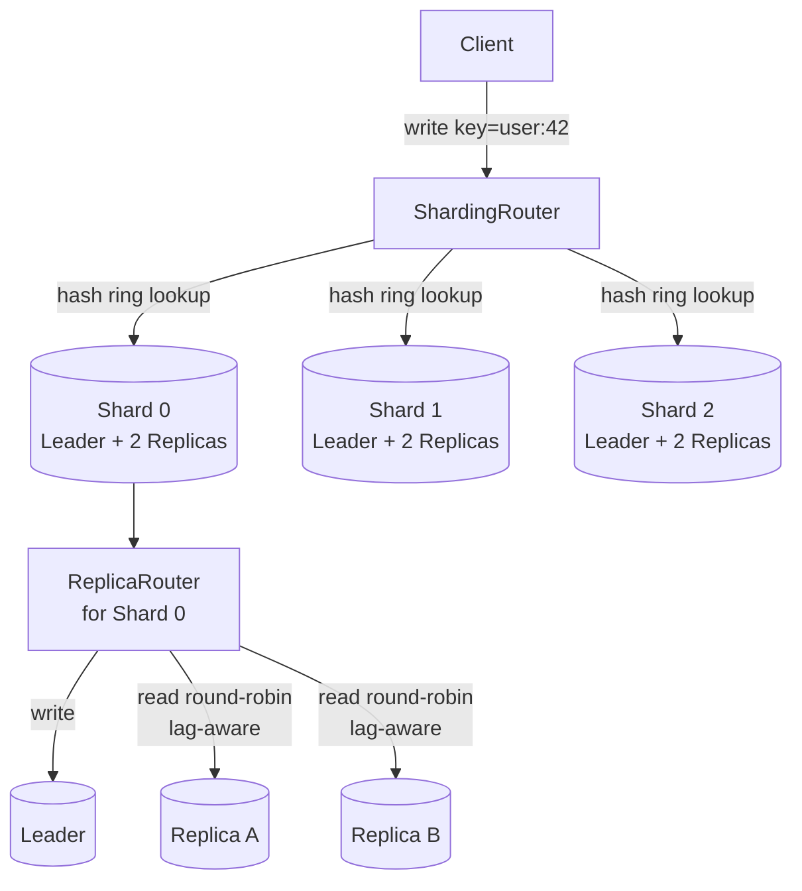

# Phase 7 · Week 03 · Day 6 — Build: Sharding Router + Replica Routing

> Objective: Implement a consistent-hashing sharding router and a lag-aware replica read-router, both fully tested.  ·  Time: ~4 hr  ·  Prereqs: [[day-3]], [[day-4]], [[day-5]]

---

## Concept

Two of the hardest problems in distributed data layers are:

1. **Shard routing** — given an arbitrary key, which shard owns it, and how do you rebalance with minimal data movement when nodes join/leave?
2. **Replica routing** — given that you have N read replicas, how do you route reads without hitting a replica that is lagging behind the leader by an unacceptable amount?

Today you build both from scratch in Python, wire them together, and test them with pytest.

---

## Architecture



```
Request flow summary
──────────────────────────────────────────────────────────────────
WRITE:  client → ShardingRouter.get_shard(key)
                 → ReplicaRouter(shard).route_write()
                 → leader node
READ:   client → ShardingRouter.get_shard(key)
                 → ReplicaRouter(shard).route_read()
                 → healthiest replica (round-robin, lag-filtered)
──────────────────────────────────────────────────────────────────
```

---

## How it works internally

### Consistent Hashing with Virtual Nodes

A naive hash ring assigns each physical node one position. When a node is added or removed, only the keys between the new node and its predecessor move — O(K/N) keys, where K = total keys and N = nodes. This is far better than rehashing everything.

**Virtual nodes** (vnodes) improve load distribution: instead of one ring position per physical node, you place V positions per node (default V=150). All V positions hash to the same physical node. With vnodes:

- Even if physical node capacities differ, you can assign more vnodes to bigger nodes.
- The chance of a single node owning a large consecutive arc shrinks dramatically.

```
Ring (simplified, 4 vnodes per node):

0        100      200      300      400 (mod 400)
|--A0----|--B0----|--A1----|--B1----|
         ↑                ↑
     key=hash(x)      key=hash(y)
     → node A          → node B
```

**Adding a node C**: insert C's vnodes into the sorted ring. The keys that fall between each new C vnode and the previous ring position move from the former owner to C. No other keys move.

**Removing a node**: the reverse. Keys belonging to the removed node's positions are reassigned to the next clockwise node.

### Replica Lag-Aware Routing

Replication lag (`replica_lag_ms`) is the delay between a write landing on the leader and the replica acknowledging it. For most reads, small lag (< 100 ms) is fine. For reads requiring strong consistency (e.g., "did my like just register?"), you must route to the leader or a replica below a lag threshold.

Round-robin over replicas distributes read load. But blindly round-robining onto a lagging replica can return stale data. The `ReplicaRouter`:

1. Maintains a dict `{replica_id: lag_ms}`.
2. Filters out replicas exceeding `max_lag_ms` (default 200 ms).
3. Round-robins across the remaining healthy set.
4. Falls back to the leader if no healthy replica is available.

---

## Worked Example

```python
# Quick smoke-test — run this after you finish the implementation
import logging
from sharding_router import ShardingRouter
from replica_router import ReplicaRouter

logging.basicConfig(level=logging.INFO)

# --- Sharding ---
router = ShardingRouter(virtual_nodes=150)
router.add_node("shard-0")
router.add_node("shard-1")
router.add_node("shard-2")

keys = [f"user:{i}" for i in range(1000)]
distribution = router.get_distribution(keys)
# Expected: roughly 33% per shard (±10%)
for shard, count in distribution.items():
    print(f"{shard}: {count} keys ({count/10:.1f}%)")

# --- Replica routing ---
rr = ReplicaRouter(
    leader="shard-0-leader",
    replicas=["shard-0-replica-a", "shard-0-replica-b"],
    max_lag_ms=200,
)
rr.mark_replica_lagging("shard-0-replica-a", lag_ms=350)  # over threshold

for _ in range(4):
    node = rr.route_read()
    print(f"read → {node}")
# Expected: all reads go to shard-0-replica-b (replica-a is lagging)
```

---

## Skeleton Code

Create `src/data_layer/sharding_router.py`:

```python
"""Consistent-hashing sharding router with virtual nodes."""

from __future__ import annotations

import hashlib
import logging
from bisect import bisect_left, insort
from collections import defaultdict
from dataclasses import dataclass, field
from typing import Optional

logger = logging.getLogger(__name__)


@dataclass
class ShardingRouter:
    """Routes keys to shards using a consistent hash ring with virtual nodes.

    Args:
        virtual_nodes: Number of virtual node positions per physical node.
                       Higher values improve key distribution uniformity.
    """

    virtual_nodes: int = 150
    _ring: dict[int, str] = field(default_factory=dict, init=False, repr=False)
    _sorted_keys: list[int] = field(default_factory=list, init=False, repr=False)
    _nodes: set[str] = field(default_factory=set, init=False, repr=False)

    # ------------------------------------------------------------------
    # Public API
    # ------------------------------------------------------------------

    def add_node(self, node: str) -> None:
        """Add a physical node to the ring.

        Places `virtual_nodes` positions on the ring for `node`.
        Logs the number of positions added.
        """
        # TODO: for each vnode index (0..virtual_nodes-1):
        #   1. compute hash key: _hash(f"{node}#{i}")
        #   2. add to self._ring and insort into self._sorted_keys
        # TODO: add node to self._nodes
        # TODO: log at INFO level
        raise NotImplementedError

    def remove_node(self, node: str) -> None:
        """Remove a physical node and all its virtual positions from the ring.

        Raises KeyError if node is not in the ring.
        """
        # TODO: validate node is in self._nodes
        # TODO: for each vnode index, remove hash key from ring and sorted_keys
        # TODO: remove from self._nodes
        # TODO: log at INFO level
        raise NotImplementedError

    def get_shard(self, key: str) -> str:
        """Return the physical node responsible for `key`.

        Uses clockwise lookup on the sorted ring.
        Raises RuntimeError if the ring is empty.
        """
        # TODO: guard empty ring
        # TODO: hash the key
        # TODO: bisect_left on self._sorted_keys
        # TODO: wrap around (modulo len) for clockwise behaviour
        # TODO: return self._ring[self._sorted_keys[idx]]
        raise NotImplementedError

    def get_distribution(self, keys: list[str]) -> dict[str, int]:
        """Return a count of how many keys from `keys` map to each shard."""
        # TODO: iterate keys, call get_shard, accumulate counts
        raise NotImplementedError

    # ------------------------------------------------------------------
    # Internal helpers
    # ------------------------------------------------------------------

    @staticmethod
    def _hash(value: str) -> int:
        """Return a stable 32-bit integer hash of `value` using MD5."""
        # TODO: use hashlib.md5, digest first 4 bytes, int.from_bytes big-endian
        raise NotImplementedError
```

Create `src/data_layer/replica_router.py`:

```python
"""Lag-aware read-replica router."""

from __future__ import annotations

import logging
from dataclasses import dataclass, field
from typing import Optional

logger = logging.getLogger(__name__)


@dataclass
class ReplicaRouter:
    """Routes reads to healthy replicas and writes to the leader.

    A replica is considered "healthy" if its reported lag is below
    `max_lag_ms`. Round-robin is applied over the healthy set.
    Falls back to the leader when no healthy replica exists.

    Args:
        leader: Node name for the primary/leader.
        replicas: List of replica node names.
        max_lag_ms: Maximum acceptable replication lag in milliseconds.
    """

    leader: str
    replicas: list[str]
    max_lag_ms: int = 200
    _lag: dict[str, int] = field(default_factory=dict, init=False, repr=False)
    _rr_index: int = field(default=0, init=False, repr=False)

    # ------------------------------------------------------------------
    # Public API
    # ------------------------------------------------------------------

    def mark_replica_lagging(self, replica: str, lag_ms: int) -> None:
        """Record the current replication lag for `replica`.

        Raises ValueError if `replica` is not in self.replicas.
        Logs at WARNING if lag exceeds max_lag_ms.
        """
        # TODO: validate replica in self.replicas
        # TODO: store lag in self._lag
        # TODO: log warning if lag_ms > self.max_lag_ms
        raise NotImplementedError

    def mark_replica_healthy(self, replica: str) -> None:
        """Clear any lag record for `replica`, marking it healthy.

        Raises ValueError if `replica` is not in self.replicas.
        """
        # TODO: remove from self._lag if present
        raise NotImplementedError

    def route_read(self) -> str:
        """Return the next node to handle a read request.

        Algorithm:
          1. Build healthy replica list: replicas where lag < max_lag_ms
             (replicas with no lag record are considered healthy).
          2. If healthy list is non-empty: round-robin across it.
          3. If empty: fall back to leader and log a WARNING.

        Returns the node name as a string.
        """
        # TODO: compute healthy_replicas
        # TODO: if empty, log warning and return self.leader
        # TODO: pick index = self._rr_index % len(healthy_replicas)
        # TODO: increment self._rr_index
        # TODO: return selected replica
        raise NotImplementedError

    def route_write(self) -> str:
        """Return the leader node for all writes."""
        # TODO: one line
        raise NotImplementedError

    def status(self) -> dict[str, object]:
        """Return a dict summarising router state for observability.

        Keys: leader, total_replicas, healthy_replicas, lagging_replicas
        """
        # TODO: compute and return status dict
        raise NotImplementedError
```

---

## Exercises

Work through these in order. Each exercise maps to one `# TODO` block or a test file.

**Part 1 — ShardingRouter (90 min)**

1. Implement `_hash`. Run: `assert ShardingRouter._hash("test") == ShardingRouter._hash("test")` — must be deterministic.
2. Implement `add_node`. Add three nodes and print `len(router._ring)` — should equal `3 * virtual_nodes`.
3. Implement `get_shard`. Call `router.get_shard("user:1")` and verify it returns one of the added nodes.
4. Implement `remove_node`. Add two nodes, remove one, verify `len(router._ring) == virtual_nodes`.
5. Implement `get_distribution`. With 3 nodes and 3000 keys, verify each shard receives 900–1100 keys (±10%).
6. **Rebalance test**: with 2 nodes and 1000 keys, record each key's shard. Add a third node. Measure what fraction of keys moved — should be roughly 1/3 (±5%).

**Part 2 — ReplicaRouter (60 min)**

7. Implement `mark_replica_lagging` and `mark_replica_healthy`.
8. Implement `route_write` — trivial.
9. Implement `route_read`. With two healthy replicas, verify alternating results over 4 calls.
10. Mark one replica lagging above threshold. Verify all reads go to the remaining healthy replica.
11. Mark all replicas lagging. Verify `route_read` returns the leader and logs a warning.
12. Implement `status`. Verify the dict keys are correct and counts are accurate.

**Part 3 — Tests (60 min)**

13. Create `tests/unit/test_sharding_router.py` — at minimum 6 tests covering: empty ring error, single node, multi-node distribution, add then remove idempotency, rebalance fraction, and key determinism.
14. Create `tests/unit/test_replica_router.py` — at minimum 6 tests covering: healthy round-robin, lag filtering, all-lagging fallback, mark_healthy clears lag, invalid replica raises ValueError, status dict shape.

**Part 4 — Integration (30 min)**

15. Create `tests/integration/test_data_layer.py`. Write one integration test that:
    - Creates a `ShardingRouter` with 3 shards.
    - Creates one `ReplicaRouter` per shard (2 replicas each).
    - Routes 100 writes and 1000 reads across the combined system.
    - Marks one replica in one shard as lagging; verifies that shard's reads never land on the lagging replica.

(Solutions: ../solutions/week-03/day-6.md)

---

## Self-check

- [ ] `ShardingRouter._hash` is deterministic across multiple calls and processes
- [ ] Adding N nodes places exactly `N * virtual_nodes` entries in `_ring`
- [ ] `get_shard` wraps correctly at the ring boundary (clockwise)
- [ ] Removing a node reduces `_ring` to `(N-1) * virtual_nodes` entries
- [ ] Distribution across 3 nodes is within ±10% of uniform for 3000 keys
- [ ] ~1/3 of keys (±5%) change shard when a 4th node is added to a 3-node ring
- [ ] `route_write` always returns the leader
- [ ] Round-robin alternates evenly across healthy replicas
- [ ] A lagging replica (above threshold) is never returned by `route_read`
- [ ] All-lagging fallback returns leader and emits a WARNING log
- [ ] All unit and integration tests pass: `pytest tests/ -v`
- [ ] No secrets or hardcoded credentials anywhere in the code
