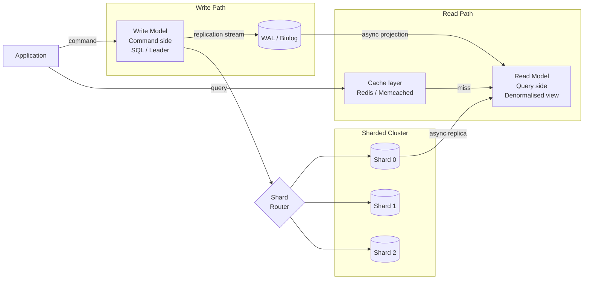

# Phase 7 · Week 03 · Day 7 — Week Review + Project Work

> Objective: Consolidate the week's data-layer concepts, complete the week project, and validate understanding with a design exercise.  ·  Time: ~3 hr  ·  Prereqs: [[day-1]] through [[day-6]]

---

## Week 3 Recap

This week covered every layer of the data tier in a production system. Below is a compressed reference — use it to spot gaps before the assessment.

```
┌─────────────────────────────────────────────────────────────────────┐
│  Topic            Core idea                    Key trade-off        │
├─────────────────────────────────────────────────────────────────────┤
│  SQL vs NoSQL     ACID vs BASE; joins vs        Consistency vs       │
│                   horizontal scale              availability (CAP)   │
│                                                                     │
│  Indexing         B-tree: range + eq            Write amp; storage   │
│                   Hash: eq only (fast)          overhead             │
│                   Composite: col order matters  Read vs write perf   │
│                                                                     │
│  Replication      Sync: no data loss            Latency on writes    │
│                   Async: lower latency          Potential data loss  │
│                   Semi-sync: middle ground      Complexity           │
│                                                                     │
│  Sharding         Range: hotspot risk           Rebalancing cost     │
│                   Hash: even distribution       No range queries     │
│                   Consistent hash: min move     Vnode overhead       │
│                                                                     │
│  CQRS             Separate read/write models    Eventual consistency │
│                   Read model optimised for      Sync complexity      │
│                   query patterns                (event sourcing)     │
│                                                                     │
│  OLTP vs OLAP     Row store: point reads        Cannot efficiently   │
│                   Column store: aggregations    do both in one DB    │
└─────────────────────────────────────────────────────────────────────┘
```

---

## Concept: How the Pieces Fit Together

In a production read-heavy system these concepts layer on top of each other:



Every architectural decision cascades:

- **Sharding strategy** determines which datastore each write lands in.
- **Replication** propagates those writes to replicas and, via CDC/events, to the CQRS read model.
- **Read routing** (your `ReplicaRouter` from Day 6) decides which replica answers a query.
- **Index design** on the read model determines whether the query is O(log N) or O(N).

---

## Worked Example: Data-Layer Design Doc Template

A design document forces you to articulate choices. Below is a template plus a short example for a social-feed product — you will flesh this out fully in the week project.

```markdown
# Data-Layer Design — <Product Name>

## 1. Requirements summary
- Write throughput: X writes/s
- Read throughput:  Y reads/s (read:write ratio Z:1)
- Latency targets:  p99 write < A ms, p99 read < B ms
- Consistency:      writes strong, reads eventual OK? or strong required?
- Retention:        data kept for N months/years

## 2. Datastore selection
| Use case         | Store chosen    | Rationale                       |
|------------------|-----------------|---------------------------------|
| User profiles    | PostgreSQL      | ACID, complex queries           |
| Post content     | PostgreSQL      | Relational, full-text search    |
| Timeline cache   | Redis Sorted Set| O(log N) range, TTL eviction    |
| Analytics        | ClickHouse      | Column store, fast aggregations |

## 3. Partitioning strategy
- Partition key: `user_id`
- Method: consistent hashing (virtual_nodes=150)
- Shard count: 16 (supports ~5× growth before reshard)
- Hotspot mitigation: celebrity accounts → dedicated overflow shard

## 4. Replication approach
- Leader per shard: 1
- Replicas per shard: 2
- Mode: semi-synchronous (1 replica must ack before leader confirms)
- Failover: automatic via orchestrator, < 30 s RTO

## 5. CQRS read model
- Read model: `timelines` table (denormalised: post_id, author_id,
  author_name, body_preview, like_count, created_at)
- Projection: event-driven via Kafka (PostCreated, PostLiked events)
- Staleness: up to 500 ms acceptable

## 6. Index design
- `timelines(follower_id, created_at DESC)` — covering index for feed query
- `posts(author_id, created_at DESC)` — profile page
- Avoid: index on `like_count` (high write amplification, use counter table)

## 7. Open questions / risks
- [ ] Celebrity fan-out: async push or pull-on-read?
- [ ] Cross-shard transactions: two-phase commit or saga?
```

---

## Integration Exercise

Combine the `ShardingRouter` and `ReplicaRouter` you built on Day 6 into a lightweight `DataLayerClient` facade:

```python
"""Facade that wires sharding router + per-shard replica routers."""

from __future__ import annotations

import logging
import os
from dataclasses import dataclass, field

from data_layer.sharding_router import ShardingRouter
from data_layer.replica_router import ReplicaRouter

logger = logging.getLogger(__name__)


@dataclass
class DataLayerClient:
    """Unified client for routing reads and writes in a sharded cluster.

    Args:
        shard_names: List of shard identifiers (e.g. ["shard-0", "shard-1"]).
        replicas_per_shard: Number of read replicas per shard.
        virtual_nodes: Virtual nodes for the consistent hash ring.
        max_lag_ms: Max acceptable replica lag for reads.
    """

    shard_names: list[str]
    replicas_per_shard: int = 2
    virtual_nodes: int = 150
    max_lag_ms: int = 200

    _shard_router: ShardingRouter = field(init=False, repr=False)
    _replica_routers: dict[str, ReplicaRouter] = field(
        default_factory=dict, init=False, repr=False
    )

    def __post_init__(self) -> None:
        self._shard_router = ShardingRouter(virtual_nodes=self.virtual_nodes)
        for shard in self.shard_names:
            self._shard_router.add_node(shard)
            leader = f"{shard}-leader"
            replicas = [f"{shard}-replica-{i}" for i in range(self.replicas_per_shard)]
            self._replica_routers[shard] = ReplicaRouter(
                leader=leader,
                replicas=replicas,
                max_lag_ms=self.max_lag_ms,
            )

    def get_write_node(self, key: str) -> str:
        """Return the leader node responsible for writing `key`."""
        shard = self._shard_router.get_shard(key)
        return self._replica_routers[shard].route_write()

    def get_read_node(self, key: str) -> str:
        """Return the best replica (or leader fallback) for reading `key`."""
        shard = self._shard_router.get_shard(key)
        return self._replica_routers[shard].route_read()

    def mark_replica_lagging(self, shard: str, replica: str, lag_ms: int) -> None:
        """Propagate lag information to the shard's ReplicaRouter."""
        self._replica_routers[shard].mark_replica_lagging(replica, lag_ms)
```

---

## Exercises

1. Complete the `DataLayerClient` from the skeleton above — fill in any missing pieces and add a `cluster_status()` method that returns a dict mapping each shard to its `ReplicaRouter.status()`.

2. Write a pytest test `tests/integration/test_data_layer_client.py` that:
   - Creates a `DataLayerClient` with 3 shards and 2 replicas each.
   - Calls `get_write_node` and `get_read_node` for 50 keys and verifies the write node is always a leader (`-leader` suffix) and the read node is always a replica under normal conditions.
   - Marks all replicas of one shard as lagging; verifies that shard's reads fall back to its leader.

3. **Design doc exercise** (40 min): Using the template from the Worked Example section, write a 1-page data-layer design doc for a social media feed product. Use the [[project.md]] requirements as input. Focus on sections 1–5. Save it as `docs/design-draft.md` in your project directory.

4. **Self-assessment gap check**: For each row in the Week 3 Recap table, write one interview-style question you could be asked and one sentence answer. If you cannot answer it confidently in one sentence, re-read the relevant Day's lesson before the assessment.

5. **Optional stretch**: Add a `reshard` method to `DataLayerClient` that adds a new shard to the ring and returns a list of `(key, old_shard, new_shard)` tuples showing which keys would move. (No actual data movement needed — just the routing delta.)

(Solutions: ../solutions/week-03/day-7.md)

---

## Week Self-check

### SQL & NoSQL
- [ ] Can explain CAP theorem and place PostgreSQL, Cassandra, Redis on it
- [ ] Know when to use a document store vs relational
- [ ] Can describe ACID guarantees and which are relaxed under BASE

### Indexing
- [ ] Know when a composite index is used (leftmost prefix rule)
- [ ] Can estimate write amplification of adding an index
- [ ] Can explain why `LIKE '%foo'` cannot use a B-tree index

### Replication
- [ ] Can describe synchronous vs asynchronous replication latency trade-off
- [ ] Know what replication lag means and how to measure it
- [ ] Can explain semi-synchronous replication and when to use it

### Sharding
- [ ] Can explain consistent hashing and the role of virtual nodes
- [ ] Know the difference between range-based and hash-based sharding
- [ ] Can estimate key movement fraction when adding a node

### CQRS & Event Sourcing
- [ ] Can draw the write path and read model projection flow
- [ ] Know how eventual consistency manifests in a CQRS system
- [ ] Can explain what a "projection" is

### Code
- [ ] `ShardingRouter` fully implemented, all tests passing
- [ ] `ReplicaRouter` fully implemented, all tests passing
- [ ] `DataLayerClient` integration test passing
- [ ] No `print` statements — all observability via `logging`
- [ ] All public functions type-annotated
