# Phase 7 · Week 06 · Day 1 — Designing a Production RAG Platform at Scale

> Objective: Architect a production-grade RAG platform covering ingestion, vector store scaling, retrieval, caching, and eval gates.  ·  Time: ~1 hr  ·  Prereqs: [[phase-6-week-05-day-5]]

---

## Concept

A production RAG platform is not a single vector database with a search endpoint. It is a **data platform** — a set of coordinated services that transform raw documents into queryable knowledge, serve queries under latency SLOs, and degrade gracefully at 10x traffic spikes.

Key responsibilities:

| Layer | Concern |
|---|---|
| Ingestion pipeline | Extract → chunk → embed → quality-gate → store |
| Vector store | Efficient ANN search, horizontal scale, consistency |
| Retrieval service | Hybrid search, reranking, relevance scoring |
| Caching | Reduce latency and LLM cost on repeated patterns |
| Observability | Trace every query from request to ranked chunks |

The failure modes of naive RAG at scale:
- Embedding pipeline becomes a bottleneck (single-threaded, synchronous)
- Vector store reindex blocks live traffic
- No quality gate → garbage chunks degrade LLM output
- Cache misses on semantically equivalent queries (same meaning, different wording)
- No per-chunk provenance → impossible to debug citation errors

---

## How It Works Internally

### Ingestion Pipeline Design

**Chunking strategies** — choice depends on document structure:

- **Fixed-size sliding window** — 512 tokens with 10% overlap. Predictable, works for dense prose. Loses semantic boundaries.
- **Sentence / paragraph boundary** — split at natural language boundaries. Better coherence, variable chunk sizes.
- **Semantic chunking** — embed candidate split points, split where cosine similarity drops. Highest quality, most expensive.
- **Hierarchical chunking** — store both parent (256 tokens, summary) and child (64 tokens, detail) chunks. Retrieve small, return large context.

**Embedding pipeline** — each chunk goes through:
1. Normalization (Unicode, whitespace, language detection)
2. Embedding model call (batched for throughput — 256 chunks per batch is typical)
3. L2 normalization of the output vector (required for cosine MIPS queries)
4. Metadata extraction: source URL, section header, page number, language, timestamp

**Metadata extraction** is often neglected but is critical for:
- Pre-filter before ANN search (reduces search space dramatically)
- Attribution in citations
- Freshness-based re-ingestion triggers

### Vector Store Scaling

Two dominant index types for production scale:

**HNSW (Hierarchical Navigable Small World)**
- Graph-based. O(log n) query, high recall (>95% at ef=200).
- Memory-resident. 4-byte float32 × dimension × vectors. At 1M × 1536d → ~6 GB RAM.
- Excellent for <10M vectors. Incremental inserts are fast (no reindex).
- Use when: low latency is paramount, dataset fits in memory, updates are frequent.

**IVF-PQ (Inverted File + Product Quantization)**
- Clusters vectors (IVF), then compresses residuals (PQ). 8-32× memory reduction.
- Approximate by design. Recall tunable via `nprobe` (number of clusters to search).
- Disk-resident possible (DiskANN variant). Handles 100M+ vectors on commodity hardware.
- Use when: dataset exceeds memory, cost matters, slight recall loss acceptable.

**Sharding strategy**: partition by namespace (tenant, document collection, language). Avoids cross-shard queries for the common case. Route by consistent hash of namespace key.

**Replication**: read replicas for query scaling. Write to primary only during ingestion. Async replication lag is acceptable for RAG (documents aren't real-time financial data).

### Retrieval Service Architecture

**Hybrid search** — combine sparse and dense signals:

```
final_score = alpha * dense_score + (1 - alpha) * sparse_score
```

- Dense: vector similarity (captures semantics, handles synonyms)
- Sparse: BM25 / TF-IDF (captures exact keyword matches, proper nouns)
- `alpha` is a tunable parameter. Start at 0.7 dense, 0.3 sparse. Tune with NDCG on a held-out eval set.

**Reranking tier** — after retrieving top-K candidates (k=50-100), run a cross-encoder reranker:
- Cross-encoder sees both query AND chunk together (no precomputed embeddings)
- Much more accurate than bi-encoder at scoring relevance
- Too slow for full corpus → use as second-stage on candidates only
- Models: `cross-encoder/ms-marco-MiniLM-L-6-v2` for latency-sensitive; Cohere Rerank API for quality-sensitive

### Caching Layers

Three distinct caches with different semantics:

| Cache | Key | Invalidation |
|---|---|---|
| Query cache | `hash(query + filters)` | TTL (5-60 min) |
| Embedding cache | `hash(normalized_text)` | Content-addressed, never expires |
| Result cache | `hash(query + top_k + model_version)` | On re-ingestion |

**Semantic query cache** — cluster query embeddings with approximate lookup. If incoming query embedding is within cosine distance 0.05 of a cached query, return cached result. Reduces LLM calls by 20-40% on typical enterprise workloads.

### Eval Gates in Ingestion

Before a chunk enters the vector store, it must pass quality scoring:

- **Length gate**: reject chunks < 50 tokens or > 600 tokens (too short = noise, too long = dilutes relevance)
- **Information density**: ratio of content tokens to stop words. Low density → structural noise (headers, nav elements)
- **Deduplication**: near-duplicate detection via MinHash LSH. Prevents vector space saturation with repeated content
- **Language confidence**: reject chunks where language detection confidence < 0.85

Chunks failing gates go to a dead-letter queue for human review, not silent discard.

---

## Platform Architecture (Mermaid)

```mermaid
flowchart TB
    subgraph Ingestion["Ingestion Pipeline"]
        SRC[Document Sources\nS3 / SharePoint / Confluence] --> EXT[Extractor\nPDF / HTML / DOCX]
        EXT --> CHUNK[Chunker\nSemantic / Sliding Window]
        CHUNK --> EVAL[Eval Gate\nLength · Density · Dedup]
        EVAL -->|pass| META[Metadata Extractor]
        EVAL -->|fail| DLQ[Dead-Letter Queue]
        META --> EMBED_W[Embedding Worker Pool\nasync batch × 8]
        EMBED_W --> NORM[L2 Normalizer]
    end

    subgraph VectorStore["Vector Store Cluster"]
        NORM --> PRIMARY[Primary Shard\nHNSW index]
        PRIMARY --> REPLICA1[Read Replica 1]
        PRIMARY --> REPLICA2[Read Replica 2]
    end

    subgraph Retrieval["Retrieval Service"]
        QIN[Query Request] --> ECACHE{Embedding\nCache?}
        ECACHE -->|hit| QEMBED_CACHE[Cached Embedding]
        ECACHE -->|miss| QEMBED[Query Embedder]
        QEMBED --> QCACHE[(Query Cache\nRedis)]
        QEMBED_CACHE --> HYBRID[Hybrid Search\nDense + BM25]
        QCACHE --> HYBRID
        REPLICA1 --> HYBRID
        SPARSE[BM25 Index\nElasticsearch] --> HYBRID
        HYBRID --> RERANK[Cross-Encoder\nReranker]
        RERANK --> RCACHE[(Result Cache\nRedis)]
        RCACHE --> RESP[Ranked Chunks\n+ Metadata]
    end

    style Ingestion fill:#1a1a2e,stroke:#4a90d9
    style VectorStore fill:#16213e,stroke:#4a90d9
    style Retrieval fill:#0f3460,stroke:#4a90d9
```



---

## Worked Example

A Python async ingestion pipeline with chunking, embedding, eval gate, and vector store insertion:

```python
"""
production_rag/ingestion/pipeline.py

Async ingestion pipeline: extract → chunk → eval → embed → store.
"""
import asyncio
import hashlib
import logging
import os
from dataclasses import dataclass, field
from typing import AsyncIterator

import anthropic
import numpy as np

logger = logging.getLogger(__name__)


@dataclass
class Chunk:
    text: str
    doc_id: str
    chunk_index: int
    metadata: dict = field(default_factory=dict)
    embedding: list[float] | None = None

    @property
    def content_hash(self) -> str:
        return hashlib.sha256(self.text.encode()).hexdigest()[:16]


@dataclass
class EvalResult:
    passed: bool
    reason: str = ""


class ChunkEvalGate:
    """Quality gate applied before embedding."""

    MIN_TOKENS = 50
    MAX_TOKENS = 600

    def evaluate(self, chunk: Chunk) -> EvalResult:
        word_count = len(chunk.text.split())

        if word_count < self.MIN_TOKENS:
            return EvalResult(False, f"too_short: {word_count} tokens")
        if word_count > self.MAX_TOKENS:
            return EvalResult(False, f"too_long: {word_count} tokens")

        stop_words = {"the", "a", "an", "is", "in", "on", "at", "to", "of", "and"}
        tokens = chunk.text.lower().split()
        density = 1.0 - sum(1 for t in tokens if t in stop_words) / max(len(tokens), 1)
        if density < 0.35:
            return EvalResult(False, f"low_density: {density:.2f}")

        return EvalResult(True)


class SemanticChunker:
    """Sliding window chunker with sentence boundary awareness."""

    def __init__(self, chunk_size: int = 400, overlap: int = 50):
        self.chunk_size = chunk_size
        self.overlap = overlap

    def chunk(self, text: str, doc_id: str) -> list[Chunk]:
        sentences = text.replace("\n", " ").split(". ")
        chunks: list[Chunk] = []
        buffer: list[str] = []
        buffer_tokens = 0
        chunk_idx = 0

        for sentence in sentences:
            sentence_tokens = len(sentence.split())
            if buffer_tokens + sentence_tokens > self.chunk_size and buffer:
                chunk_text = ". ".join(buffer) + "."
                chunks.append(Chunk(text=chunk_text, doc_id=doc_id, chunk_index=chunk_idx))
                chunk_idx += 1
                # Keep overlap: last N tokens worth of sentences
                overlap_buffer: list[str] = []
                overlap_tokens = 0
                for s in reversed(buffer):
                    if overlap_tokens + len(s.split()) > self.overlap:
                        break
                    overlap_buffer.insert(0, s)
                    overlap_tokens += len(s.split())
                buffer = overlap_buffer
                buffer_tokens = overlap_tokens

            buffer.append(sentence)
            buffer_tokens += sentence_tokens

        if buffer:
            chunks.append(Chunk(text=". ".join(buffer), doc_id=doc_id, chunk_index=chunk_idx))

        return chunks


class EmbeddingWorker:
    """
    Async embedding worker using claude-sonnet-5-5 via Anthropic client.
    Batches chunks for throughput.
    """

    BATCH_SIZE = 32

    def __init__(self):
        self.client = anthropic.AsyncAnthropic(api_key=os.getenv("ANTHROPIC_API_KEY"))

    async def embed_batch(self, texts: list[str]) -> list[list[float]]:
        """
        NOTE: Anthropic's embeddings endpoint is illustrative here.
        In production, use a dedicated embedding model endpoint.
        This example shows the async batch pattern.
        """
        # Placeholder: real embedding call would go here
        # response = await self.client.embeddings.create(model="...", input=texts)
        # return [r.embedding for r in response.data]

        # Simulated for illustration — replace with actual embedding API
        return [np.random.randn(1536).tolist() for _ in texts]

    async def embed_chunks(self, chunks: list[Chunk]) -> list[Chunk]:
        results: list[Chunk] = []
        for i in range(0, len(chunks), self.BATCH_SIZE):
            batch = chunks[i : i + self.BATCH_SIZE]
            texts = [c.text for c in batch]
            logger.info("Embedding batch %d-%d", i, i + len(batch))
            embeddings = await self.embed_batch(texts)
            for chunk, emb in zip(batch, embeddings):
                # L2 normalize
                arr = np.array(emb, dtype=np.float32)
                arr = arr / (np.linalg.norm(arr) + 1e-9)
                chunk.embedding = arr.tolist()
                results.append(chunk)
        return results


class IngestionPipeline:
    """
    Full async ingestion pipeline.

    Usage:
        pipeline = IngestionPipeline()
        stats = await pipeline.ingest(doc_id="doc-001", text=raw_text)
    """

    def __init__(self):
        self.chunker = SemanticChunker()
        self.gate = ChunkEvalGate()
        self.embedder = EmbeddingWorker()
        self._vector_store: list[Chunk] = []  # Replace with real vector DB client
        self._dead_letter: list[tuple[Chunk, str]] = []

    async def ingest(self, doc_id: str, text: str) -> dict:
        chunks = self.chunker.chunk(text, doc_id)
        logger.info("doc=%s produced %d chunks", doc_id, len(chunks))

        passed: list[Chunk] = []
        failed = 0
        for chunk in chunks:
            result = self.gate.evaluate(chunk)
            if result.passed:
                passed.append(chunk)
            else:
                self._dead_letter.append((chunk, result.reason))
                failed += 1
                logger.debug("chunk rejected doc=%s idx=%d reason=%s",
                             doc_id, chunk.chunk_index, result.reason)

        embedded = await self.embedder.embed_chunks(passed)

        for chunk in embedded:
            chunk.metadata["doc_id"] = doc_id
            chunk.metadata["content_hash"] = chunk.content_hash
            self._vector_store.append(chunk)  # Replace: await vector_db.upsert(chunk)

        stats = {
            "doc_id": doc_id,
            "total_chunks": len(chunks),
            "passed_gate": len(passed),
            "failed_gate": failed,
            "embedded_and_stored": len(embedded),
        }
        logger.info("ingestion complete stats=%s", stats)
        return stats
```

Run a quick smoke test:

```python
# tests/unit/ingestion/test_pipeline.py
import asyncio
import pytest
from production_rag.ingestion.pipeline import IngestionPipeline, ChunkEvalGate, Chunk

def test_eval_gate_rejects_short_chunk():
    gate = ChunkEvalGate()
    chunk = Chunk(text="Too short.", doc_id="d1", chunk_index=0)
    result = gate.evaluate(chunk)
    assert not result.passed
    assert "too_short" in result.reason

@pytest.mark.asyncio
async def test_pipeline_returns_stats():
    text = " ".join(["This is a meaningful sentence about machine learning systems."] * 60)
    pipeline = IngestionPipeline()
    stats = await pipeline.ingest(doc_id="test-doc", text=text)
    assert stats["embedded_and_stored"] >= 1
    assert "doc_id" in stats
```

---

## Exercises

1. **Chunking strategy benchmark** — Implement a `RecursiveCharacterChunker` that splits on `\n\n`, then `\n`, then `. `, then ` ` in order. Compare average chunk length and coherence score (BLEU against original paragraphs) against the `SemanticChunker` above on a 50-page PDF. Which strategy produces higher retrieval NDCG on 20 test queries?

2. **HNSW vs IVF-PQ tradeoff analysis** — Using FAISS, build both an HNSW index (m=16, ef_construction=200) and an IVF-PQ index (nlist=256, m=16, nbits=8) over 500K synthetic 1536-d vectors. Measure: index build time, index size on disk, query latency at p50/p95, and recall@10 at nprobe=8/16/32. Plot the recall-latency Pareto curve. Under what conditions would you choose each?

3. **Semantic query cache** — Implement a `SemanticQueryCache` class backed by an in-memory HNSW index. On each query, check if any cached query embedding is within cosine distance 0.05. If yes, return the cached result. If no, execute the real retrieval and store the result. Measure cache hit rate and mean latency reduction on a synthetic workload of 1000 queries with 30% semantic duplicates.

4. **Eval gate tuning** — The current eval gate uses fixed thresholds (50-600 tokens, density > 0.35). Design an experiment to tune these thresholds using human-labeled relevance judgments. Define a metric that captures the tradeoff between ingestion recall (are all good chunks passing?) and precision (are bad chunks being rejected?). Implement the experiment and report optimal thresholds for a legal document corpus.

---

## Self-check

- Can you explain why L2-normalizing embeddings before storage is required for cosine similarity queries?
- What is the difference between `ef_construction` and `ef` (search time) in HNSW? Which affects build quality vs. query recall?
- Why does hybrid search typically outperform dense-only retrieval on proper nouns and product codes?
- What happens to HNSW recall as you perform incremental inserts without periodic reindexing? How does `hnswlib` handle this internally?
- If ingestion throughput needs to scale from 10 docs/sec to 1000 docs/sec, which components in the pipeline are the bottlenecks and what architectural changes address each?
