# Phase 7 · Week 06 · Day 2 — Designing an Agent Platform

> Objective: Architect a production agent platform covering orchestration, MCP tool services, memory stores, HITL checkpoints, and agent observability.  ·  Time: ~1 hr  ·  Prereqs: [[phase-7-week-06-day-1]]

---

## Concept

A production agent platform is the infrastructure layer between your LLM and the real world. It is responsible for:

- **Executing agent graphs reliably** — deterministic replay, fault tolerance, step-level persistence
- **Routing tool calls safely** — sandboxed execution, registry-based discovery, audit trail
- **Managing agent memory** — scoped by time horizon and memory type
- **Inserting human-in-the-loop control points** — approval gates, escalation paths, veto mechanisms
- **Making agent behavior observable** — correlated traces, per-tool-call spans, cost attribution

Without this infrastructure, agents are demo-quality. With it, they can run as autonomous production services with SLOs, audit requirements, and compliance controls.

Key design tensions:
- **Autonomy vs control**: more HITL = safer but slower; fewer HITL = faster but higher blast radius
- **Memory breadth vs cost**: richer memory = better decisions but more tokens per turn
- **Tool generality vs safety**: generic tool execution is powerful but hard to sandbox

---

## How It Works Internally

### Orchestration Layer — LangGraph-Style Graph Execution

An agent workflow is a **directed graph** of nodes (LLM calls, tool calls, branching logic) with typed state flowing between them. The orchestration layer provides:

**State machine semantics**: each node is a pure function `(State) -> State`. The orchestrator routes between nodes based on edge conditions. State is serializable — the orchestrator can checkpoint state to durable storage and resume after failure.

**Execution modes**:
- *Synchronous*: nodes execute sequentially. Simple, easy to reason about, limited throughput.
- *Fan-out/fan-in*: multiple tool calls dispatch in parallel, results merged before next LLM call.
- *Streaming*: partial LLM output flows to downstream nodes before completion.

**Graph persistence**: every state transition is appended to a WAL (write-ahead log). A crashed orchestrator replays from the last checkpoint. This enables:
- Human approval steps that pause the graph for minutes/hours
- Debugging via graph replay
- Time-travel debugging (inspect state at any step)

**Retry semantics**: distinguish retriable errors (transient API timeout) from terminal errors (invalid tool arguments, auth failure). Exponential backoff with jitter for retriable; dead-letter routing for terminal.

### Tool Services via MCP

The Model Context Protocol (MCP) defines a standard interface between agent orchestrators and tool servers. In a platform design:

**Tool registry** — a catalog service that:
- Stores tool schemas (name, description, input JSON Schema, output schema)
- Tags tools with capability labels (read-only, write, external, filesystem)
- Enforces permission policies per agent role
- Serves discovery requests: `GET /tools?capability=read-only&namespace=crm`

**Tool execution sandboxing**:
- Each tool call executes in an isolated process (Docker container or gVisor sandbox)
- CPU/memory quotas per call
- Network egress restricted to allowlist
- Filesystem access via read-only mounts or ephemeral scratch volumes
- Execution timeout enforced at the orchestrator (not inside the sandbox)
- Return value size cap to prevent exfiltration via large payloads

**MCP server per domain**: separate MCP servers for filesystem, web search, code execution, database, and external APIs. This isolates blast radius — a compromised web-search MCP server cannot access the filesystem MCP server.

**Audit log**: every tool call emits a structured log entry: `{agent_id, tool_name, input_hash, output_hash, latency_ms, sandbox_id, timestamp}`. The input hash (not the value) is logged for PII compliance; full payloads go to encrypted audit storage.

### State and Memory Store Design

Agents need multiple memory scopes with different characteristics:

**Short-term working memory** (scratchpad):
- Lives for the duration of a single agent run / conversation turn
- Stored in-memory in the orchestrator process
- Contains: current task context, tool call results, intermediate reasoning steps
- Size: bounded (e.g., 16K tokens). When full, summarize oldest entries.

**Long-term episodic memory** (conversation history, past runs):
- Persists across sessions and agent restarts
- Stored in a time-series store (PostgreSQL with `agent_id + timestamp` index)
- Retrieval: fetch last N turns, or use embedding search over past interactions
- Enables agents to "remember" that user X prefers format Y

**Semantic memory** (world knowledge, user preferences, entity facts):
- Persists indefinitely
- Stored in a vector store (same infrastructure as RAG platform from Day 1)
- Indexed by content: retrieve memories semantically relevant to the current context
- Write path: agent explicitly stores facts ("User said they prefer metric units")
- Read path: at the start of each turn, query semantic memory with the current task

**Memory isolation**: strict namespace separation per user/tenant. Cross-namespace reads require explicit policy grant. Memory stores are part of your trust boundary.

### HITL Checkpoints and Approval Workflows

Human-in-the-loop is not a binary flag. There are multiple checkpoint patterns:

**Pre-action approval**: agent proposes action, human approves before execution. Appropriate for: write operations, external API calls with cost implications, irreversible actions.

**Post-action review**: agent acts, human reviews within a time window. Appropriate for: draft emails, generated reports, code changes with automated test gate.

**Confidence-gated escalation**: agent proceeds autonomously if confidence > threshold, escalates to human if below. Threshold is task-specific, tunable.

**Stepped approval**: for multi-step workflows, approve at each phase boundary rather than every action. Reduces friction while maintaining control at key decision points.

Implementation requirements:
- HITL checkpoints must **durably pause** the graph (state serialized to DB)
- Approval requests must have TTL — if no response in T hours, escalate or auto-reject
- Approval UI must surface: the proposed action, the reasoning, the reversibility, the cost estimate
- Full audit trail: who approved, when, what was the outcome

### Observability for Agents

Standard APM (traces/metrics/logs) is necessary but not sufficient for agents. Additional requirements:

**Trace correlation**: every agent run gets a `run_id`. Every LLM call, tool call, and HITL pause gets a `span_id` with `parent_id` pointing to the run. This gives a complete tree of what happened.

**Tool call logging**: beyond latency, capture: tool name, argument summary (not PII content), success/failure, retry count, and sandbox resource usage.

**Token accounting**: log prompt tokens, completion tokens, and cost per LLM call. Aggregate by run, by user, by day. Feed into cost allocation and budget alerting.

**Semantic drift alerting**: track embedding distance between agent responses and ground-truth reference outputs over time. Significant drift indicates model update side effects or prompt regression.

**Replay capability**: given a `run_id`, re-execute the graph from the start with the same inputs and tool mock responses to reproduce and debug failures.

---

## Agent Platform Architecture (Mermaid)

```mermaid
flowchart TB
    subgraph Client["Client Layer"]
        UI[Chat UI / API Client]
        UI --> GW[API Gateway\nAuth · Rate Limit]
    end

    subgraph Orchestrator["Orchestration Layer"]
        GW --> ORCH[Graph Executor\nLangGraph-style]
        ORCH --> STATE[(State Store\nPostgres WAL)]
        ORCH --> ROUTER{Node Router}
        ROUTER --> LLM_CALL[LLM Call\nclaude-sonnet-5-5]
        ROUTER --> TOOL_DISPATCH[Tool Dispatcher]
        ROUTER --> HITL_CHECK{HITL\nCheckpoint?}
    end

    subgraph Memory["Memory Stores"]
        ORCH --> WM[Working Memory\nIn-process]
        ORCH --> EPISODIC[(Episodic Memory\nPostgres + pgvector)]
        ORCH --> SEMANTIC[(Semantic Memory\nVector Store)]
    end

    subgraph Tools["MCP Tool Services"]
        TOOL_DISPATCH --> REGISTRY[Tool Registry\nSchema + Policy]
        REGISTRY --> FS_MCP[Filesystem\nMCP Server]
        REGISTRY --> WEB_MCP[Web Search\nMCP Server]
        REGISTRY --> CODE_MCP[Code Exec\nMCP Server]
        FS_MCP --> SANDBOX1[gVisor Sandbox]
        WEB_MCP --> SANDBOX2[gVisor Sandbox]
        CODE_MCP --> SANDBOX3[gVisor Sandbox]
    end

    subgraph HITL["HITL Workflow"]
        HITL_CHECK -->|needs approval| APPROVAL_Q[(Approval Queue\nRedis)]
        APPROVAL_Q --> APPROVER[Human Approver\nSlack / UI]
        APPROVER -->|approved| ORCH
        APPROVER -->|rejected| DLQ2[Rejected Actions\nAudit Log]
    end

    subgraph Observability["Observability"]
        ORCH --> TRACER[OTel Tracer\nRun · Span IDs]
        TOOL_DISPATCH --> AUDIT[Audit Log\nEncrypted]
        LLM_CALL --> COST[Token Counter\nCost Attribution]
        TRACER --> OTEL[OpenTelemetry\nCollector]
        OTEL --> TEMPO[Tempo / Jaeger]
    end

    style Client fill:#1a1a2e,stroke:#4a90d9
    style Orchestrator fill:#16213e,stroke:#4a90d9
    style Memory fill:#0d1b2a,stroke:#4a90d9
    style Tools fill:#0f3460,stroke:#4a90d9
    style HITL fill:#1b1b2f,stroke:#e94560
    style Observability fill:#162032,stroke:#4a90d9
```



---

## Worked Example

An async agent orchestrator with MCP tool routing, memory integration, and HITL checkpoint:

```python
"""
agent_platform/orchestrator/agent.py

Async agent orchestrator: graph execution, MCP tool routing,
state management, HITL checkpoint, and OTel tracing.
"""
import asyncio
import logging
import os
import uuid
from dataclasses import dataclass, field
from enum import Enum
from typing import Any, Callable

import anthropic

logger = logging.getLogger(__name__)

MODEL = "claude-sonnet-5-5"


class NodeType(str, Enum):
    LLM_CALL = "llm_call"
    TOOL_CALL = "tool_call"
    HITL_CHECKPOINT = "hitl_checkpoint"
    END = "end"


@dataclass
class AgentState:
    run_id: str = field(default_factory=lambda: str(uuid.uuid4()))
    messages: list[dict] = field(default_factory=list)
    tool_results: list[dict] = field(default_factory=list)
    pending_approval: dict | None = None
    working_memory: dict = field(default_factory=dict)
    current_node: str = "start"
    completed: bool = False


@dataclass
class ToolSchema:
    name: str
    description: str
    input_schema: dict
    capability: str  # "read-only" | "write" | "external"
    handler: Callable


class ToolRegistry:
    """MCP-style tool registry with capability-based dispatch."""

    def __init__(self):
        self._tools: dict[str, ToolSchema] = {}

    def register(self, tool: ToolSchema) -> None:
        self._tools[tool.name] = tool
        logger.info("tool_registered name=%s capability=%s", tool.name, tool.capability)

    def get(self, name: str) -> ToolSchema | None:
        return self._tools.get(name)

    def list_for_llm(self) -> list[dict]:
        """Return tool definitions in Anthropic tool format."""
        return [
            {
                "name": t.name,
                "description": t.description,
                "input_schema": t.input_schema,
            }
            for t in self._tools.values()
        ]


class HITLApprovalGate:
    """
    Durable approval gate. In production, persists to DB and notifies
    via Slack/email. Here simplified to async event for illustration.
    """

    def __init__(self):
        self._pending: dict[str, asyncio.Event] = {}
        self._decisions: dict[str, bool] = {}

    async def request_approval(self, approval_id: str, action: dict) -> bool:
        event = asyncio.Event()
        self._pending[approval_id] = event
        logger.info("hitl_approval_requested id=%s action=%s", approval_id, action.get("type"))
        # In production: write to DB, send Slack notification with approve/reject buttons
        # For test: auto-approve after short delay
        await asyncio.sleep(0.1)
        self._decisions[approval_id] = True
        event.set()
        await event.wait()
        return self._decisions.get(approval_id, False)

    def resolve(self, approval_id: str, approved: bool) -> None:
        """Called by approval webhook when human responds."""
        self._decisions[approval_id] = approved
        if approval_id in self._pending:
            self._pending[approval_id].set()


class AgentOrchestrator:
    """
    Async agent orchestrator with:
    - LLM call via Anthropic API (claude-sonnet-5-5)
    - MCP-style tool dispatch
    - HITL checkpoint for write-capability tools
    - Structured logging with run_id/span_id
    """

    WRITE_CAPABILITIES = {"write", "external"}

    def __init__(self, registry: ToolRegistry, hitl: HITLApprovalGate):
        self.client = anthropic.AsyncAnthropic(api_key=os.getenv("ANTHROPIC_API_KEY"))
        self.registry = registry
        self.hitl = hitl

    async def run(self, task: str, state: AgentState | None = None) -> AgentState:
        if state is None:
            state = AgentState()

        state.messages.append({"role": "user", "content": task})
        logger.info("run_started run_id=%s", state.run_id)

        for step in range(10):  # max iterations
            span_id = str(uuid.uuid4())[:8]
            logger.info("step=%d run_id=%s span_id=%s", step, state.run_id, span_id)

            response = await self.client.messages.create(
                model=MODEL,
                max_tokens=2048,
                tools=self.registry.list_for_llm(),
                messages=state.messages,
            )

            # Collect assistant content
            assistant_content = response.content
            state.messages.append({"role": "assistant", "content": assistant_content})

            if response.stop_reason == "end_turn":
                state.completed = True
                logger.info("run_complete run_id=%s steps=%d", state.run_id, step + 1)
                break

            if response.stop_reason == "tool_use":
                tool_results = await self._dispatch_tools(
                    assistant_content, state, span_id
                )
                state.messages.append({"role": "user", "content": tool_results})

        return state

    async def _dispatch_tools(
        self,
        content: list,
        state: AgentState,
        span_id: str,
    ) -> list[dict]:
        results = []
        for block in content:
            if block.type != "tool_use":
                continue

            tool = self.registry.get(block.name)
            if tool is None:
                logger.warning("unknown_tool name=%s run_id=%s", block.name, state.run_id)
                results.append({
                    "type": "tool_result",
                    "tool_use_id": block.id,
                    "content": f"Error: tool '{block.name}' not found",
                })
                continue

            # HITL checkpoint for write/external tools
            if tool.capability in self.WRITE_CAPABILITIES:
                approval_id = f"{state.run_id}-{span_id}-{block.name}"
                approved = await self.hitl.request_approval(
                    approval_id,
                    {"type": block.name, "input": block.input},
                )
                if not approved:
                    logger.info("hitl_rejected tool=%s run_id=%s", block.name, state.run_id)
                    results.append({
                        "type": "tool_result",
                        "tool_use_id": block.id,
                        "content": "Action rejected by human reviewer.",
                    })
                    continue

            try:
                logger.info(
                    "tool_call tool=%s capability=%s run_id=%s span=%s",
                    block.name, tool.capability, state.run_id, span_id,
                )
                output = await tool.handler(block.input)
                results.append({
                    "type": "tool_result",
                    "tool_use_id": block.id,
                    "content": str(output),
                })
                state.tool_results.append({
                    "tool": block.name,
                    "span_id": span_id,
                    "success": True,
                })
            except Exception as exc:
                logger.error(
                    "tool_error tool=%s error=%s run_id=%s", block.name, exc, state.run_id
                )
                results.append({
                    "type": "tool_result",
                    "tool_use_id": block.id,
                    "content": f"Error: {exc}",
                })

        return results
```

Usage with a registered tool:

```python
# Registering a read-only tool
registry = ToolRegistry()
registry.register(ToolSchema(
    name="get_weather",
    description="Returns current weather for a city.",
    input_schema={
        "type": "object",
        "properties": {"city": {"type": "string"}},
        "required": ["city"],
    },
    capability="read-only",
    handler=lambda inp: {"temp_c": 22, "condition": "sunny"},
))

hitl = HITLApprovalGate()
orchestrator = AgentOrchestrator(registry=registry, hitl=hitl)

# asyncio.run(orchestrator.run("What is the weather in Berlin?"))
```

---

## Exercises

1. **Graph persistence and replay** — Extend `AgentState` to be fully serializable to JSON. Implement a `StateStore` class backed by SQLite with methods `save(state)` and `load(run_id)`. After each step in the orchestrator, checkpoint state. Implement a `replay(run_id)` function that reloads state and continues execution. Verify that a simulated mid-run crash is recoverable.

2. **Memory retrieval integration** — Implement a `MemoryManager` class with three scopes: `working_memory` (dict, in-process), `episodic_memory` (list of past turns stored in SQLite), and `semantic_memory` (a FAISS index of embedded facts). At the start of each `run()` call, retrieve the 5 most semantically relevant episodic memories and prepend them to the system prompt. Measure the latency overhead.

3. **Tool sandbox simulation** — Design a `SandboxedToolExecutor` that runs tool handler functions in a subprocess with a configurable timeout and memory limit (using Python's `resource` module on Linux or `signal.alarm` for timeout). The main process communicates with the subprocess via a JSON pipe. Test that a tool that intentionally sleeps beyond the timeout is killed and returns a timeout error to the orchestrator.

4. **HITL approval audit trail** — Extend `HITLApprovalGate` to write every approval request and decision to an append-only SQLite table: `(approval_id, run_id, tool_name, input_hash, decision, decided_by, decided_at)`. Implement a query function `get_approvals_for_run(run_id)` that returns the full approval history. What additional fields would you add for a SOC 2 compliance use case?

---

## Self-check

- What is the key architectural difference between a stateless LLM API call and a stateful graph execution in an agent platform?
- Why should MCP servers be isolated per domain (filesystem, web, code) rather than running as a single combined server?
- What are the three memory types, and when should an agent write to semantic memory vs. episodic memory?
- What happens to a paused HITL graph if the orchestrator process crashes before the human responds? How does WAL-based checkpointing solve this?
- A tool call produces a 50 MB response. What are three failure modes this causes and how does the platform design prevent them?
