# Phase 7 · Week 06 · Day 3 — LLM Serving at Scale: Gateway, Routing, Autoscaling, Batching

> Objective: Architect an LLM serving infrastructure covering gateway design, intelligent routing, autoscaling, batching strategies, and cost accounting.  ·  Time: ~1 hr  ·  Prereqs: [[phase-7-week-06-day-2]]

---

## Concept

Serving LLMs in production at scale is a distinct engineering problem from calling LLM APIs in a notebook. As request volume grows, you face:

- **Cost**: uncontrolled traffic → unbounded API spend; without routing, every request pays premium model prices
- **Latency variance**: p99 > 10s destroys UX; without request queue management, a slow batch blocks fast interactive requests
- **Availability**: a single provider outage takes down your product; without fallback chains, MTTR is hours
- **Abuse and fairness**: without rate limiting, a single tenant can starve others; without auth, public endpoints get scraped
- **Autoscaling lag**: cold-start on GPU inference nodes takes 2-5 minutes; without mitigation, traffic spikes see timeouts

The LLM gateway and serving layer exists to solve all of these as a cross-cutting infrastructure concern, so application teams don't implement ad-hoc retries, costs, and rate limits in every service.

Architecture layers from bottom to top:

```
Client apps
    ↓
LLM Gateway (auth, rate limit, routing, logging)
    ↓
Request Queue (priority queues, backpressure)
    ↓
Routing Engine (model selection, fallback)
    ↓
Model Backends (Anthropic API, self-hosted vLLM, Azure OpenAI)
    ↓
Autoscaler (HPA, custom metrics, node pre-warming)
```

---

## How It Works Internally

### LLM Gateway Design

The gateway is the single ingress point for all LLM traffic. It handles:

**Authentication and authorization**:
- API key → tenant lookup → permission set
- Per-tenant allowed models, max token limits, rate limit tier
- Short-circuit on invalid key before any downstream call (no cost incurred)
- JWT support for user-level attribution within a tenant

**Rate limiting**:
- Token-bucket per tenant per model (not just requests/sec — LLMs are priced per token, so token-rate limiting is more accurate)
- Two rate limit dimensions: requests per minute (RPM) and tokens per minute (TPM)
- When limit hit: return HTTP 429 with `Retry-After` header based on current bucket refill rate
- Burst allowance: allow 2× sustained rate for up to 10 seconds (handles request clustering)

**Request routing** (see Routing Engine section below)

**Logging and tracing**:
- Assign `request_id` at gateway edge
- Log: tenant, model requested, input tokens (estimated from request), timestamp
- Forward `X-Request-ID` header downstream for trace correlation
- On response: log actual input/output tokens, latency, model actually used (may differ from requested after routing), cost

**Response modification**:
- Inject `X-Request-ID` into response headers
- Strip or mask sensitive fields in responses (if PII policy requires)
- Add `X-Cost-USD` header for client-side cost visibility

### Intelligent Routing Strategies

Routing determines which model backend actually serves a request. Three primary strategies:

**Cost-based routing**:
- Maintain a cost profile per model: $/1M input tokens, $/1M output tokens
- For each request, estimate output tokens (prompt-length heuristic or explicit max_tokens)
- Route to the cheapest model that meets the capability requirement
- Capability requirements are declared by the caller: `"capability": "reasoning"` → only premium models; `"capability": "basic"` → can use haiku-class models
- Example: a summarization request with no reasoning requirement routes to `claude-haiku-5-5` instead of `claude-sonnet-5-5`, reducing cost by 10-20×

**Latency-based routing**:
- Track rolling p50/p95 latency per backend with an exponential moving average (window: 60s)
- If primary backend p95 > SLO threshold (e.g., 5s), shift traffic to next backend
- Implemented as weighted round-robin with weights inversely proportional to p95 latency
- Detect "backend degradation" as: latency rises AND error rate rises simultaneously (prevents routing away from a backend just because it's doing slow, correct work)

**Capability-based routing**:
- Route based on declared task type: code generation, long-context, reasoning, vision, embedding
- Model capability matrix is stored in gateway config; updated when new models deploy
- Enables "best model for task" routing without callers knowing model names

**Fallback chain** (critical for availability):
- Each request has a primary model and an ordered fallback list
- Fallback triggers: HTTP 5xx from backend, timeout > N seconds, rate limit from provider
- Fallback does NOT trigger on: HTTP 4xx (caller error), content policy refusal (model-level, not infrastructure)
- Circuit breaker per backend: if error rate > 50% over 30s, open circuit and skip to next fallback without waiting for timeout

### GPU/CPU Autoscaling

**Horizontal Pod Autoscaler (HPA)** in Kubernetes scales replica count based on metrics. For LLM serving, standard CPU/memory metrics are insufficient. Use **custom metrics**:

- `gpu_utilization_percent` — scale up when > 70% sustained over 2 minutes
- `pending_queue_depth` — scale up when queue depth > N (proactive, before latency degrades)
- `tokens_per_second_served` — capacity metric; scale to maintain target throughput

**Cold-start mitigation** — GPU inference nodes take 2-5 minutes to boot and load model weights:
- **Pre-warming**: maintain N "warm standby" replicas at zero traffic; scale these up ahead of predicted traffic (use historical patterns — Monday 9am spike is predictable)
- **Minimum floor**: never scale below floor = ceil(peak_traffic × 0.1); prevents cold-start on every traffic uptick
- **Scale-down delay**: don't scale down immediately after traffic drop; add a 5-minute stabilization window to absorb bursty traffic patterns without thrashing

**Scale-up speed**: set HPA `scaleUp.stabilizationWindowSeconds: 0` and `scaleUp.policies[].periodSeconds: 30` so the autoscaler reacts within 30 seconds instead of the default 3-5 minutes. Scale-down can be slower (safety).

### Continuous Batching vs. Static Batching

**Static batching** (naive approach):
- Group N requests into a batch, run them together through the GPU
- Batch waits for all requests to complete before any result is returned
- Problem: one slow request (long output) holds up all fast requests in the batch
- Result: p99 latency ≈ worst request in batch × batch size

**Continuous batching** (iteration-level batching, used by vLLM):
- At each generation step (one token), the scheduler checks if any request has finished
- Finished requests are immediately evicted from the batch; new requests are added
- The GPU is never blocked waiting for slow requests; fast requests complete as soon as they're done
- Result: p99 latency for short requests is largely independent of long requests in the batch
- Throughput improvement: 2-10× over static batching at the same GPU count

**PagedAttention** (vLLM innovation):
- KV cache (key-value cache from the attention mechanism) is managed in fixed-size pages, like virtual memory
- Enables: sharing KV cache across requests with identical prefixes (system prompt), avoiding fragmentation, higher concurrent request count per GPU

### Request Queue Design

A simple first-in-first-out queue is insufficient:

**Priority queues**: interactive user requests (latency SLO: 2s) must preempt batch processing jobs (latency SLO: 5 minutes). Use a min-heap keyed on `(priority, enqueue_time)`.

**Backpressure**: when queue depth exceeds high-water mark, return HTTP 503 immediately rather than queuing indefinitely. Unbounded queues cause latency to grow without bound during overload.

**Request expiry**: requests in queue for longer than their SLO deadline are dropped with a 503. No point serving a 2-second SLO request after it has been queued for 10 seconds.

**Deduplification**: identical idempotent requests (same prompt + same params + same user) within a short window are collapsed to a single backend call; all waiting callers receive the same response. Reduces load by 5-15% in chatbot workloads where users retry on slow responses.

### Cost Accounting Per Request

Every LLM call must produce a cost record for:
- Per-tenant billing
- Budget alerting
- Model routing optimization

Cost record fields:
```
request_id, tenant_id, user_id, model_id,
input_tokens, output_tokens, cache_read_tokens,
input_cost_usd, output_cost_usd, total_cost_usd,
timestamp, latency_ms, routing_reason
```

Store in a time-series table (partition by day). Aggregate with a streaming processor (Flink or simple cron-aggregated SQL) to produce:
- Daily spend by tenant → billing
- Per-model cost breakdown → routing optimization signal
- Per-user spend → anomaly detection (sudden spike = possible prompt injection abuse)

---

## LLM Serving Infrastructure (Mermaid)

```mermaid
flowchart TB
    subgraph Clients["Clients"]
        APP1[App Service A]
        APP2[App Service B]
        BATCH[Batch Job]
    end

    subgraph Gateway["LLM Gateway"]
        LB[Load Balancer] --> AUTH[Auth + Tenant Lookup]
        AUTH --> RL[Rate Limiter\nRPM · TPM per tenant]
        RL -->|429| ERR1[Rate Limit Response]
        RL --> LOG1[Request Logger\nrequest_id · tokens_est]
        LOG1 --> ROUTER[Routing Engine]
    end

    subgraph Routing["Routing Engine"]
        ROUTER --> CB_CHECK{Circuit\nBreaker?}
        CB_CHECK -->|open| FALLBACK[Next Backend\nin Fallback Chain]
        CB_CHECK -->|closed| MODEL_SELECT[Model Selector\nCost · Latency · Capability]
        MODEL_SELECT --> PQ[Priority Queue\nInteractive > Batch]
        FALLBACK --> PQ
    end

    subgraph Backends["Model Backends"]
        PQ --> ANTHROPIC[Anthropic API\nclaude-sonnet-5-5\nclaude-haiku-5-5]
        PQ --> VLLM[vLLM Cluster\nSelf-hosted\nContinuous Batching]
        PQ --> AZURE[Azure OpenAI\nFallback]
    end

    subgraph Scaling["Autoscaling"]
        VLLM --> GPU_NODES[GPU Node Pool\nvLLM replicas]
        METRICS[Custom Metrics\nGPU util · Queue depth] --> HPA[HPA Controller]
        HPA --> GPU_NODES
        PREWARM[Pre-warm Scheduler\nPredictive scale-up] --> GPU_NODES
    end

    subgraph Observability2["Observability"]
        LOG1 --> COST_DB[(Cost Records\nPostgres)]
        ANTHROPIC --> LOG2[Response Logger\nActual tokens · latency]
        VLLM --> LOG2
        LOG2 --> COST_DB
        COST_DB --> BILLING[Billing Aggregator]
        COST_DB --> ALERT[Budget Alerting]
    end

    APP1 & APP2 & BATCH --> LB

    style Clients fill:#1a1a2e,stroke:#4a90d9
    style Gateway fill:#16213e,stroke:#4a90d9
    style Routing fill:#0f3460,stroke:#4a90d9
    style Backends fill:#0d1b2a,stroke:#4a90d9
    style Scaling fill:#162032,stroke:#4a90d9
    style Observability2 fill:#1b1b2f,stroke:#4a90d9
```



---

## Worked Example

A Python LLM gateway router with model selection logic, cost tracking, fallback chain, and request logging. Uses `os.getenv("ANTHROPIC_API_KEY")` and model `claude-sonnet-5-5` as primary.

```python
"""
llm_gateway/router.py

LLM gateway router: model selection, cost tracking, fallback chain.
"""
import logging
import os
import time
import uuid
from dataclasses import dataclass, field
from typing import Any

import anthropic

logger = logging.getLogger(__name__)


@dataclass
class ModelConfig:
    model_id: str
    cost_per_1m_input: float   # USD
    cost_per_1m_output: float  # USD
    capabilities: set[str]
    priority: int              # lower = higher priority in fallback


@dataclass
class CostRecord:
    request_id: str
    tenant_id: str
    model_id: str
    input_tokens: int
    output_tokens: int
    input_cost_usd: float
    output_cost_usd: float
    total_cost_usd: float
    latency_ms: float
    routing_reason: str
    timestamp: float = field(default_factory=time.time)


@dataclass
class RoutingRequest:
    prompt: str
    tenant_id: str
    required_capability: str = "basic"  # "basic" | "reasoning" | "code" | "long-context"
    max_tokens: int = 1024
    request_id: str = field(default_factory=lambda: str(uuid.uuid4()))


class CircuitBreaker:
    """Per-backend circuit breaker. Opens after N errors in window."""

    def __init__(self, error_threshold: int = 5, window_seconds: float = 30.0):
        self._errors: list[float] = []
        self._threshold = error_threshold
        self._window = window_seconds

    def record_error(self) -> None:
        now = time.time()
        self._errors = [t for t in self._errors if now - t < self._window]
        self._errors.append(now)

    def is_open(self) -> bool:
        now = time.time()
        recent = [t for t in self._errors if now - t < self._window]
        return len(recent) >= self._threshold


class CostLedger:
    """In-memory cost ledger. In production: write to Postgres."""

    def __init__(self):
        self._records: list[CostRecord] = []

    def record(self, cost: CostRecord) -> None:
        self._records.append(cost)
        logger.info(
            "cost_record request_id=%s model=%s total_usd=%.6f latency_ms=%.0f",
            cost.request_id, cost.model_id, cost.total_cost_usd, cost.latency_ms,
        )

    def total_by_tenant(self, tenant_id: str) -> float:
        return sum(r.total_cost_usd for r in self._records if r.tenant_id == tenant_id)


class LLMGatewayRouter:
    """
    LLM gateway router with:
    - Capability-based model selection
    - Cost-based routing preference
    - Per-backend circuit breaker
    - Fallback chain on error
    - Cost accounting per request

    Primary model: claude-sonnet-5-5
    Fallback model: claude-haiku-5-5
    """

    MODEL_CATALOG: list[ModelConfig] = [
        ModelConfig(
            model_id="claude-opus-5-5",
            cost_per_1m_input=15.0,
            cost_per_1m_output=75.0,
            capabilities={"basic", "reasoning", "code", "long-context"},
            priority=2,
        ),
        ModelConfig(
            model_id="claude-sonnet-5-5",
            cost_per_1m_input=3.0,
            cost_per_1m_output=15.0,
            capabilities={"basic", "reasoning", "code", "long-context"},
            priority=1,
        ),
        ModelConfig(
            model_id="claude-haiku-5-5",
            cost_per_1m_input=0.25,
            cost_per_1m_output=1.25,
            capabilities={"basic"},
            priority=0,
        ),
    ]

    def __init__(self, ledger: CostLedger | None = None):
        self._client = anthropic.Anthropic(api_key=os.getenv("ANTHROPIC_API_KEY"))
        self._circuit_breakers: dict[str, CircuitBreaker] = {
            m.model_id: CircuitBreaker() for m in self.MODEL_CATALOG
        }
        self._ledger = ledger or CostLedger()

    def _select_models(self, required_capability: str) -> list[ModelConfig]:
        """
        Return models sorted by cost (cheapest first) that satisfy
        the required capability and have a closed circuit breaker.
        """
        candidates = [
            m for m in self.MODEL_CATALOG
            if required_capability in m.capabilities
            and not self._circuit_breakers[m.model_id].is_open()
        ]
        return sorted(candidates, key=lambda m: m.cost_per_1m_input)

    def _calculate_cost(
        self, model: ModelConfig, input_tokens: int, output_tokens: int
    ) -> tuple[float, float, float]:
        input_cost = (input_tokens / 1_000_000) * model.cost_per_1m_input
        output_cost = (output_tokens / 1_000_000) * model.cost_per_1m_output
        return input_cost, output_cost, input_cost + output_cost

    def route(self, req: RoutingRequest) -> dict[str, Any]:
        """
        Route request through model selection and fallback chain.
        Returns response dict with content, model used, and cost info.
        """
        candidates = self._select_models(req.required_capability)
        if not candidates:
            raise RuntimeError("All backends in circuit-open state — no available model")

        last_error: Exception | None = None

        for model in candidates:
            start_ts = time.monotonic()
            routing_reason = f"capability={req.required_capability} cost_optimized"

            try:
                logger.info(
                    "routing request_id=%s model=%s reason=%s",
                    req.request_id, model.model_id, routing_reason,
                )
                response = self._client.messages.create(
                    model=model.model_id,
                    max_tokens=req.max_tokens,
                    messages=[{"role": "user", "content": req.prompt}],
                )
                latency_ms = (time.monotonic() - start_ts) * 1000

                input_tokens = response.usage.input_tokens
                output_tokens = response.usage.output_tokens
                input_cost, output_cost, total_cost = self._calculate_cost(
                    model, input_tokens, output_tokens
                )

                self._ledger.record(CostRecord(
                    request_id=req.request_id,
                    tenant_id=req.tenant_id,
                    model_id=model.model_id,
                    input_tokens=input_tokens,
                    output_tokens=output_tokens,
                    input_cost_usd=input_cost,
                    output_cost_usd=output_cost,
                    total_cost_usd=total_cost,
                    latency_ms=latency_ms,
                    routing_reason=routing_reason,
                ))

                content = response.content[0].text if response.content else ""
                return {
                    "content": content,
                    "model_used": model.model_id,
                    "request_id": req.request_id,
                    "input_tokens": input_tokens,
                    "output_tokens": output_tokens,
                    "total_cost_usd": total_cost,
                    "latency_ms": latency_ms,
                }

            except anthropic.APIStatusError as exc:
                latency_ms = (time.monotonic() - start_ts) * 1000
                logger.warning(
                    "backend_error model=%s status=%d request_id=%s",
                    model.model_id, exc.status_code, req.request_id,
                )
                self._circuit_breakers[model.model_id].record_error()
                last_error = exc
                # 4xx = caller error, do not fallback — re-raise immediately
                if exc.status_code < 500:
                    raise

            except Exception as exc:
                logger.error(
                    "unexpected_error model=%s error=%s request_id=%s",
                    model.model_id, exc, req.request_id,
                )
                self._circuit_breakers[model.model_id].record_error()
                last_error = exc

        raise RuntimeError(
            f"All fallback models exhausted for request {req.request_id}"
        ) from last_error
```

Example usage:

```python
# Example: route a basic summarization request (will select haiku for cost)
ledger = CostLedger()
router = LLMGatewayRouter(ledger=ledger)

req = RoutingRequest(
    prompt="Summarize the following in two sentences: ...",
    tenant_id="tenant-acme",
    required_capability="basic",
    max_tokens=256,
)
# result = router.route(req)
# logger.info("response model=%s cost=$%.6f", result["model_used"], result["total_cost_usd"])

# Example: route a reasoning request (will select sonnet or opus)
req_reasoning = RoutingRequest(
    prompt="Analyze the logical consistency of this argument: ...",
    tenant_id="tenant-acme",
    required_capability="reasoning",
    max_tokens=1024,
)
# result = router.route(req_reasoning)
```

---

## Exercises

1. **Token-bucket rate limiter** — Implement a `TokenBucketRateLimiter` class with two dimensions: `requests_per_minute` (RPM) and `tokens_per_minute` (TPM). The class should have a `check_and_consume(tenant_id: str, estimated_tokens: int) -> bool` method that returns `False` if either limit would be exceeded. Use an in-memory dict keyed by `tenant_id`. Test with a simulated workload that triggers both RPM and TPM limits for different tenants simultaneously.

2. **Latency-based routing weight update** — Extend `LLMGatewayRouter` to track a rolling p95 latency per model using an exponential moving average (EMA). Add a `_select_models_by_latency(required_capability)` method that returns models sorted by EMA p95 latency ascending (fastest first) instead of by cost. Write a test that simulates one backend having elevated latency and verifies that traffic shifts to the faster backend.

3. **Continuous batching simulation** — Implement a `ContinuousBatchScheduler` class that manages a queue of `(request_id, prompt, max_tokens)` tuples. The scheduler runs in a loop, selecting up to `batch_size=4` requests at a time. Simulate continuous batching by tracking which iteration each request finishes (based on its `max_tokens`). Compare total wall-clock time to serve 20 requests of varying lengths under: (a) static batching (wait for all in batch to finish) vs. (b) continuous batching (evict finished requests each iteration). Measure mean and p99 latency for both.

4. **Cost anomaly detection** — Using `CostLedger`, implement a `detect_cost_anomalies(tenant_id: str, window_hours: int, threshold_multiplier: float) -> list[str]` function that returns a list of time windows where the per-hour cost exceeded the tenant's rolling average by `threshold_multiplier`. Test with a synthetic workload that includes a 10× cost spike in one hour. What alert suppression rules would you add to avoid false positives from legitimate traffic spikes during product launches?

---

## Self-check

- A backend returns HTTP 429 (provider rate limit). Should the circuit breaker open? Why or why not?
- What is the difference between token-rate limiting at the gateway vs. request-rate limiting? Which is more accurate for cost control?
- Why does continuous batching improve p99 latency compared to static batching? What GPU-level mechanism enables it?
- Your primary model backend has a p95 latency of 8s during a traffic spike. The fallback has p95 of 3s but costs 4× more. How would you design the routing policy to balance cost and latency SLO automatically?
- A tenant's spend spikes 20× in 5 minutes. List three possible causes (at least one benign, one malicious) and describe what signals in the cost record you would use to distinguish them.
