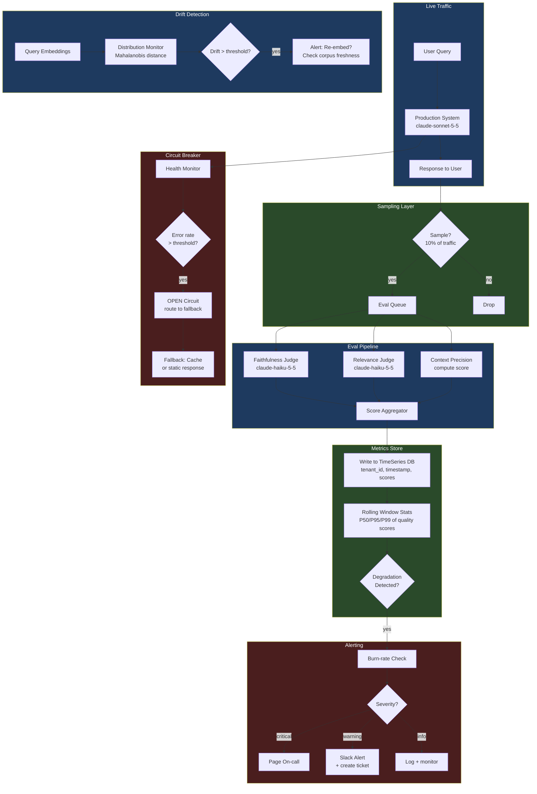

# Phase 7 · Week 06 · Day 5 — Eval and Monitoring in Production: Failure Modes

> Objective: Build a production eval pipeline that continuously scores output quality, detects degradation, and triggers automated responses to failure modes.  ·  Time: ~1 hr  ·  Prereqs: [[day-4]]

---

## Concept

Deploying an AI system is not the end of quality work — it is the beginning. Models drift. Retrieval quality degrades as document corpora age. User queries evolve. Agent tool chains develop subtle bugs under novel inputs. None of these failures announce themselves loudly; they accumulate quietly until a user complains or a business metric drops.

Production eval is the discipline of measuring system quality continuously, not just before launch. The goal is to detect degradation fast enough to act before it affects a meaningful percentage of users.

Two failure modes are particularly dangerous:
1. **Silent failures**: The system returns an answer. The answer is plausible. The answer is wrong. No exception is raised. Only a scoring system catches it.
2. **Cascading failures**: One failure mode (e.g., retrieval returning stale documents) causes downstream failures (hallucination in the LLM response), which may trigger further failures (agent re-trying with the wrong context, burning tokens in a loop).

---

## How It Works Internally

### Online Eval vs Offline Eval

**Offline eval** runs on a fixed held-out dataset before deployment. It answers: "Is this new model/prompt/retriever version better than the current one?" Fast feedback loop. Does not catch production distribution shift.

**Online eval** runs continuously on live traffic. It answers: "Is the currently deployed system performing as well as it did last week?" Catches drift, corpus degradation, and query distribution changes. Has latency overhead and cost (you are scoring every response, or a sampled fraction).

**Shadow scoring** is a hybrid: a new model version processes real queries in parallel with the production system, but its responses are not shown to users. The two responses are compared. Zero user-facing risk. High infrastructure cost (double compute).

```
Live Query ──► Production System ──► Response to User ──► Online Scorer ──► Metrics Store
     │
     └──────► Shadow System ──────► Shadow Response ──────► Comparison Scorer ──► Metrics Store
```

### LLM-as-Judge for Continuous Quality Monitoring

Human evaluation is the gold standard but does not scale to millions of queries. LLM-as-judge uses a capable model (e.g., `claude-haiku-5-5` for cost efficiency) to evaluate responses along defined dimensions:

- **Faithfulness**: Does the response contain only claims that can be grounded in the provided context? (Critical for RAG — measures hallucination rate.)
- **Answer relevance**: Does the response address the user's actual question?
- **Context precision**: Of the chunks retrieved, what fraction were actually useful for answering the question?
- **Fluency / coherence**: Is the response well-formed? (Usually high unless something is badly broken.)

**Judge prompt design is critical.** A bad judge prompt produces scores that are noisy, biased toward longer answers, or easily gamed. Best practices:

- Use a structured scoring rubric with explicit criteria per score level.
- Ask the judge to explain its score before giving it (chain-of-thought reasoning improves calibration).
- Validate judge scores against a human-labeled benchmark to measure judge accuracy.
- Use a different model family as judge than as responder to avoid self-preference bias.

**Judge cost model:**

```
judge_cost_per_query = judge_input_tokens * price_in + judge_output_tokens * price_out

If sampling 10% of traffic at 1M queries/day:
  = 100,000 judge calls/day
  = ~200 input tokens (context + response + rubric) * 100,000 = 20M input tokens/day
```

Using `claude-haiku-5-5` keeps this cost manageable.

### Embedding Drift Detection

Embeddings encode the statistical structure of documents in the vector store. When:
- The embedding model is updated (provider-side change),
- The document corpus changes significantly,
- The query distribution shifts,

...retrieval quality degrades without any error being raised. This is embedding drift.

**Detection methods:**

1. **Distribution shift on query embeddings**: Compute a reference distribution of query embedding vectors over a baseline period. Monitor Mahalanobis distance or Maximum Mean Discrepancy (MMD) between the reference and a rolling window. Alert when distance exceeds a threshold.

2. **Retrieval score monitoring**: Track the average cosine similarity score of the top retrieved document per query. A declining trend indicates increasing mismatch between queries and indexed documents.

3. **Periodic re-embedding check**: Weekly, re-embed a sample of reference queries against the current index and compare retrieval results to a stored ground truth. If overlap with expected documents drops, trigger a re-indexing job.

### Retrieval Quality Degradation Signals

Beyond embedding drift, monitor:

- **Context recall rate**: Fraction of queries where the correct answer is contained in the top-k retrieved chunks. Requires a labeled eval set but can be approximated with the judge.
- **Chunk freshness**: Average age of retrieved documents. Stale documents cause temporal hallucinations ("As of 2022..." when the query is about 2025).
- **Namespace miss rate**: Fraction of queries where the tenant's namespace returns fewer than k results (insufficient indexed content).

### Agent Failure Modes

Agents introduce failure modes that RAG pipelines do not have:

**Tool call loops**: The agent calls a tool, gets a result, calls the same tool again with slightly different parameters, gets a similar result, and continues indefinitely. Causes: ambiguous tool output, insufficient stopping criteria, or a bug in the reasoning step.

Detection: count consecutive tool calls of the same type in a single agent run. Alert or abort at a configurable threshold (e.g., 3 consecutive identical tool calls).

**Context overflow**: Long agent runs accumulate tool outputs in the context window. When the context limit is approached, the model's behavior degrades — it may truncate important earlier instructions or start hallucinating. Detection: track context length per step; alert when approaching the model's context limit.

**Hallucination cascades**: The model hallucinates a fact in step 3, uses that hallucinated fact as input to a tool call in step 4, gets a confused result, and builds further reasoning on the confused result. Each step amplifies the error. Detection: faithfulness scoring at each agent step, not just the final answer.

### Circuit Breakers and Fallback Strategies

A circuit breaker is a component that monitors downstream service health and short-circuits calls when the service is degraded, preventing cascading failures.

**States:**

```
CLOSED ──(errors exceed threshold)──► OPEN ──(cooldown period)──► HALF-OPEN
  ▲                                                                     │
  └─────────────────(probe succeeds)───────────────────────────────────┘
```

- **CLOSED**: Normal operation. Calls pass through.
- **OPEN**: Downstream is unhealthy. Calls are immediately rejected or routed to fallback. No load sent to degraded service.
- **HALF-OPEN**: Cooldown expired. One probe request is sent. If it succeeds, return to CLOSED. If it fails, return to OPEN.

**Fallback strategies for AI systems:**

- LLM unavailable: Return a cached response for the same query (semantic cache hit), or return a graceful "I cannot answer right now" with no hallucination risk.
- Retrieval unavailable: Fall back to LLM-only response (lower quality, but available). Log the fallback for later analysis.
- All systems degraded: Serve a static FAQ / escalate to human agent.

### SLA Breach Runbooks

A runbook is a documented procedure for responding to a specific alert. Every SLA-impacting alert should have one. Minimal runbook structure:

```
Alert: RAG P95 Latency Breach
Severity: High
Trigger: P95 latency > 2000ms for >5 minutes

Diagnosis steps:
  1. Check embedding service latency (Grafana: embedding_latency_p95)
  2. Check vector DB query time (Grafana: vectordb_query_latency_p95)
  3. Check LLM API latency (Grafana: llm_api_latency_p95)
  4. Check for traffic spike (Grafana: requests_per_second)

Mitigation:
  - If embedding service slow: check GPU utilization; scale up if > 80%
  - If vector DB slow: check index fragmentation; trigger reindex if last reindex > 7 days
  - If LLM API slow: activate circuit breaker; route to fallback model
  - If traffic spike: activate request throttling at API gateway
```

### Canary Deployments for Model Updates

When updating a model (new version, different prompt, different retriever), do not switch 100% of traffic at once. Use canary deployment:

1. Route 5% of traffic to new model version (canary).
2. Run parallel eval scoring on canary vs. control traffic.
3. Monitor for 24-48 hours: response quality, latency, error rate, user feedback signals.
4. If canary scores are equal or better, gradually increase traffic split (5% → 25% → 50% → 100%).
5. If canary degrades on any metric, roll back to 0% instantly.

---

## Eval and Monitoring Pipeline



---

## Worked Example

A production eval harness that scores RAG responses using `claude-haiku-5-5` as judge, tracks metrics, and fires alerts on degradation.

```python
"""
phase-7-system-design/week-06/examples/production_eval_harness.py

Production eval harness demonstrating:
  - LLM-as-judge scoring (faithfulness + relevance)
  - Rolling metric window with degradation detection
  - Alert firing on quality degradation
  - Circuit breaker stub
"""

from __future__ import annotations

import logging
import os
import time
from collections import deque
from dataclasses import dataclass, field
from typing import Any

import anthropic

logger = logging.getLogger(__name__)

JUDGE_MODEL = "claude-haiku-5-5"


# ---------------------------------------------------------------------------
# Data models
# ---------------------------------------------------------------------------

@dataclass
class RAGSample:
    """A single RAG response to be evaluated."""
    query: str
    retrieved_chunks: list[str]
    response: str
    tenant_id: str
    query_id: str


@dataclass
class EvalScore:
    query_id: str
    faithfulness: float    # 0.0 – 1.0
    relevance: float       # 0.0 – 1.0
    judge_reasoning: str
    scored_at: float = field(default_factory=time.time)


@dataclass
class DegradationAlert:
    metric: str
    current_value: float
    threshold: float
    window_size: int
    severity: str  # "critical" | "warning" | "info"


# ---------------------------------------------------------------------------
# LLM-as-judge scorer
# ---------------------------------------------------------------------------

FAITHFULNESS_PROMPT = """\
You are an evaluation judge assessing the faithfulness of an AI response to its source context.

CONTEXT (retrieved documents):
{context}

QUESTION:
{question}

RESPONSE TO EVALUATE:
{response}

TASK:
1. Identify every factual claim in the response.
2. For each claim, determine whether it is directly supported by the context.
3. Compute faithfulness = (supported claims) / (total claims). If no claims, score 1.0.

First, think step-by-step through each claim. Then output your score on the last line in this exact format:
SCORE: <float between 0.0 and 1.0>
"""

RELEVANCE_PROMPT = """\
You are an evaluation judge assessing whether an AI response answers the user's question.

QUESTION:
{question}

RESPONSE TO EVALUATE:
{response}

TASK:
Score the relevance of the response to the question on a scale of 0.0 to 1.0:
- 1.0: Response fully and directly answers the question.
- 0.7: Response partially answers the question or includes significant irrelevant content.
- 0.4: Response is tangentially related but does not answer the question.
- 0.0: Response is unrelated to the question.

First, explain your reasoning in one sentence. Then output your score on the last line:
SCORE: <float between 0.0 and 1.0>
"""


class LLMJudge:
    """
    Uses claude-haiku-5-5 to score faithfulness and relevance.
    Cost-optimized: haiku is ~10x cheaper than sonnet for scoring.
    """

    def __init__(self) -> None:
        self._client = anthropic.Anthropic(api_key=os.getenv("ANTHROPIC_API_KEY"))

    def _extract_score(self, text: str) -> float:
        """Parse 'SCORE: X.X' from judge output. Returns -1.0 on parse failure."""
        for line in reversed(text.strip().splitlines()):
            if line.strip().startswith("SCORE:"):
                try:
                    return float(line.split(":", 1)[1].strip())
                except ValueError:
                    logger.warning("Could not parse score from judge output: %s", line)
        return -1.0

    def score(self, sample: RAGSample) -> EvalScore:
        context = "\n\n---\n\n".join(sample.retrieved_chunks)

        faithfulness_response = self._client.messages.create(
            model=JUDGE_MODEL,
            max_tokens=512,
            messages=[
                {
                    "role": "user",
                    "content": FAITHFULNESS_PROMPT.format(
                        context=context,
                        question=sample.query,
                        response=sample.response,
                    ),
                }
            ],
        )
        faithfulness_text = faithfulness_response.content[0].text
        faithfulness = self._extract_score(faithfulness_text)

        relevance_response = self._client.messages.create(
            model=JUDGE_MODEL,
            max_tokens=256,
            messages=[
                {
                    "role": "user",
                    "content": RELEVANCE_PROMPT.format(
                        question=sample.query,
                        response=sample.response,
                    ),
                }
            ],
        )
        relevance_text = relevance_response.content[0].text
        relevance = self._extract_score(relevance_text)

        logger.info(
            "Scored query=%s faithfulness=%.2f relevance=%.2f",
            sample.query_id,
            faithfulness,
            relevance,
        )

        return EvalScore(
            query_id=sample.query_id,
            faithfulness=faithfulness,
            relevance=relevance,
            judge_reasoning=faithfulness_text[:200],
        )


# ---------------------------------------------------------------------------
# Rolling metrics window
# ---------------------------------------------------------------------------

class MetricsWindow:
    """
    Maintains a rolling window of eval scores.
    Detects degradation when the rolling average drops below a threshold.
    """

    def __init__(self, window_size: int = 100) -> None:
        self._window_size = window_size
        self._faithfulness: deque[float] = deque(maxlen=window_size)
        self._relevance: deque[float] = deque(maxlen=window_size)

    def record(self, score: EvalScore) -> None:
        if score.faithfulness >= 0:
            self._faithfulness.append(score.faithfulness)
        if score.relevance >= 0:
            self._relevance.append(score.relevance)

    def current_averages(self) -> dict[str, float]:
        def safe_avg(d: deque[float]) -> float:
            return sum(d) / len(d) if d else 0.0

        return {
            "faithfulness": safe_avg(self._faithfulness),
            "relevance": safe_avg(self._relevance),
            "sample_count": len(self._faithfulness),
        }

    def check_degradation(
        self,
        faithfulness_threshold: float = 0.75,
        relevance_threshold: float = 0.70,
    ) -> list[DegradationAlert]:
        alerts: list[DegradationAlert] = []
        avgs = self.current_averages()

        if avgs["sample_count"] < 10:
            return alerts  # not enough data yet

        if avgs["faithfulness"] < faithfulness_threshold:
            gap = faithfulness_threshold - avgs["faithfulness"]
            severity = "critical" if gap > 0.15 else "warning" if gap > 0.05 else "info"
            alerts.append(
                DegradationAlert(
                    metric="faithfulness",
                    current_value=avgs["faithfulness"],
                    threshold=faithfulness_threshold,
                    window_size=len(self._faithfulness),
                    severity=severity,
                )
            )

        if avgs["relevance"] < relevance_threshold:
            gap = relevance_threshold - avgs["relevance"]
            severity = "critical" if gap > 0.15 else "warning" if gap > 0.05 else "info"
            alerts.append(
                DegradationAlert(
                    metric="relevance",
                    current_value=avgs["relevance"],
                    threshold=relevance_threshold,
                    window_size=len(self._relevance),
                    severity=severity,
                )
            )

        return alerts


# ---------------------------------------------------------------------------
# Alert dispatcher
# ---------------------------------------------------------------------------

class AlertDispatcher:
    """
    Routes degradation alerts to the appropriate channel.
    Production: integrate with PagerDuty, Slack webhook, or OpsGenie.
    """

    def dispatch(self, alert: DegradationAlert) -> None:
        message = (
            f"[{alert.severity.upper()}] Quality degradation detected: "
            f"{alert.metric}={alert.current_value:.3f} "
            f"(threshold={alert.threshold:.3f}, "
            f"window={alert.window_size} samples)"
        )

        if alert.severity == "critical":
            logger.critical("PAGERDUTY: %s", message)
            # production: requests.post(PAGERDUTY_WEBHOOK, json={...})
        elif alert.severity == "warning":
            logger.warning("SLACK: %s", message)
            # production: requests.post(SLACK_WEBHOOK, json={"text": message})
        else:
            logger.info("TICKET: %s", message)


# ---------------------------------------------------------------------------
# Circuit breaker
# ---------------------------------------------------------------------------

class CircuitBreaker:
    """
    Simple circuit breaker for the LLM serving layer.
    Production: use tenacity or a dedicated circuit breaker library.
    """

    def __init__(
        self,
        failure_threshold: int = 5,
        cooldown_seconds: float = 60.0,
    ) -> None:
        self._failure_threshold = failure_threshold
        self._cooldown_seconds = cooldown_seconds
        self._consecutive_failures = 0
        self._opened_at: float | None = None
        self._state = "CLOSED"  # CLOSED | OPEN | HALF-OPEN

    def record_success(self) -> None:
        self._consecutive_failures = 0
        if self._state in ("OPEN", "HALF-OPEN"):
            logger.info("Circuit breaker: CLOSED (probe succeeded)")
        self._state = "CLOSED"

    def record_failure(self) -> None:
        self._consecutive_failures += 1
        if (
            self._state == "CLOSED"
            and self._consecutive_failures >= self._failure_threshold
        ):
            self._state = "OPEN"
            self._opened_at = time.time()
            logger.error(
                "Circuit breaker: OPEN after %d consecutive failures",
                self._consecutive_failures,
            )

    def allow_request(self) -> bool:
        if self._state == "CLOSED":
            return True
        if self._state == "OPEN":
            if time.time() - (self._opened_at or 0) > self._cooldown_seconds:
                self._state = "HALF-OPEN"
                logger.info("Circuit breaker: HALF-OPEN (probing)")
                return True
            return False
        # HALF-OPEN: allow one probe
        return True

    @property
    def state(self) -> str:
        return self._state


# ---------------------------------------------------------------------------
# Eval harness orchestrator
# ---------------------------------------------------------------------------

class ProductionEvalHarness:
    """
    Orchestrates the full eval pipeline:
      1. Receive a sampled RAG response
      2. Score with LLM judge
      3. Record to metrics window
      4. Check for degradation
      5. Dispatch alerts if needed
    """

    def __init__(
        self,
        judge: LLMJudge,
        metrics: MetricsWindow,
        alerter: AlertDispatcher,
        sample_rate: float = 0.10,
    ) -> None:
        self._judge = judge
        self._metrics = metrics
        self._alerter = alerter
        self._sample_rate = sample_rate
        self._scored_count = 0

    def process(self, sample: RAGSample) -> EvalScore | None:
        """Score sample, update metrics, and fire alerts as needed."""
        import random
        if random.random() > self._sample_rate:
            return None  # not sampled this request

        score = self._judge.score(sample)
        self._metrics.record(score)
        self._scored_count += 1

        # Check for degradation every 10 scored samples
        if self._scored_count % 10 == 0:
            alerts = self._metrics.check_degradation()
            for alert in alerts:
                self._alerter.dispatch(alert)

            stats = self._metrics.current_averages()
            logger.info(
                "Eval window stats: faithfulness=%.3f relevance=%.3f samples=%d",
                stats["faithfulness"],
                stats["relevance"],
                stats["sample_count"],
            )

        return score


# ---------------------------------------------------------------------------
# Demo
# ---------------------------------------------------------------------------

def main() -> None:
    logging.basicConfig(
        level=logging.INFO,
        format="%(asctime)s %(levelname)-8s %(name)s  %(message)s",
    )

    judge = LLMJudge()
    metrics = MetricsWindow(window_size=50)
    alerter = AlertDispatcher()
    harness = ProductionEvalHarness(judge, metrics, alerter, sample_rate=1.0)

    # Simulate a high-quality response
    good_sample = RAGSample(
        query="What is the average latency SLO for RAG queries?",
        retrieved_chunks=[
            "RAG queries must meet a P95 latency target of 2000ms and a P99 target of 4000ms.",
            "Latency is measured from first byte of request to last byte of response.",
        ],
        response="The P95 latency SLO for RAG queries is 2000ms, with a P99 target of 4000ms.",
        tenant_id="tenant_abc",
        query_id="q_001",
    )

    # Simulate a hallucinated response (answer not in context)
    bad_sample = RAGSample(
        query="What is the average latency SLO for RAG queries?",
        retrieved_chunks=[
            "RAG queries must meet a P95 latency target of 2000ms and a P99 target of 4000ms.",
        ],
        response=(
            "RAG queries have a P50 latency of 300ms, a P95 of 500ms, and cost only "
            "$0.001 per query in all configurations."
        ),
        tenant_id="tenant_abc",
        query_id="q_002",
    )

    for sample in [good_sample, bad_sample]:
        score = harness.process(sample)
        if score:
            logger.info(
                "Final scores for %s: faithfulness=%.2f relevance=%.2f",
                score.query_id,
                score.faithfulness,
                score.relevance,
            )


if __name__ == "__main__":
    main()
```

**Key design decisions:**

- Haiku as judge: ~15x cheaper than Sonnet. For scoring at 10% sample rate on high-volume traffic, the cost difference is significant.
- Chain-of-thought in judge prompts: asking the judge to reason before scoring improves calibration and provides an audit trail.
- Rolling deque with `maxlen`: O(1) insertion, automatic expiry of oldest samples. No growing memory footprint.
- Degradation check every 10 samples: avoids alert spam on single outliers while staying responsive to sustained drops.
- Sample rate as a parameter: set to 1.0 in the demo for visible output; production default is 0.05–0.10.

---

## Exercises

1. **Judge calibration test**: Build a labeled evaluation dataset with 20 (query, context, response) triples — 10 that are clearly faithful and 10 that contain fabricated claims not in the context. Run `LLMJudge.score()` on all 20. Compute precision and recall of the judge's faithfulness scores (threshold 0.7) against your labels. Report the result and identify any systematic bias.

2. **Embedding drift simulator**: Generate two batches of synthetic query embeddings using `numpy.random.multivariate_normal`: one from a "baseline" distribution and one from a "shifted" distribution with a different mean. Implement a `DriftDetector` class that computes the Maximum Mean Discrepancy (MMD) between the two batches and raises an alert when MMD exceeds a threshold. Write a test that confirms the alert fires only for the shifted distribution.

3. **Agent loop detector**: Implement an `AgentLoopDetector` that receives a sequence of tool calls (name + arguments dict) and raises `AgentLoopError` when it detects 3 or more consecutive calls to the same tool with highly similar arguments (define similarity as argument dict equality after sorting). Write tests covering: (a) a clean sequence, (b) an exact loop, (c) a near-miss where arguments differ.

4. **Canary traffic splitter**: Implement a `CanaryRouter` class that accepts a `canary_fraction` (0.0–1.0) and two async handler functions (`production_handler`, `canary_handler`). For each incoming request, it routes to the canary handler with probability `canary_fraction` and the production handler otherwise. Implement a `ramp_up(target_fraction, steps, interval_seconds)` async method that gradually increases `canary_fraction` in equal steps. Write tests using mock handlers that record which version handled each request.

---

## Self-check

- What is the difference between online eval and shadow scoring? When would you choose shadow scoring?
- Why should the judge model be different from the responder model?
- What does a burn rate of 14.4x mean in the context of SLO error budgets?
- Name three signals that indicate retrieval quality is degrading without any error being raised.
- What is the difference between circuit breaker OPEN and HALF-OPEN states, and why does HALF-OPEN exist?
- Describe a hallucination cascade in an agent system: what triggers it and how do you detect it early?
