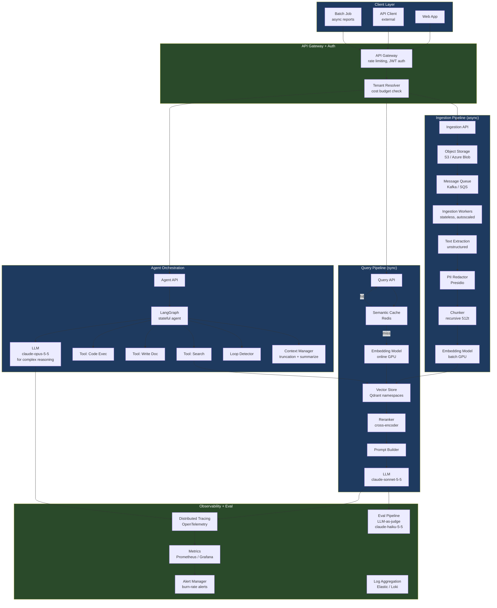
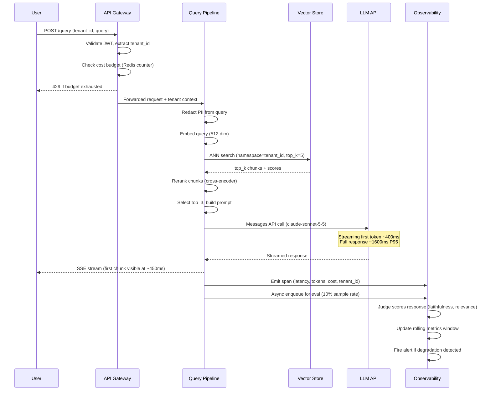

# Phase 7 · Week 06 · Day 6 — Saturday Deep Practice: Enterprise AI Platform Design

> Objective: Synthesize Days 1–5 into a complete enterprise AI platform design — requirements through tradeoffs, with capacity math, cost modeling, and Architecture Decision Records.  ·  Time: ~4 hr  ·  Prereqs: [[day-1]], [[day-2]], [[day-3]], [[day-4]], [[day-5]]

---

## How to Use This Session

This is a structured design workshop. Work through each section sequentially. Block 4 hours. Treat it as a mock system design interview conducted at depth — you have the luxury of time a real interview does not give you, use it to build intuition for the decisions and numbers that interviewers test you on.

Each major section maps to a phase of the standard system design interview framework:
1. Requirements clarification
2. Capacity estimation
3. High-level design
4. Deep-dive on critical subsystems
5. Tradeoffs and alternative approaches

---

## Section 1: System Design Framework Walkthrough

### Step 1 — Requirements Clarification (5–10 min in an interview, 20 min here)

Before drawing a single box, extract requirements. Interviewers evaluate your ability to ask the right questions before proposing solutions.

**Functional requirements (what the system must do):**

These are negotiated with the interviewer. For this session, treat the following as given:
- Users can upload enterprise documents (PDF, DOCX, HTML) and query them via natural language.
- Agents can autonomously complete multi-step tasks (search, summarize, draft, send).
- System serves multiple tenants with complete data isolation.
- Results must be explainable (sources cited, agent steps visible).
- Both synchronous (chat) and asynchronous (batch report generation) access patterns.

**Non-functional requirements (constraints and quality bars):**

| Requirement            | Target                                  |
|------------------------|-----------------------------------------|
| Availability           | 99.9% (8.7 hr downtime/year)           |
| RAG query latency      | P95 < 2s, P99 < 4s                     |
| Agent task latency     | P95 < 30s for 5-tool tasks             |
| Throughput             | 10,000 concurrent users, peak 500 QPS  |
| Data isolation         | SOC2 Type II compliant                 |
| Max document size      | 100MB per file                         |
| Max corpus per tenant  | 100GB text (post-extraction)           |
| PII handling           | Auto-redact before indexing            |
| Cost per query         | < $0.05 (including amortized infra)    |

**Clarifying questions (practice asking these):**

- What is the read/write ratio? (Mostly reads: 95% queries, 5% ingestion)
- Are agents long-running (minutes to hours) or short-running (seconds)?
- Is real-time streaming of agent steps required, or is a final result sufficient?
- What is the expected corpus growth rate per tenant?
- Is there a preference for cloud-native services, or must it run on-prem?

### Step 2 — Capacity Estimation

**Traffic estimates:**

```
Peak QPS: 500 queries/second
Average query size (input tokens):
  - System prompt:      500 tokens
  - Retrieved context:  1,500 tokens (3 chunks × 500 tokens each)
  - User query:         50 tokens
  Total input:          ~2,050 tokens per RAG query

Average output: 300 tokens per response

Token throughput at peak:
  Input:  500 QPS × 2,050 tokens = 1,025,000 input tokens/second
  Output: 500 QPS × 300 tokens  =   150,000 output tokens/second
```

**LLM serving capacity (claude-sonnet-5-5):**

Assume a hosted API — no self-hosting needed. API rate limits and latency are the constraints. For self-hosted serving (Llama-class models on GPU), the calculation differs:

```
Typical A100 80GB throughput (FP16, continuous batching):
  ~2,000 output tokens/second for a 70B parameter model

Required GPUs for output throughput:
  150,000 output tokens/sec ÷ 2,000 tokens/sec/GPU = 75 GPUs

Add 2x headroom for spikes and serving overhead:
  75 × 2 = 150 A100s for LLM serving

This illustrates why most enterprises use cloud-hosted LLM APIs
rather than self-hosting at this scale.
```

**Embedding throughput:**

```
Assumption: every query + every ingested chunk must be embedded.
Queries: 500 QPS × 512-dim embedding model
  → embedding latency: ~10ms per batch of 64 queries (GPU)
  → required throughput: 500 / 64 × 10ms = ~78ms of GPU time/second
  → well within 1 embedding GPU at this scale

Ingestion peak (assume 100 tenants uploading 1GB each simultaneously):
  100GB × 1M tokens/GB ÷ 512 tokens/chunk = ~200M chunks
  Spread over 4 hours: 200M / 14,400s = ~14,000 chunks/second
  Batch size 128: 14,000 / 128 = 110 batches/second
  → requires ~3-4 embedding GPUs for ingestion bursts
```

**Vector store sizing:**

```
Corpus: 100 tenants × 100GB text = 10TB raw text
Post-chunking: 10TB / 512 tokens × 4 bytes/token ≈ 78M chunks
Embedding vectors: 78M × 1536 dimensions × 4 bytes = 479GB
Metadata overhead: ~30% = 143GB
Total vector store size: ~620GB

With 3x replication: ~1.8TB
Fits comfortably in a single Qdrant cluster with NVMe SSDs.
```

**Object storage for raw documents:**

```
10TB raw documents + 10TB extracted text = 20TB
Growth rate: assume 10% monthly = 24TB at end of Year 1
Use S3 or Azure Blob — trivial at this scale.
```

### Step 3 — High-Level Design

See the full platform diagram below. At the highest level, the system has six major layers:

1. **API Gateway + Auth**: Entry point for all traffic. JWT validation, tenant extraction, rate limiting, cost budget enforcement.
2. **Ingestion Pipeline**: Async document processing. Extraction → PII redaction → chunking → embedding → write to vector store.
3. **Query Pipeline**: Synchronous RAG. Embed query → retrieve → rerank → LLM → return.
4. **Agent Orchestration**: LangGraph-based agents with tool access, context management, and loop detection.
5. **LLM Serving**: Anthropic API (claude-sonnet-5-5 for agents/RAG, claude-haiku-5-5 for classification/eval, claude-opus-5-5 for complex long-context tasks).
6. **Observability + Eval**: Metrics, tracing, eval pipeline, alerting.

### Step 4 — Deep Dives

Select one or two areas for deep technical discussion. In an interview, the interviewer will choose. Prepare depth in all areas.

**Deep dive: RAG retrieval pipeline**

The RAG pipeline is the most latency-critical path. Breaking down the P95 budget:

```
P95 latency budget: 2000ms

  Query embedding:     30ms  (GPU, batch 1)
  Vector ANN search:   50ms  (Qdrant, HNSW index, top-100)
  Reranking (cross-encoder): 100ms  (GPU)
  Prompt assembly:     10ms  (CPU)
  LLM API call:       1600ms  (claude-sonnet-5-5, ~300 output tokens)
  Response parsing:    10ms  (CPU)
  Overhead:           200ms  (network, middleware)
                      -----
  Total P95:         2000ms  ✓
```

The LLM API call dominates. Optimization levers:
- Streaming: return first token at ~400ms even if full completion takes 1600ms. Improves perceived latency.
- Context caching: if the system prompt is identical across queries (it usually is), Anthropic's prompt caching can eliminate repeated input token billing and reduce latency for the cached prefix.
- Parallel retrieval: if multiple namespaces or sub-queries are needed, run them in parallel.

**Deep dive: Ingestion pipeline**

Ingestion is async and can tolerate higher latency. Key challenge: large PDF files with mixed content (text, tables, images).

```
Ingestion stages and tools:
  1. Upload to S3                      ~1s (network bound)
  2. Queue message to SQS/Kafka        <10ms
  3. Worker picks up job               <5s (depends on queue depth)
  4. Text extraction (pdfminer/unstructured) 10–120s for large PDFs
  5. PII detection (Presidio)          ~2s per 10,000 tokens
  6. Chunking (recursive, 512 tokens)  ~1s per 100 chunks
  7. Batch embedding (512 dim)         ~3s per 1000 chunks
  8. Write to vector store             ~5s per 1000 chunks
```

Workers should be stateless containers, auto-scaled by queue depth. Target: < 10 minutes end-to-end for a 100MB PDF.

### Step 5 — Tradeoffs

Every architectural decision has tradeoffs. Practice articulating them explicitly.

**Managed API vs. self-hosted LLM:**

| Dimension        | Managed API (Anthropic)    | Self-hosted (Llama/Mistral)  |
|------------------|----------------------------|------------------------------|
| Cost at scale    | Variable (pay-per-token)   | Fixed (GPU infra) + lower marginal |
| Latency          | Higher (network + shared)  | Lower (collocated)           |
| Data sovereignty | Shared infrastructure      | Full control (on-prem)       |
| Ops burden       | Zero                       | High (GPU ops, model updates)|
| Model quality    | State-of-art access        | Lags proprietary by 6-12 mo  |

Decision: Use managed API unless data sovereignty requirements mandate on-prem, or until monthly token costs exceed ~$500k/month (rough break-even for GPU investment).

**Vector DB: single cluster vs. per-tenant:**

Covered in Day 4. At 100 tenants with namespace isolation, single cluster is correct. Revisit at 10,000 tenants: cluster-per-tenant becomes necessary to avoid HNSW index degradation at extreme shard sizes.

---

## Full Platform Architecture



---

## Data Flow Diagram



---

## Cost Modeling

### Per-query cost breakdown

```
RAG query cost (claude-sonnet-5-5):
  Input tokens:   2,050 × $3.00/M   = $0.00615
  Output tokens:    300 × $15.00/M  = $0.00450
  LLM subtotal:                       $0.01065

Embedding (assume hosted API):
  Query:            512 tokens × $0.020/M = $0.000010
  Negligible.

Eval scoring (claude-haiku-5-5, 10% sample rate):
  ~2,500 judge input tokens × $0.25/M × 0.10 = $0.0000625
  Amortized across 10 queries:                  $0.00000625 per query

Infrastructure amortization (vector DB, embedding GPU, workers):
  Assume $5,000/month cluster cost ÷ 10M queries/month = $0.0005/query

Total per-query cost: ~$0.011 + $0.0005 = ~$0.012
```

This is well within the $0.05 budget target.

### Monthly cost projection (500 QPS peak, 30% average load)

```
Average QPS: 500 × 0.30 = 150 QPS
Queries/month: 150 × 86,400 × 30 = 388,800,000

LLM cost: 388.8M × $0.01065 = $4,140,720/month
Infra:    $5,000 fixed
Eval:     388.8M × $0.0000063 × 0.10 = $24,494

Total: ~$4.17M/month at 388M queries

Per-tenant (100 tenants, equal distribution):
  $41,700/month per tenant → charge at least $60,000/month (30% margin)
```

**Cost optimization levers (ordered by impact):**

1. **Prompt caching**: System prompts are static. Anthropic prompt caching can reduce input token cost by 50–90% for the cached portion. Estimated saving: $1.5M–$2M/month.
2. **Model tiering**: Use `claude-haiku-5-5` for simple classification/routing tasks and only route complex queries to `claude-sonnet-5-5`. Estimated saving: 20–30%.
3. **Semantic caching**: Cache frequent queries (Redis with embedding-based lookup). Hit rate of 15–20% on enterprise corpora is typical.
4. **Context compression**: Summarize retrieved chunks before passing to LLM. Reduces input tokens by 30–40% with minimal quality loss.

---

## Architecture Decision Records (ADRs)

ADRs document a decision, its context, and the alternatives considered. They are the institutional memory of architectural choices. Practice writing them — they appear in staff engineer interviews.

### ADR-001: Vector Database Selection

**Decision**: Use Qdrant for the vector store.

**Context**: Need a vector DB that supports namespace isolation, metadata filtering, HNSW index, and production-grade APIs. Evaluated: Pinecone, Weaviate, Qdrant, Chroma.

**Considered alternatives**:
- Pinecone: fully managed, fast, namespace support. Vendor lock-in. No on-prem option. Cannot inspect data at rest.
- Weaviate: strong GraphQL API, multi-tenancy support. More complex ops; hybrid search requires more configuration.
- Chroma: excellent for prototyping. Not production-grade at 100M+ vectors.
- pgvector: familiar PostgreSQL. Excellent for smaller deployments (<10M vectors). Full SQL semantics. HNSW performance lags dedicated vector DBs at scale.

**Decision rationale**: Qdrant — open source (Apache 2), Rust-based (high throughput, low latency), native namespace/collection isolation, strong multi-tenancy primitives, self-hostable for data sovereignty. Active development community.

**Consequences**: Must self-host and operate. Need monitoring and backup procedures. Cannot leverage Pinecone's managed service SLAs.

---

### ADR-002: LLM Provider

**Decision**: Use Anthropic API (claude-sonnet-5-5 / claude-haiku-5-5 / claude-opus-5-5) as primary LLM provider.

**Context**: Enterprise customers require high-quality, safe, instruction-following models. System handles sensitive enterprise documents.

**Considered alternatives**:
- OpenAI GPT series: strong benchmark performance. Data privacy concerns for enterprise. Higher cost at this scale.
- Self-hosted open-weight models (Llama, Mistral): full data control. Significant ops burden. Quality gap for complex reasoning tasks. GPU capex.
- Google Vertex AI: strong multimodal. Tightly coupled to GCP. Less predictable API behavior for long-context tasks.

**Decision rationale**: Anthropic's Constitutional AI approach aligns with enterprise safety requirements. Extended context windows (200K tokens) handle large document queries. Consistent API behavior. claude-haiku-5-5 provides a cost-effective tier for eval and classification.

**Consequences**: Vendor dependency on Anthropic API availability. Mitigated by circuit breaker + fallback to cached responses. Data sent to Anthropic — acceptable under enterprise data processing agreements.

---

### ADR-003: Agent Orchestration Framework

**Decision**: Use LangGraph for agent orchestration.

**Context**: Agents require stateful multi-step execution, conditional branching, tool calling, and error recovery. Need human-in-the-loop support.

**Considered alternatives**:
- Custom state machine: full control, zero dependencies. Significant build cost. No built-in persistence or streaming.
- LangChain AgentExecutor: simpler API. Less control over execution flow. Harder to test individual nodes.
- Semantic Kernel (Microsoft): strong enterprise integration. C#-first, Python bindings lag. Less community momentum for Python-native shops.

**Decision rationale**: LangGraph provides explicit state graph with typed state, conditional edges, streaming support, persistence via checkpointer, and native human-in-the-loop. Aligns with the team's Python-first stack. The explicit graph structure makes agent logic inspectable and testable.

**Consequences**: LangGraph is Langchain ecosystem — updates can introduce breaking changes. Pin versions in pyproject.toml. Nodes must be pure functions to enable testability.

---

### ADR-004: Ingestion Pipeline Async Architecture

**Decision**: Use Kafka as the ingestion message queue.

**Context**: Ingestion is bursty (batch uploads from tenants). Workers must be independently scalable. Need durable message delivery and replay capability.

**Considered alternatives**:
- SQS (AWS): fully managed, simpler ops. Proprietary. Weaker ordering guarantees. No replay without explicit DLQ logic.
- RabbitMQ: mature, good Python client. Not designed for high-throughput replay scenarios. Harder to scale horizontally.
- Redis Streams: lower latency, lighter weight. Less durable than Kafka. Appropriate for < 10M messages/day.

**Decision rationale**: Kafka provides durable, ordered, replayable message delivery. Consumer groups enable parallel workers. Retention policy allows replaying failed ingestion jobs. At 14,000 chunks/second peak, Kafka's throughput headroom is critical.

**Consequences**: Kafka cluster adds operational complexity. Use managed Kafka (Confluent Cloud, MSK) to reduce ops burden. Development environment can use Redpanda (Kafka-compatible, easier local setup).

---

### ADR-005: Multi-tenancy Isolation Level

**Decision**: Use namespace-per-tenant isolation in Qdrant for the vector store; row-level security for relational metadata (PostgreSQL).

**Context**: 100 tenants at launch, projected 1,000 tenants in Year 2. Must meet SOC2 Type II isolation requirements.

**Considered alternatives**:
- Cluster-per-tenant: maximum isolation. Cost-prohibitive at 100+ tenants. Reserved for >$100k/month contracts.
- Shared schema with metadata filter only (no RLS): cheapest. Does not meet SOC2 Type II isolation standard. Filter bugs could cause data bleed.

**Decision rationale**: Namespace isolation provides strong isolation guarantees without the ops cost of per-tenant clusters. Qdrant's namespace API enforces isolation at the DB layer, not just the application layer — a bug in application code cannot cause cross-namespace reads without an explicit namespace override. PostgreSQL RLS adds a second layer for relational metadata.

**Consequences**: Namespace-scoped ANN indexes are smaller than a global index, which improves query latency (smaller HNSW graph to traverse). At 10,000+ tenants, individual namespace index management becomes complex; revisit with a sharding strategy.

---

## Exercises

1. **Full platform design from scratch (60 min)**: Without referring back to this document, sketch the full enterprise AI platform on paper (or a whiteboard tool). Start from requirements, estimate throughput and storage, draw the architecture, and write 2 ADRs for decisions you made. Compare your design to the one in this lesson: what did you add, remove, or change? Write a 1-page reflection on the differences.

2. **Cost optimization analysis (45 min)**: Using the cost model in this lesson as a baseline, compute the projected monthly cost at 500 QPS (30% average load) with all four optimization levers applied simultaneously (prompt caching at 80% hit rate, model tiering at 40% haiku / 60% sonnet, semantic cache at 15% hit rate, context compression at 35% token reduction). Show your calculation step by step. What is the new per-query cost? New monthly total? What is the payback period for investing 1 engineer-month in implementing each optimization?

3. **ADR for a new decision (30 min)**: Write a complete ADR for one of the following decisions not covered in this lesson: (a) choice of observability stack (Prometheus + Grafana vs. Datadog vs. self-hosted OpenTelemetry collector), (b) choice of reranker model (cross-encoder vs. ColBERT vs. LLM-as-reranker), or (c) choice of PII detection approach (Presidio vs. fine-tuned NER model vs. LLM-based detection). Follow the exact ADR format used in this lesson: Decision, Context, Considered alternatives, Decision rationale, Consequences.

---

## Self-check

- Walk through all five phases of the system design framework from memory. What is the purpose of each phase?
- What is the P95 latency budget for a RAG query, and which component consumes the most of it?
- How many A100 GPUs are required for 150,000 output tokens/second? What assumption underlies this calculation?
- Explain the cost difference between prompt caching and semantic caching. When does each apply?
- What is an ADR, and what information must it contain to be useful to a future engineer?
- At what point (number of tenants or monthly revenue) does per-tenant-cluster isolation become cost-competitive with namespace isolation?
