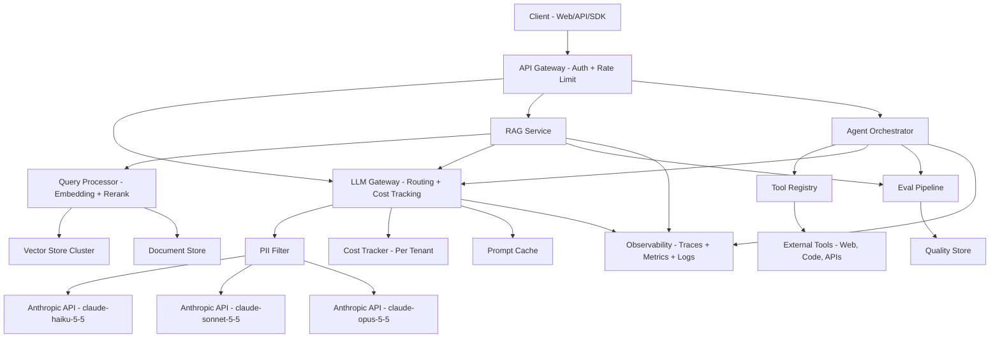

# Week 06 Project — Enterprise AI Platform System Design Document

## Overview

Write a complete, production-grade system design document for an enterprise AI platform. The platform must support three workloads: Retrieval-Augmented Generation (RAG) for internal knowledge search, a multi-agent orchestration system for workflow automation, and an LLM serving layer that fronts multiple model providers.

Your deliverable is both a written design document **and** a working Python reference implementation of the capacity and cost model.

This project simulates what a senior AI engineer would produce as the "design phase" artifact before building. Reviewers will assess whether you understand the tradeoffs — not whether you picked the "right" answer.

---

## Part 1 — Requirements

### 1.1 Functional Requirements

Define the following for your platform:

1. **RAG platform**: Users can submit natural language queries against a private enterprise knowledge base. The system retrieves relevant chunks from a vector store, augments the prompt, and calls an LLM to synthesize an answer with citations.

2. **Agent platform**: Users can trigger multi-step agentic workflows (e.g., research + summarize + draft report). Agents can call tools (web search, code execution, internal APIs). Workflows must be observable and interruptible.

3. **LLM serving layer**: A unified gateway that routes requests to the appropriate model, handles authentication/quota, logs all requests, and abstracts provider differences.

4. **Eval pipeline**: Automated quality evaluation of LLM outputs at both batch (offline) and streaming (online) levels.

5. **Observability stack**: Full-stack tracing from API call to LLM response, including cost attribution, latency breakdown, and quality signals.

6. **Security and multi-tenancy**: 200 enterprise tenants, each with isolated data, quota enforcement, and audit logs.

### 1.2 Non-Functional Requirements

State explicit SLOs for each workload. Your document must include at minimum:

| SLO | RAG queries | Agent workflows | LLM serving |
|---|---|---|---|
| Availability | ≥ 99.9% | ≥ 99.5% | ≥ 99.95% |
| p50 latency | ≤ 500ms | ≤ 2s (first token) | ≤ 150ms TTFT |
| p99 latency | ≤ 2s | ≤ 30s | ≤ 800ms TTFT |
| Max cost/query | $0.05 | $0.50 | — |
| Throughput | 500 QPS peak | 50 concurrent workflows | 1,000 QPS |

### 1.3 Constraints

- All LLM API keys must be stored in secrets manager (e.g., AWS Secrets Manager). Never in application config.
- PII detected in prompts must be redacted before leaving the platform perimeter.
- All tenant data must be logically isolated at the vector store level.
- The system must support model swapping without code deploys (config-driven routing).
- Cost per tenant must be attributable and reportable with < 1% error.

### 1.4 SLO Rationale

For each SLO above, write one sentence justifying the number (e.g., "500ms RAG p50 is derived from the 1s user perceived response tolerance minus 500ms for rendering and network round-trip").

---

## Part 2 — Capacity Estimation

Work through the following estimation exercise. Show your math. Estimates should be order-of-magnitude accurate, not exact.

### 2.1 User and Request Volume

- **Users**: 50,000 DAU across 200 tenants
- **Usage pattern**: 20 RAG queries/user/day, 2 agent workflows/user/day
- **Peak-to-average ratio**: 3x (peak is 3x the daily average rate)

Calculate:
- Average QPS (RAG)
- Peak QPS (RAG)
- Average concurrent agent workflows
- Peak concurrent agent workflows

### 2.2 Storage

- **Knowledge base**: 10M documents, average 2KB each after chunking to 512-token chunks
- **Embedding dimension**: 1536 floats (float32)
- **Vector store overhead**: 1.5x raw embedding size (indexes, metadata)
- **Retention**: 90 days of query logs

Calculate:
- Raw document storage (GB)
- Vector storage (GB)
- Vector store total with overhead (GB)
- Query log storage at peak QPS (GB/day)

### 2.3 GPU Sizing for Self-Hosted Models (optional track)

If you were to self-host an 8B parameter instruction-tuned model (e.g., for a sensitive tenant who cannot use SaaS APIs):

- **Model weights**: 8B params × 2 bytes (BF16) = 16 GB
- **KV cache at batch size 32, 4096 context, 32 layers, 128 head dim**: calculate per the formula `2 × layers × head_dim × seq_len × batch × 2 bytes`
- **Recommended GPU**: select an appropriate GPU (A100-80GB, H100-80GB, etc.) and justify
- **Throughput estimate**: assume 40 tokens/sec/GPU at batch 1, and 150 tokens/sec at batch 32

Calculate:
- Minimum GPU memory required (weights + KV cache at batch 32)
- GPUs needed to serve peak QPS (500 QPS × 200 output tokens average per query)
- Monthly GPU cost at $3/GPU-hour (H100)

### 2.4 API Cost Estimation

Using the Anthropic API:
- **RAG queries**: use `claude-haiku-5-5` for 80% of queries, `claude-sonnet-5-5` for 20%
- **Average RAG prompt**: 1,500 input tokens, 300 output tokens
- **Agent workflows**: use `claude-opus-5-5` for planning (500 input, 200 output), `claude-sonnet-5-5` for execution (4 tool calls × 800 input + 400 output each)
- **Pricing**: Haiku 5.5 at $0.10/$0.50 per 1M tokens; Sonnet 5.5 at $2/$10; Opus 5.5 at $4/$20

Calculate:
- Cost per RAG query (blended)
- Cost per agent workflow
- Daily API cost at average load
- Monthly API cost

---

## Part 3 — High-Level Architecture

Write a high-level description of your architecture and include a Mermaid diagram.

Your architecture must show:
- Client layer (web, API, SDK)
- API gateway / LLM gateway
- RAG pipeline components (query processing, retrieval, generation)
- Agent orchestration layer
- LLM serving / model router
- Vector store cluster
- Eval pipeline
- Observability stack (tracing, metrics, logs)
- Security boundary (PII filter, tenant auth)
- Data stores (document store, vector store, query log store)

### Mermaid Diagram Template



Extend this diagram to include your multi-tenancy isolation boundaries, the eval feedback loop, and the PII redaction path.

---

## Part 4 — Component Deep-Dives

Write a 300–500 word design section for each component below. Each section must include: purpose, key design decisions, data flow, and at least one explicit tradeoff.

### 4.1 RAG Platform

Cover: chunking strategy and why it matters, embedding model choice, retrieval strategy (dense, sparse, hybrid), reranking, prompt assembly, citation generation, and how you handle knowledge base updates (ingestion pipeline).

Key questions to address:
- How do you handle multi-hop questions that require synthesizing across 5+ documents?
- How do you prevent retrieval from returning stale or contradictory chunks?
- What is your index update strategy to avoid downtime during re-indexing?

### 4.2 Agent Platform

Cover: agent state machine design, tool call execution model, context window management across multi-turn agent loops, error handling and retry, agent interruption and resumption, and how you prevent runaway agents (cost and time limits).

Key questions to address:
- Your agent calls a tool that returns 200KB of structured data. The context window is 50% full. What do you do?
- An agent is mid-workflow when the underlying LLM is rate-limited. How do you handle state persistence and resumption?
- How do you prevent prompt injection via tool results?

### 4.3 LLM Serving Layer

Cover: request routing logic (rule-based vs. ML-based), prompt caching strategy, streaming response handling, fallback logic, cost attribution, and the contract between the gateway and downstream consumers.

Key questions to address:
- How do you implement prompt caching to maximize cache hit rate? What is the invalidation strategy?
- How do you handle the case where a tenant's quota is exhausted mid-stream?
- Describe the observability contract: what does every LLM call emit, and to where?

### 4.4 Eval Pipeline

Cover: offline eval (batch regression testing before deploy), online eval (real-time quality monitoring on live traffic), LLM-as-judge pattern, human-in-the-loop labeling pipeline, and how eval results gate deploys.

Key questions to address:
- How do you define and measure "quality" for a RAG system? List at minimum three metrics.
- How do you detect prompt regression without ground-truth labels?
- Describe your shadow deployment strategy: how do you test a new model version on live traffic before cutting over?

### 4.5 Observability Stack

Cover: distributed tracing (what a trace looks like for a RAG query end-to-end), metrics (which metrics you emit at each layer), log structure (what fields every log line must contain), alerting (which conditions page on-call vs. create a ticket), and cost attribution (how you tie a cloud bill line item back to a tenant and query type).

Key questions to address:
- Draw the trace for a single RAG query: list every span, what it measures, and its expected p50/p99 duration.
- Which single metric is the most actionable leading indicator of a quality degradation? Why?
- How do you correlate a spike in cloud costs with a specific tenant, model, or feature?

### 4.6 Security and Multi-Tenancy

Cover: tenant isolation at the vector store level (namespace, schema, or cluster isolation), PII detection and redaction pipeline (what you detect, how, and where in the request path), authentication and authorization model, prompt injection defense, secrets management, and audit logging.

Key questions to address:
- Describe three different levels of vector store isolation (weakest to strongest). For a tenant processing PHI, which do you use?
- Where exactly in the request path do you perform PII redaction? What happens to the original unredacted data?
- An internal security audit finds that tenant A's query results occasionally include chunks from tenant B's documents. What is the root cause and how do you fix it?

---

## Part 5 — Tradeoffs and Architecture Decision Records

Write an ADR (Architecture Decision Record) for each of the following five decisions. Each ADR must follow this format:

```
## ADR-N: <Title>

**Status**: Proposed | Accepted | Deprecated

**Context**: <1-2 sentences describing the problem>

**Decision**: <What you decided>

**Rationale**: <Why this option over the alternatives>

**Alternatives considered**:
- Option A: <description> — rejected because <reason>
- Option B: <description> — rejected because <reason>

**Consequences**:
- Positive: <what this enables>
- Negative: <what this costs or constrains>
```

Required ADRs:

1. **ADR-1: Vector store technology choice** — Managed SaaS (Pinecone) vs. self-hosted (Weaviate) vs. integrated (pgvector). Consider: operational burden, multi-tenancy support, query latency at 100M vectors, vendor lock-in.

2. **ADR-2: LLM routing strategy** — Rule-based routing (task_type → model) vs. ML-based routing (classifier predicts optimal model) vs. cascading (try cheap model first, escalate on low confidence). Consider: latency overhead, accuracy, operational complexity.

3. **ADR-3: Agent state persistence** — In-memory (Redis) vs. durable (Postgres) vs. event-sourced (Kafka + event store). Consider: agent resumption after failure, audit trail, cost, query patterns.

4. **ADR-4: PII redaction placement** — Client-side (SDK), gateway-side (centralized), or model-side (system prompt instruction). Consider: coverage guarantees, latency overhead, false-positive rate, compliance auditability.

5. **ADR-5: Eval gating strategy** — Automatic deploy if eval score ≥ threshold vs. human-in-the-loop approval vs. shadow traffic comparison. Consider: deploy velocity, risk of silent regressions, operational overhead.

---

## Part 6 — Implementation: Reference Capacity and Cost Model

Implement the following Python module. This is a working reference implementation, not pseudocode.

### Specifications

- `CapacityModel`: estimates infrastructure requirements given platform parameters
- `CostModel`: computes per-query, per-workflow, and monthly API costs
- `PlatformConfig`: Pydantic model holding all platform parameters
- All classes use `pydantic.BaseModel` for config
- All methods have type hints and docstrings
- `logging` module used for INFO/DEBUG output; no `print`
- Unit: tokens are `int`, costs are `float` (USD), sizes are `float` (GB), rates are `float` (QPS)

### Scaffold

```python
"""
Enterprise AI Platform — Capacity and Cost Reference Model
Week 06 Project, Phase 7: System Design

Usage:
    python capacity_model.py

Produces a capacity and cost report for the platform configuration
defined in PlatformConfig.
"""

import logging
import math
from enum import Enum
from typing import Optional

from pydantic import BaseModel, Field, computed_field

logging.basicConfig(
    level=logging.INFO,
    format="%(asctime)s %(name)s %(levelname)s %(message)s",
)
logger = logging.getLogger(__name__)


# ---------------------------------------------------------------------------
# Model pricing (USD per 1M tokens, input / output)
# Source: Anthropic API reference, November 2026
# ---------------------------------------------------------------------------
MODEL_PRICING: dict[str, tuple[float, float]] = {
    "claude-haiku-5-5": (0.10, 0.50),
    "claude-sonnet-5-5": (2.00, 10.00),
    "claude-opus-5-5": (4.00, 20.00),
}


class ModelTier(str, Enum):
    HAIKU = "claude-haiku-5-5"
    SONNET = "claude-sonnet-5-5"
    OPUS = "claude-opus-5-5"


class RAGQueryProfile(BaseModel):
    """Token profile for a single RAG query."""

    avg_input_tokens: int = Field(default=1500, description="Average input tokens per query")
    avg_output_tokens: int = Field(default=300, description="Average output tokens per query")
    haiku_fraction: float = Field(
        default=0.80,
        ge=0.0,
        le=1.0,
        description="Fraction of RAG queries routed to Haiku",
    )
    sonnet_fraction: float = Field(
        default=0.20,
        ge=0.0,
        le=1.0,
        description="Fraction of RAG queries routed to Sonnet",
    )


class AgentWorkflowProfile(BaseModel):
    """Token profile for a single agent workflow."""

    planning_input_tokens: int = Field(default=500)
    planning_output_tokens: int = Field(default=200)
    tool_calls_per_workflow: int = Field(default=4)
    tool_call_input_tokens: int = Field(default=800)
    tool_call_output_tokens: int = Field(default=400)
    planning_model: ModelTier = ModelTier.OPUS
    execution_model: ModelTier = ModelTier.SONNET


class PlatformConfig(BaseModel):
    """Top-level configuration for the enterprise AI platform."""

    # Users and load
    daily_active_users: int = Field(default=50_000)
    tenants: int = Field(default=200)
    rag_queries_per_user_per_day: int = Field(default=20)
    agent_workflows_per_user_per_day: int = Field(default=2)
    peak_to_average_ratio: float = Field(default=3.0)

    # Knowledge base
    document_count: int = Field(default=10_000_000)
    avg_document_size_bytes: int = Field(default=2_048)
    embedding_dimension: int = Field(default=1_536)
    embedding_dtype_bytes: int = Field(default=4, description="float32 = 4 bytes")
    vector_store_overhead_factor: float = Field(
        default=1.5,
        description="Overhead multiplier for indexes and metadata",
    )
    query_log_retention_days: int = Field(default=90)
    avg_query_log_bytes: int = Field(default=4_096)

    # GPU sizing (for self-hosted optional track)
    model_params_billions: float = Field(default=8.0)
    model_dtype_bytes: int = Field(default=2, description="BF16 = 2 bytes")
    kv_layers: int = Field(default=32)
    kv_head_dim: int = Field(default=128)
    kv_seq_len: int = Field(default=4_096)
    kv_batch_size: int = Field(default=32)
    gpu_memory_gb: float = Field(default=80.0, description="H100 SXM")
    gpu_cost_per_hour_usd: float = Field(default=3.0)
    tokens_per_sec_batch1: float = Field(default=40.0)
    tokens_per_sec_batch32: float = Field(default=150.0)
    avg_output_tokens_per_query: int = Field(default=200)

    # Token profiles
    rag_profile: RAGQueryProfile = Field(default_factory=RAGQueryProfile)
    agent_profile: AgentWorkflowProfile = Field(default_factory=AgentWorkflowProfile)


class CapacityModel(BaseModel):
    """
    Estimates infrastructure capacity requirements for the platform.

    All methods are pure functions of self.config. Call report() for a
    human-readable summary.
    """

    config: PlatformConfig

    def average_rag_qps(self) -> float:
        """Return average RAG queries per second across the day."""
        queries_per_day = (
            self.config.daily_active_users * self.config.rag_queries_per_user_per_day
        )
        logger.debug("Total RAG queries/day: %d", queries_per_day)
        return queries_per_day / 86_400

    def peak_rag_qps(self) -> float:
        """Return peak RAG QPS using the configured peak-to-average ratio."""
        return self.average_rag_qps() * self.config.peak_to_average_ratio

    def average_agent_concurrency(self) -> float:
        """
        Return average concurrent agent workflows.

        Assumes each workflow takes 30 seconds end-to-end on average.
        """
        workflows_per_sec = (
            self.config.daily_active_users
            * self.config.agent_workflows_per_user_per_day
            / 86_400
        )
        avg_workflow_duration_sec = 30.0
        return workflows_per_sec * avg_workflow_duration_sec

    def peak_agent_concurrency(self) -> float:
        """Return peak concurrent agent workflows."""
        return self.average_agent_concurrency() * self.config.peak_to_average_ratio

    def document_storage_gb(self) -> float:
        """Raw document storage in GB."""
        raw_bytes = self.config.document_count * self.config.avg_document_size_bytes
        return raw_bytes / (1024**3)

    def vector_storage_raw_gb(self) -> float:
        """Raw vector storage in GB (embeddings only, no overhead)."""
        raw_bytes = (
            self.config.document_count
            * self.config.embedding_dimension
            * self.config.embedding_dtype_bytes
        )
        return raw_bytes / (1024**3)

    def vector_storage_total_gb(self) -> float:
        """Vector storage with index/metadata overhead applied."""
        return self.vector_storage_raw_gb() * self.config.vector_store_overhead_factor

    def query_log_storage_per_day_gb(self) -> float:
        """Query log ingestion per day in GB at peak QPS."""
        bytes_per_day = (
            self.peak_rag_qps() * 86_400 * self.config.avg_query_log_bytes
        )
        return bytes_per_day / (1024**3)

    def kv_cache_memory_gb(self) -> float:
        """
        KV cache memory in GB for the self-hosted model at configured batch size.

        Formula: 2 * layers * head_dim * seq_len * batch_size * dtype_bytes
        The factor of 2 accounts for both key and value tensors.
        """
        c = self.config
        raw_bytes = (
            2
            * c.kv_layers
            * c.kv_head_dim
            * c.kv_seq_len
            * c.kv_batch_size
            * c.model_dtype_bytes
        )
        return raw_bytes / (1024**3)

    def model_weights_gb(self) -> float:
        """Model weight memory in GB."""
        return (
            self.config.model_params_billions * 1e9 * self.config.model_dtype_bytes / (1024**3)
        )

    def min_gpu_memory_required_gb(self) -> float:
        """Minimum GPU memory needed: weights + KV cache."""
        return self.model_weights_gb() + self.kv_cache_memory_gb()

    def gpus_needed_for_peak_qps(self) -> int:
        """
        Number of GPUs required to serve peak RAG QPS at batch=32.

        Assumes output-bound workload; each GPU delivers tokens_per_sec_batch32
        tokens per second across the batch.
        """
        tokens_per_query = self.config.avg_output_tokens_per_query
        qps = self.peak_rag_qps()
        total_tokens_per_sec = qps * tokens_per_query
        tokens_per_gpu_per_sec = self.config.tokens_per_sec_batch32
        raw = total_tokens_per_sec / tokens_per_gpu_per_sec
        return math.ceil(raw)

    def monthly_gpu_cost_usd(self) -> float:
        """Monthly cost (USD) for the GPU fleet."""
        gpu_count = self.gpus_needed_for_peak_qps()
        hours_per_month = 730.0
        return gpu_count * hours_per_month * self.config.gpu_cost_per_hour_usd

    def report(self) -> dict[str, object]:
        """Return a dict summary of all capacity estimates."""
        return {
            "load": {
                "average_rag_qps": round(self.average_rag_qps(), 2),
                "peak_rag_qps": round(self.peak_rag_qps(), 2),
                "average_agent_concurrency": round(self.average_agent_concurrency(), 1),
                "peak_agent_concurrency": round(self.peak_agent_concurrency(), 1),
            },
            "storage_gb": {
                "documents": round(self.document_storage_gb(), 2),
                "vectors_raw": round(self.vector_storage_raw_gb(), 2),
                "vectors_total": round(self.vector_storage_total_gb(), 2),
                "query_logs_per_day": round(self.query_log_storage_per_day_gb(), 2),
            },
            "gpu_sizing": {
                "model_weights_gb": round(self.model_weights_gb(), 2),
                "kv_cache_gb": round(self.kv_cache_memory_gb(), 2),
                "min_gpu_memory_gb": round(self.min_gpu_memory_required_gb(), 2),
                "gpus_for_peak_qps": self.gpus_needed_for_peak_qps(),
                "monthly_gpu_cost_usd": round(self.monthly_gpu_cost_usd(), 2),
            },
        }


class CostModel(BaseModel):
    """
    Computes API cost estimates for the platform using Anthropic model pricing.

    All monetary values are in USD.
    """

    config: PlatformConfig

    @staticmethod
    def _cost_for_tokens(
        model: ModelTier,
        input_tokens: int,
        output_tokens: int,
    ) -> float:
        """Return USD cost for a single call given token counts."""
        input_price_per_m, output_price_per_m = MODEL_PRICING[model.value]
        input_cost = (input_tokens / 1_000_000) * input_price_per_m
        output_cost = (output_tokens / 1_000_000) * output_price_per_m
        return input_cost + output_cost

    def cost_per_rag_query_haiku(self) -> float:
        """USD cost for a single RAG query on Haiku 5.5."""
        p = self.config.rag_profile
        return self._cost_for_tokens(ModelTier.HAIKU, p.avg_input_tokens, p.avg_output_tokens)

    def cost_per_rag_query_sonnet(self) -> float:
        """USD cost for a single RAG query on Sonnet 5.5."""
        p = self.config.rag_profile
        return self._cost_for_tokens(ModelTier.SONNET, p.avg_input_tokens, p.avg_output_tokens)

    def blended_cost_per_rag_query(self) -> float:
        """Weighted average cost per RAG query across the model mix."""
        p = self.config.rag_profile
        return (
            p.haiku_fraction * self.cost_per_rag_query_haiku()
            + p.sonnet_fraction * self.cost_per_rag_query_sonnet()
        )

    def cost_per_agent_workflow(self) -> float:
        """
        USD cost for a single agent workflow.

        Includes one planning call (Opus) and N tool calls (Sonnet).
        """
        ap = self.config.agent_profile
        planning_cost = self._cost_for_tokens(
            ap.planning_model,
            ap.planning_input_tokens,
            ap.planning_output_tokens,
        )
        per_tool_cost = self._cost_for_tokens(
            ap.execution_model,
            ap.tool_call_input_tokens,
            ap.tool_call_output_tokens,
        )
        total_tool_cost = per_tool_cost * ap.tool_calls_per_workflow
        total = planning_cost + total_tool_cost
        logger.debug(
            "Workflow cost breakdown: planning=%.4f, tools=%.4f, total=%.4f",
            planning_cost,
            total_tool_cost,
            total,
        )
        return total

    def daily_rag_cost_usd(self) -> float:
        """Total daily API cost for all RAG queries at average load."""
        daily_queries = (
            self.config.daily_active_users * self.config.rag_queries_per_user_per_day
        )
        return daily_queries * self.blended_cost_per_rag_query()

    def daily_agent_cost_usd(self) -> float:
        """Total daily API cost for all agent workflows at average load."""
        daily_workflows = (
            self.config.daily_active_users * self.config.agent_workflows_per_user_per_day
        )
        return daily_workflows * self.cost_per_agent_workflow()

    def daily_total_cost_usd(self) -> float:
        """Total daily API cost across RAG and agent workloads."""
        return self.daily_rag_cost_usd() + self.daily_agent_cost_usd()

    def monthly_total_cost_usd(self) -> float:
        """Total monthly API cost (30-day month)."""
        return self.daily_total_cost_usd() * 30

    def cost_per_tenant_per_month_usd(self) -> float:
        """Average API cost per tenant per month."""
        return self.monthly_total_cost_usd() / self.config.tenants

    def report(self) -> dict[str, object]:
        """Return a dict summary of all cost estimates."""
        return {
            "per_query": {
                "rag_haiku_usd": round(self.cost_per_rag_query_haiku(), 6),
                "rag_sonnet_usd": round(self.cost_per_rag_query_sonnet(), 6),
                "rag_blended_usd": round(self.blended_cost_per_rag_query(), 6),
                "agent_workflow_usd": round(self.cost_per_agent_workflow(), 4),
            },
            "daily": {
                "rag_cost_usd": round(self.daily_rag_cost_usd(), 2),
                "agent_cost_usd": round(self.daily_agent_cost_usd(), 2),
                "total_cost_usd": round(self.daily_total_cost_usd(), 2),
            },
            "monthly": {
                "total_cost_usd": round(self.monthly_total_cost_usd(), 2),
                "cost_per_tenant_usd": round(self.cost_per_tenant_per_month_usd(), 2),
            },
        }


def main() -> None:
    """Run the capacity and cost model and print a formatted report."""
    import json

    config = PlatformConfig()
    capacity = CapacityModel(config=config)
    cost = CostModel(config=config)

    logger.info("Running capacity and cost model for default PlatformConfig")

    capacity_report = capacity.report()
    cost_report = cost.report()

    combined = {"capacity": capacity_report, "cost": cost_report}
    print(json.dumps(combined, indent=2))

    logger.info(
        "Summary: peak RAG QPS=%.1f, monthly API cost=$%.2f, GPUs needed=%d",
        capacity.peak_rag_qps(),
        cost.monthly_total_cost_usd(),
        capacity.gpus_needed_for_peak_qps(),
    )


if __name__ == "__main__":
    main()
```

### Implementation Tasks

Complete the scaffold by:

1. Filling in any `TODO` gaps you identify (there are none in the scaffold above — it is fully functional)
2. Adding the following extensions:
   - `CostModel.cost_at_qps(qps: float) -> float`: returns the per-second API cost at a given QPS level
   - `CapacityModel.slo_headroom(target_p99_ms: float, measured_p99_ms: float) -> float`: returns the fraction of the SLO budget remaining
   - `PlatformConfig.from_yaml(path: str) -> PlatformConfig`: classmethod that loads config from a YAML file using `pydantic-settings` or manual parsing
3. Writing pytest tests (see Deliverables checklist)

### Running the Reference Implementation

```bash
# Install dependencies
pip install pydantic fastapi anthropic pytest

# Run the reference model
python capacity_model.py

# Expected output (approximate values for default config):
# {
#   "capacity": {
#     "load": {
#       "average_rag_qps": 11.57,
#       "peak_rag_qps": 34.72,
#       ...
#     },
#     ...
#   },
#   "cost": {
#     "per_query": {
#       "rag_blended_usd": 0.000175,
#       ...
#     },
#     "monthly": {
#       "total_cost_usd": ...,
#       ...
#     }
#   }
# }
```

---

## Deliverables Checklist

Submit the following files:

- [ ] `design_doc.md` — Written design document covering Parts 1–5 (your answers, not this template)
- [ ] `capacity_model.py` — Complete Python implementation (Part 6 scaffold + extensions)
- [ ] `tests/test_capacity_model.py` — pytest test suite (requirements below)
- [ ] `adr/` — Directory with one `.md` file per ADR from Part 5

### Required Tests (`tests/test_capacity_model.py`)

All tests must pass with `pytest tests/` from the project root.

1. `test_average_rag_qps_calculation` — verify formula: `DAU × queries_per_day / 86400`
2. `test_peak_rag_qps_is_multiple_of_average` — assert `peak == average * ratio`
3. `test_vector_storage_raw_gb` — verify formula: `doc_count × dim × bytes / 1024^3`
4. `test_vector_storage_total_applies_overhead` — assert `total == raw * overhead_factor`
5. `test_kv_cache_formula` — verify formula with known inputs
6. `test_gpus_needed_ceil` — fractional GPU count must be ceiling'd
7. `test_cost_per_rag_query_haiku` — verify math against known token count and price
8. `test_cost_per_rag_query_sonnet` — same for Sonnet
9. `test_blended_cost_uses_fractions` — blended = haiku_frac × haiku_cost + sonnet_frac × sonnet_cost
10. `test_agent_workflow_cost_includes_planning_and_tools` — assert total > planning_only
11. `test_monthly_cost_is_30x_daily` — assert monthly == daily × 30
12. `test_cost_per_tenant_divides_monthly` — assert per_tenant == monthly / tenants
13. `test_model_pricing_constants` — assert MODEL_PRICING keys are exactly the three model IDs
14. `test_platform_config_defaults_are_valid` — Pydantic validation passes on default config
15. `test_report_returns_expected_keys` — both `capacity.report()` and `cost.report()` return dicts with expected top-level keys

---

## Grading Criteria

| Component | Points |
|---|---|
| Part 1 — Requirements (SLOs justified, constraints complete) | 10 |
| Part 2 — Capacity estimation (math shown, order-of-magnitude correct) | 15 |
| Part 3 — Architecture diagram (all required components, correct data flows) | 10 |
| Part 4 — Component deep-dives (tradeoffs explicit, questions answered) | 25 |
| Part 5 — ADRs (decision clear, alternatives genuine, consequences honest) | 15 |
| Part 6 — Implementation (extensions complete, all tests passing) | 25 |
| **Total** | **100** |

**Pass threshold**: 75 points

**Bonus (up to 10 extra points)**:
- Implement a working FastAPI `/estimate` endpoint that accepts a `PlatformConfig` JSON body and returns the full capacity + cost report (+5)
- Add a `CostModel.optimize_model_mix(target_cost_per_query: float) -> dict` that computes the maximum Sonnet fraction achievable within the cost target (+5)
