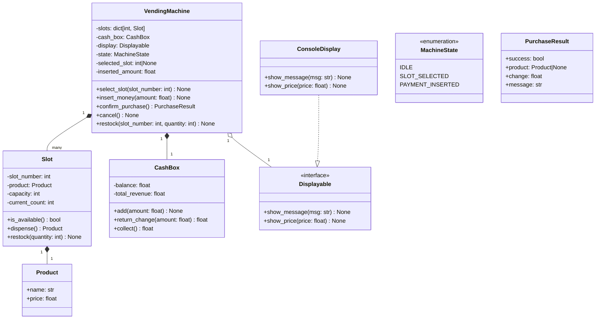

# Phase 7 · Week 07 · Day 2 — Requirements to Class Design

> Objective: Systematically extract entities, behaviors, and relationships from a requirements spec and translate them to a clean class hierarchy with well-segregated interfaces.  ·  Time: ~1 hr  ·  Prereqs: [[day-1]]

## Concept

### From prose to code: the extraction loop

Requirements are written in natural language. Class designs are expressed in code. The bridge is a mechanical process:

1. **Noun extraction** — every significant noun in the spec is a candidate entity or attribute.
2. **Verb extraction** — every verb is a candidate method or responsibility.
3. **Adjective extraction** — qualifiers often reveal variants (e.g., "premium member" -> inheritance or composition).
4. **Actor identification** — "who does what" maps to classes with responsibilities.
5. **Constraint tagging** — "must", "cannot", "always", "never" become preconditions, invariants, or validation logic.

This is not a one-pass process. As you extract, new relationships emerge that require revisiting earlier decisions.

### Interface segregation principle preview

Before writing a single class, write its interface. An interface answers: "what can callers do with this?" not "how does this work?"

Good interfaces are:
- **Narrow**: one cohesive responsibility per interface.
- **Stable**: callers depend on the interface, not the implementation — implementations can be swapped.
- **Caller-shaped**: designed around what callers need, not what the implementer finds convenient.

Split an interface when two callers only need disjoint subsets of its methods. This is ISP (Interface Segregation Principle).

### Entity-relationship thinking

Before typing any class body:
- Write entities as bare names.
- Write relationships as sentences: "A Floor **contains** many ParkingSpots."
- Note ownership: does the parent own the child's lifecycle?
- Note cardinality: 1:1, 1:N, M:N.

M:N relationships usually need a join entity (e.g., "Booking" between Member and Show).

## How it works internally

### The noun-verb table technique

Read the spec once. Build two columns:

| Nouns (entity candidates) | Verbs (behavior candidates) |
|---------------------------|------------------------------|
| machine, product, slot    | select, insert, dispense     |
| inventory, payment, change| accept_payment, check_stock  |
| display                   | show_message, show_price     |

Filter:
- Remove nouns that are just attributes of another noun (e.g., "price" is an attribute of Product, not its own class).
- Remove verbs that are purely internal operations not part of a public contract.
- Promote nouns to classes only when they have both state AND behavior.

### Interface before implementation (design-by-contract)

Write the method signatures — no body, just `...` or `pass`. Compile. Then write a test that only imports the interface. Now implement. This sequence guarantees:
- The interface is caller-driven.
- No accidental coupling to implementation detail.
- Tests are stable under refactoring.

In Python, interfaces are expressed as:
- `abc.ABC` + `@abstractmethod` for inheritance-based contracts.
- `typing.Protocol` for structural subtyping (duck typing with type safety).

Use `Protocol` when you do not control the implementor class (third-party code). Use `ABC` when you control the hierarchy.

## Worked example

**Problem: Vending Machine**

### Requirements spec (given text)

> A vending machine holds multiple products in numbered slots. Each slot has a fixed capacity and a current inventory count. Products have a name and a price. A customer selects a slot, inserts money (in whole dollars), and the machine checks if the product is in stock and if sufficient payment was provided. If both conditions pass, the machine dispenses the product and returns change. The machine displays messages to the customer throughout the interaction. An admin can restock slots and collect the cash box. The machine tracks total revenue.

### Step 1 — Noun extraction

Raw nouns: machine, product, slot, capacity, inventory, customer, money, payment, change, display, admin, cash box, revenue.

Filtered:
- **Classes**: `VendingMachine`, `Product`, `Slot`, `Display`, `CashBox`
- **Attributes, not classes**: capacity (attribute of Slot), inventory (attribute of Slot), money/payment (attribute of Transaction), revenue (attribute of CashBox)
- **Actors, not domain objects**: customer, admin (they drive behavior but are not stored)

### Step 2 — Verb extraction

Raw verbs: select, insert money, check stock, check payment, dispense, return change, display message, restock, collect cash, track revenue.

Mapped to responsibilities:
- `select(slot_number)` -> `VendingMachine`
- `insert_money(amount)` -> `VendingMachine`
- `dispense()` -> `VendingMachine` (triggers `Slot.dispense()`)
- `show_message(msg)` -> `Display`
- `restock(slot_number, quantity)` -> `VendingMachine` (admin action)
- `collect()` -> `CashBox`

### Step 3 — Mermaid class diagram



### Step 4 — Interface segregation

Two distinct caller roles -> two interface families:

```
CustomerInterface:   select_slot, insert_money, confirm_purchase, cancel
AdminInterface:      restock, collect_revenue, get_status
```

A customer terminal only sees `CustomerInterface`. An admin panel only sees `AdminInterface`. Neither needs the other's methods.

### Step 5 — Code

```python
"""
vending_machine.py — LLD: Vending Machine
Python 3.12+ | pydantic v2 | logging
"""
from __future__ import annotations

import logging
from abc import ABC, abstractmethod
from enum import Enum, auto
from typing import Optional, Protocol

from pydantic import BaseModel, Field, model_validator

logging.basicConfig(level=logging.INFO, format="%(levelname)s %(name)s: %(message)s")
log = logging.getLogger(__name__)


# ---------------------------------------------------------------------------
# Value objects
# ---------------------------------------------------------------------------

class Product(BaseModel):
    name: str
    price: float = Field(gt=0)

    model_config = {"frozen": True}  # immutable value object


class PurchaseResult(BaseModel):
    success: bool
    product: Optional[Product] = None
    change: float = 0.0
    message: str = ""


# ---------------------------------------------------------------------------
# State machine
# ---------------------------------------------------------------------------

class MachineState(Enum):
    IDLE = auto()
    SLOT_SELECTED = auto()
    PAYMENT_INSERTED = auto()


# ---------------------------------------------------------------------------
# Slot
# ---------------------------------------------------------------------------

class Slot:
    def __init__(self, slot_number: int, product: Product, capacity: int) -> None:
        self.slot_number = slot_number
        self.product = product
        self.capacity = capacity
        self.current_count = 0  # start empty; admin must restock

    def is_available(self) -> bool:
        return self.current_count > 0

    def dispense(self) -> Product:
        if not self.is_available():
            raise ValueError(f"Slot {self.slot_number} is empty")
        self.current_count -= 1
        log.info("Slot %d dispensed '%s', remaining: %d",
                 self.slot_number, self.product.name, self.current_count)
        return self.product

    def restock(self, quantity: int) -> None:
        if quantity <= 0:
            raise ValueError("Restock quantity must be positive")
        new_count = min(self.current_count + quantity, self.capacity)
        added = new_count - self.current_count
        self.current_count = new_count
        log.info("Slot %d restocked +%d (total: %d/%d)",
                 self.slot_number, added, self.current_count, self.capacity)


# ---------------------------------------------------------------------------
# CashBox
# ---------------------------------------------------------------------------

class CashBox:
    def __init__(self) -> None:
        self._balance: float = 0.0       # money currently in machine from customer
        self._total_revenue: float = 0.0

    def add(self, amount: float) -> None:
        self._balance += amount
        log.debug("CashBox: +%.2f (balance=%.2f)", amount, self._balance)

    def return_change(self, amount: float) -> float:
        """Return up to `amount` from balance. Actual change returned."""
        change = min(amount, self._balance)
        self._balance -= change
        log.info("CashBox: returning change %.2f", change)
        return change

    def finalize_sale(self, product_price: float) -> float:
        """
        Called after a successful sale.
        Deducts product price from balance (already in box),
        moves price to revenue, returns any leftover as change.
        """
        change_due = self._balance - product_price
        self._total_revenue += product_price
        self._balance = 0.0
        return change_due

    def collect(self) -> float:
        """Admin empties revenue."""
        collected = self._total_revenue
        self._total_revenue = 0.0
        log.info("CashBox: collected %.2f", collected)
        return collected

    @property
    def current_balance(self) -> float:
        return self._balance

    @property
    def total_revenue(self) -> float:
        return self._total_revenue


# ---------------------------------------------------------------------------
# Display interface — structural subtyping (Protocol)
# ---------------------------------------------------------------------------

class Displayable(Protocol):
    def show_message(self, msg: str) -> None: ...
    def show_price(self, price: float) -> None: ...


class ConsoleDisplay:
    """Default display — logs to console."""

    def show_message(self, msg: str) -> None:
        log.info("[DISPLAY] %s", msg)

    def show_price(self, price: float) -> None:
        log.info("[DISPLAY] Price: $%.2f", price)


# ---------------------------------------------------------------------------
# Customer and Admin interface segregation (ABCs)
# ---------------------------------------------------------------------------

class CustomerFacing(ABC):
    @abstractmethod
    def select_slot(self, slot_number: int) -> None: ...

    @abstractmethod
    def insert_money(self, amount: float) -> None: ...

    @abstractmethod
    def confirm_purchase(self) -> PurchaseResult: ...

    @abstractmethod
    def cancel(self) -> float: ...


class AdminFacing(ABC):
    @abstractmethod
    def restock(self, slot_number: int, quantity: int) -> None: ...

    @abstractmethod
    def collect_revenue(self) -> float: ...

    @abstractmethod
    def get_status(self) -> dict[int, dict[str, object]]: ...


# ---------------------------------------------------------------------------
# VendingMachine — implements both interfaces
# ---------------------------------------------------------------------------

class VendingMachine(CustomerFacing, AdminFacing):
    def __init__(self, display: Displayable | None = None) -> None:
        self._slots: dict[int, Slot] = {}
        self._cash_box = CashBox()
        self._display: Displayable = display or ConsoleDisplay()
        self._state = MachineState.IDLE
        self._selected_slot: Optional[int] = None

    # ------------------------------------------------------------------
    # Configuration (not part of public interface, called during setup)
    # ------------------------------------------------------------------

    def add_slot(self, slot: Slot) -> None:
        self._slots[slot.slot_number] = slot
        log.info("Added slot %d: %s at $%.2f",
                 slot.slot_number, slot.product.name, slot.product.price)

    # ------------------------------------------------------------------
    # CustomerFacing
    # ------------------------------------------------------------------

    def select_slot(self, slot_number: int) -> None:
        if self._state != MachineState.IDLE:
            self._display.show_message("Cancel current transaction first.")
            return
        slot = self._slots.get(slot_number)
        if slot is None:
            self._display.show_message(f"Slot {slot_number} does not exist.")
            return
        if not slot.is_available():
            self._display.show_message(f"Slot {slot_number} is out of stock.")
            return
        self._selected_slot = slot_number
        self._state = MachineState.SLOT_SELECTED
        self._display.show_price(slot.product.price)
        self._display.show_message(f"Selected: {slot.product.name}. Insert money.")

    def insert_money(self, amount: float) -> None:
        if self._state == MachineState.IDLE:
            self._display.show_message("Select a slot first.")
            return
        if amount <= 0:
            self._display.show_message("Insert a positive amount.")
            return
        self._cash_box.add(amount)
        self._state = MachineState.PAYMENT_INSERTED
        self._display.show_message(
            f"Inserted ${amount:.2f}. Balance: ${self._cash_box.current_balance:.2f}"
        )

    def confirm_purchase(self) -> PurchaseResult:
        if self._state != MachineState.PAYMENT_INSERTED:
            return PurchaseResult(success=False, message="Insert money first.")

        assert self._selected_slot is not None
        slot = self._slots[self._selected_slot]
        price = slot.product.price

        if self._cash_box.current_balance < price:
            shortfall = price - self._cash_box.current_balance
            self._display.show_message(
                f"Insufficient funds. Need ${shortfall:.2f} more."
            )
            return PurchaseResult(success=False, message="Insufficient funds.")

        product = slot.dispense()
        change_due = self._cash_box.finalize_sale(price)
        change_returned = self._cash_box.return_change(change_due)

        self._state = MachineState.IDLE
        self._selected_slot = None

        self._display.show_message(
            f"Dispensing {product.name}. Change: ${change_returned:.2f}"
        )
        return PurchaseResult(
            success=True, product=product, change=change_returned,
            message="Purchase complete."
        )

    def cancel(self) -> float:
        change = self._cash_box.return_change(self._cash_box.current_balance)
        self._state = MachineState.IDLE
        self._selected_slot = None
        self._display.show_message(f"Cancelled. Returning ${change:.2f}.")
        return change

    # ------------------------------------------------------------------
    # AdminFacing
    # ------------------------------------------------------------------

    def restock(self, slot_number: int, quantity: int) -> None:
        slot = self._slots.get(slot_number)
        if slot is None:
            raise KeyError(f"Slot {slot_number} not found")
        slot.restock(quantity)

    def collect_revenue(self) -> float:
        return self._cash_box.collect()

    def get_status(self) -> dict[int, dict[str, object]]:
        return {
            num: {
                "product": slot.product.name,
                "price": slot.product.price,
                "count": slot.current_count,
                "capacity": slot.capacity,
            }
            for num, slot in self._slots.items()
        }


# ---------------------------------------------------------------------------
# Demo
# ---------------------------------------------------------------------------

def build_machine() -> VendingMachine:
    machine = VendingMachine()

    water = Product(name="Water", price=1.50)
    chips = Product(name="Chips", price=2.00)
    soda = Product(name="Soda", price=1.75)

    s1 = Slot(slot_number=1, product=water, capacity=10)
    s2 = Slot(slot_number=2, product=chips, capacity=5)
    s3 = Slot(slot_number=3, product=soda, capacity=8)

    machine.add_slot(s1)
    machine.add_slot(s2)
    machine.add_slot(s3)

    # Admin restocks before opening
    machine.restock(1, 10)
    machine.restock(2, 5)
    machine.restock(3, 8)

    return machine


def main() -> None:
    machine = build_machine()

    log.info("=== Status before sales ===")
    for slot_num, info in machine.get_status().items():
        log.info("  Slot %d: %s ($%.2f) x%d",
                 slot_num, info["product"], info["price"], info["count"])

    log.info("=== Customer 1: buy water with exact change ===")
    machine.select_slot(1)
    machine.insert_money(1.50)
    result = machine.confirm_purchase()
    log.info("Result: success=%s, change=$%.2f", result.success, result.change)

    log.info("=== Customer 2: buy chips with overpayment ===")
    machine.select_slot(2)
    machine.insert_money(3.00)
    result = machine.confirm_purchase()
    log.info("Result: success=%s, change=$%.2f", result.success, result.change)

    log.info("=== Customer 3: cancel mid-transaction ===")
    machine.select_slot(3)
    machine.insert_money(1.00)
    returned = machine.cancel()
    log.info("Returned: $%.2f", returned)

    log.info("=== Admin collects revenue ===")
    revenue = machine.collect_revenue()
    log.info("Collected: $%.2f", revenue)


if __name__ == "__main__":
    main()
```

## Exercises

1. **Coffee shop ordering** — Requirements: "Customers order drinks (espresso, latte, cappuccino) with optional customizations (milk type, extra shot, syrup flavor). Orders go to a barista queue. Baristas mark orders complete. Customers are notified when their order is ready. A manager can view the queue and daily sales." Apply noun/verb extraction, draw a Mermaid class diagram, define two segregated interfaces (CustomerOrderInterface, ManagerInterface), and implement `OrderQueue` with `add_order`, `complete_order`, and `pending_orders` methods.

2. **Hotel booking** — Requirements: "A hotel has rooms of different types (single, double, suite). Guests book rooms for date ranges. A room cannot be double-booked. Guests can cancel with a 24-hour free cancellation window; after that, a 1-night penalty applies. Front desk staff can check in and check out guests. The system tracks occupancy per floor." Apply the full extraction process, define entity relationships with cardinalities, and implement `Hotel.book(guest, room_type, check_in, check_out) -> Booking | None` with overlap detection.

3. **Interface segregation exercise** — Given this interface, identify the ISP violation and refactor it into two or more well-segregated interfaces:

```python
class DocumentService(ABC):
    @abstractmethod
    def read(self, doc_id: str) -> str: ...

    @abstractmethod
    def write(self, doc_id: str, content: str) -> None: ...

    @abstractmethod
    def delete(self, doc_id: str) -> None: ...

    @abstractmethod
    def search(self, query: str) -> list[str]: ...

    @abstractmethod
    def export_pdf(self, doc_id: str) -> bytes: ...

    @abstractmethod
    def share(self, doc_id: str, user_id: str) -> None: ...

    @abstractmethod
    def get_edit_history(self, doc_id: str) -> list[dict]: ...
```

Justify each split by naming the distinct caller types who would use each sub-interface.

(Solutions: ../solutions/week-07/day-2.md)

## Self-check

- [ ] I can extract candidate entities from a paragraph of requirements in under 3 minutes
- [ ] I can filter nouns into "classes" vs "attributes" using the state+behavior rule
- [ ] I can draw a Mermaid class diagram with relationships and cardinalities
- [ ] I can explain the difference between `ABC` and `Protocol` and when to use each
- [ ] I can identify an ISP violation and propose the correct split
- [ ] I can implement the vending machine from scratch without reference

## Supplementary

- [Mermaid classDiagram docs](https://mermaid.js.org/syntax/classDiagram.html)
- [Python typing.Protocol](https://docs.python.org/3/library/typing.html#typing.Protocol)
- [Python abc module](https://docs.python.org/3/library/abc.html)
- [Interface Segregation Principle — Refactoring Guru](https://refactoring.guru/solid-principles/interface-segregation)
- [Pydantic v2 Field validators](https://docs.pydantic.dev/latest/concepts/validators/)
