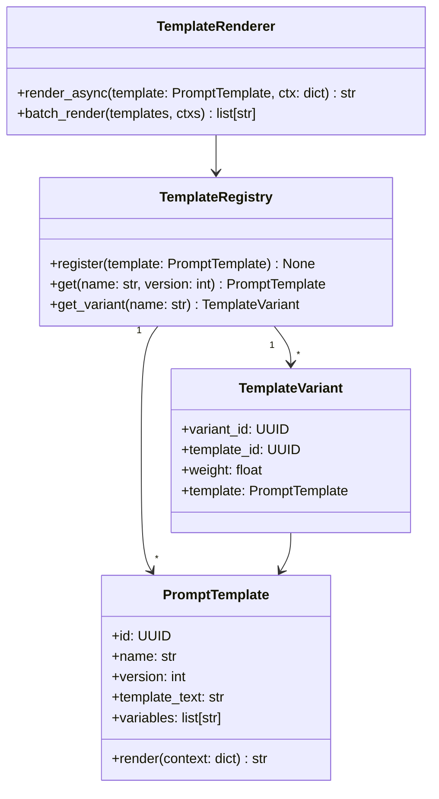

# Phase 7 · Week 12 · Day 1 — Coding + LLD Mock Interview Loop

> Objective: Run a full timed coding + low-level design mock loop, score against a rubric, and identify gaps.  ·  Time: ~1 hr  ·  Prereqs: [[week-11/day-7]]

## Concept

A coding + LLD loop mirrors rounds 1–2 of an AI/ML engineering interview. You will face:

- **Coding round** (35–45 min): one medium-hard DSA or ML-implementation problem. Interviewers watch problem decomposition, edge-case handling, and complexity analysis — not just correctness.
- **LLD round** (45 min): design a single class/module/service to a stated spec. You must produce a class diagram, data models, key interfaces, and a brief discussion of extensibility.

Both rounds share a core ritual: restate → clarify → plan aloud → implement → test → complexity.

## How it works internally

**Coding evaluation axes**

| Axis | What the interviewer watches |
|---|---|
| Decomposition | Does the candidate break the problem before touching code? |
| Communication | Running narration — silence is a red flag |
| Correctness | Handles base case, edge case, empty input |
| Complexity | States O(n)/O(log n) unprompted; optimises only if asked |
| Code quality | Names, types, no dead code |

**LLD evaluation axes**

| Axis | What the interviewer watches |
|---|---|
| Requirements parsing | Clarifies functional vs non-functional before drawing |
| Class decomposition | SRP honoured; no god class |
| Interface design | Clear contracts; dependency inversion |
| Data model | Right field types; Pydantic boundaries |
| Extensibility | Open/closed principle visible in design |

## Worked example

### Coding mock prompt

> "Implement a token bucket rate limiter. A bucket has capacity `C` and refills at `R` tokens/second. `allow(key: str) -> bool` returns True if the request is allowed and consumes one token."

**Model answer sketch (5-min plan, then code)**

```
Plan:
- Per-key bucket: {tokens: float, last_refill: float}
- On allow(): compute elapsed, add R*elapsed tokens (cap at C), return tokens >= 1
- Thread-safe: use threading.Lock per key
```

```python
# phase-7-system-design/week-12/examples/rate_limiter.py
import time
import threading
import logging
from dataclasses import dataclass, field

logger = logging.getLogger(__name__)


@dataclass
class Bucket:
    capacity: float
    refill_rate: float          # tokens per second
    tokens: float = field(init=False)
    last_refill: float = field(init=False)
    lock: threading.Lock = field(default_factory=threading.Lock, compare=False)

    def __post_init__(self) -> None:
        self.tokens = self.capacity
        self.last_refill = time.monotonic()

    def allow(self) -> bool:
        with self.lock:
            now = time.monotonic()
            elapsed = now - self.last_refill
            self.tokens = min(self.capacity, self.tokens + elapsed * self.refill_rate)
            self.last_refill = now
            if self.tokens >= 1.0:
                self.tokens -= 1.0
                return True
            return False


class TokenBucketLimiter:
    def __init__(self, capacity: float, refill_rate: float) -> None:
        self._capacity = capacity
        self._rate = refill_rate
        self._buckets: dict[str, Bucket] = {}
        self._global_lock = threading.Lock()

    def allow(self, key: str) -> bool:
        with self._global_lock:
            if key not in self._buckets:
                self._buckets[key] = Bucket(self._capacity, self._rate)
        return self._buckets[key].allow()
```

**Complexity**: O(1) per call. Space O(K) for K unique keys.

---

### LLD mock prompt

> "Design the data models and class structure for an LLM prompt template engine. It must support: variable substitution, versioning, A/B variants, and async rendering."

**Model answer (class diagram in Mermaid)**



Key decisions:
- `PromptTemplate` is immutable after creation — versioning via new record.
- `TemplateVariant` holds weight for weighted random selection (A/B).
- `TemplateRenderer` is stateless — no coupling to storage.

## Exercises

1. **Coding**: Implement `LRUCache(capacity: int)` with `get(key)` and `put(key, value)` in O(1). Write three pytest cases covering capacity eviction, key update, and missing key.

2. **LLD**: Design a job scheduler that supports one-time and recurring jobs, cancellation, and priority. Produce a Mermaid class diagram and a Pydantic model for `Job`. List three design decisions you made and why.

3. **Mock drill**: Set a 40-minute timer. Read the token bucket prompt cold. Narrate aloud (or write) every step. After time is up, score yourself on the five coding axes (1–5 each). Where did you lose points?

4. **Complexity analysis**: For the `TokenBucketLimiter` above, what happens to space complexity if keys are never evicted? Propose a fix using an LRU eviction policy.

(Solutions: ../solutions/week-12/day-1.md)

## Self-check
- [ ] I can implement a rate limiter from scratch in < 20 min
- [ ] I narrate my approach before writing any code
- [ ] I produce a Mermaid class diagram for an LLD prompt in < 10 min
- [ ] I state time/space complexity unprompted

## Supplementary
- [Grokking the Coding Interview — Patterns](https://www.educative.io/courses/grokking-the-coding-interview)
- [refactoring.guru — Design Patterns](https://refactoring.guru/design-patterns)
